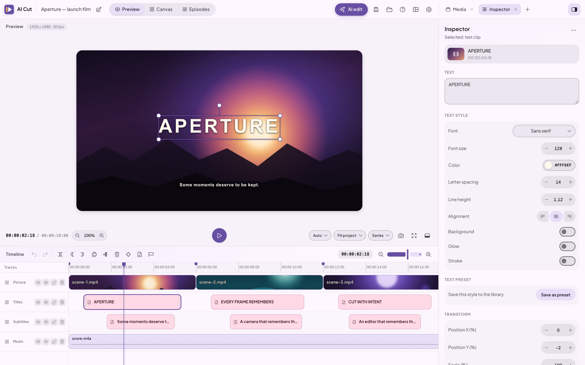
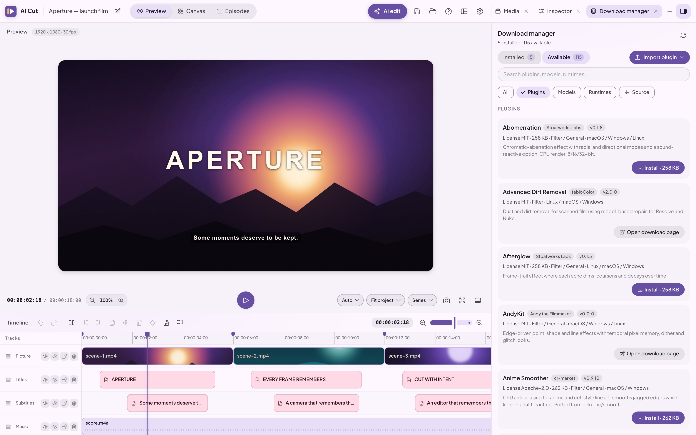

<p align="center">
  
</p>

<p align="center">
  <a href="https://github.com/heshengtao/ai-cut/releases"></a>
  <a href="LICENSE"></a>
  
  <a href="https://hub.docker.com/r/ailm32442/ai-cut"></a>
</p>

<p align="center">
  <a href="README_zh.md">简体中文</a> ·
  <a href="README_zh-TW.md">繁體中文</a> ·
  <a href="README.md">English</a> ·
  <a href="README_ja.md">日本語</a> ·
  <a href="README_ko.md">한국어</a> ·
  <a href="README_es.md">Español</a> ·
  <a href="README_fr.md">Français</a> ·
  <a href="README_de.md">Deutsch</a> ·
  <a href="README_ru.md">Русский</a> ·
  <a href="README_ar.md"><b>العربية</b></a>
</p>

<p align="center">
  <a href="https://hub.docker.com/r/ailm32442/ai-cut"><b>Docker Hub</b></a> ·
  <a href="https://github.com/heshengtao/ai-cut/releases">تنزيل</a>
</p>

## ما هو AI Cut؟

**AI Cut محرّر فيديو صغير قائم على الذكاء الاصطناعي من الأساس، لسطح المكتب** — اقطع، واكتب الترجمة، وسجّل التعليق الصوتي، وامزج، وصدّر في تطبيق واحد خفيف، ودع وكيل AI يعمل في المخطط الزمني إلى جانبك.

إنه محرّر حقيقي: مخطط زمني متعدد المسارات، و**لوحة لا نهائية لسير العمل القائم على العُقد**، و**رسم بياني متفرّع للحلقات**، ومكتبة وسائط، ولوحة خصائص، ومقاطع نصية، وترجمات، وتعليق صوتي، وأدوات AI للصوت والفيديو، و**إضافات مؤثرات OpenFX (OFX)**، وتصدير إلى MP4 أو ProRes أو GIF. المخطط الزمني واللوحة والرسم البياني للحلقات ثلاث عروض للمشروع نفسه. وقد بُني أيضًا ليُشغّله **نموذج** — إذ تعلّم مهارة Skill مضمّنة أي بيئة AI كيفية قيادة التطبيق العامل عبر MCP، فيستطيع الوكيل استيراد الوسائط، وإضافة المسارات، ووضع المقاطع وقصّها، وإعادة كتابة النص، وبناء لوحة أو إعادة توصيل فرع، وقراءة المشروع مرة أخرى بينما تراقب الواجهة تتحدّث.

كل شيء يعمل على جهازك أنت. لا حساب، ولا رفع للملفات، ولا حاجة إلى مفتاح API للمحرّر نفسه.

<p align="center">
  
</p>

## لماذا يهمّ هذا

أصبحت النماذج بارعة في كتابة الشيفرة لأنها تستطيع **تشغيلها** عبر إطار عمل وكيل برمجي؛ وأصبحت بارعة في النمذجة ثلاثية الأبعاد لأنها تستطيع قيادة برامج نمذجة حقيقية عبر Blender MCP. في الحالتين يحصل النموذج على أداة حقيقية، ونتيجة حقيقية، وحلقة تغذية راجعة حقيقية — وهذا ما يجعل التكرار السريع ممكنًا.

أما الفيديو فقد غابت عنه تلك الحلقة في الغالب. يستطيع النموذج توليد مقطع، لكنه لا يستطيع *العمل على مخطط زمني* كما يفعل المونتير: لا ترتيب يُحرَّر، ولا مسارات تُوازَن، ولا سجل تراجع، ولا وسيلة لملاحظة أن قطعه الأخير جعل النتيجة أسوأ.

**AI Cut محاولة صغيرة ومقصودة لسدّ تلك الفجوة.** إنه محرّر حقيقي يستطيع وكيل AI تشغيله عبر Skill وMCP، ما يجعله مفيدًا في:

- **اختبار ما يعرفه النموذج فعلًا عن المونتاج** — لا ما إذا كان قادرًا على توليد لقطات، بل ما إذا كان قادرًا على بناء تسلسل، واختيار المشاهد، وتصحيح الإيقاع.
- **جمع آثار مونتاج حقيقية** — كل تعديل يقوم به الوكيل يستقر في مشروع عادي بسجل تراجع عادي، فتصبح الجلسة بيانات عن كيفية تفكير النموذج في الفيديو.
- **خطوة نحو نماذج تستطيع مونتاج الفيديو كما تكتب الشيفرة** — بمخطط زمني يردّ عليها.

## خفيف بالتصميم

أن يكون صغيرًا ميزة، لا تنازلًا.

- **بصمة خفيفة** — بلا Electron، وبلا سحابة، وبلا مجموعة نماذج مضمّنة. التطبيق بناء Tauri، ويأتي ffmpeg / ffprobe كـ sidecars ثابتة، فلا يحتاج المستخدمون إلى تثبيت ffmpeg.
- **بدء سريع** — لا يُحمَّل شيء ثقيل عند الإقلاع؛ ولا تُستدعى نماذج AI إلا عندما تستخدمها.
- **الذكاء الاصطناعي الثقيل يبقى في مكانه** — التوليد خارجي عمدًا. تستطيع بيئة AI لديك توليد اللقطات أو جلبها، ثم تسليم الملفات إلى AI Cut للمونتاج والترجمة والمزج والتصدير.
- **مبنيّ للتمديد** — كل تعديل أمر قابل للتسلسل، فلا تحتاج عمليات المونتاج الجديدة إلى CLI جديد أو أداة MCP جديدة؛ واللوحة تعمل على نموذج الأوامر نفسه، ويمكن لإضافات التطبيق أن تضيف عُقدها وأنواع بياناتها ولوحاتها وأوامرها.
- **مدير إضافات OFX** — يدير مدير التنزيل إضافات OpenFX المثبَّتة / الخارجية / المتاحة، والبحث والاستيراد والتحديثات والإزالة؛ وتفتح لوحة إضافات OFX واجهة إضافة مثبَّتة. تأتي الإدخالات المجانية/مفتوحة المصدر من [AI Cut OFX Registry](https://github.com/heshengtao/ai-cut-ofx-registry) مع تحقّق SHA-256. ويجوز لإدخالات GPL/AGPL أن تنزّل من إصدار المنشئ الأعلى، لكن التطبيق لا يستضيف ملفاتها الثنائية ولا يضمّنها أبدًا. يحمّل المضيف الأصلي (`crates/ofx-host`، وCLI بأمر `ofx-host probe|render`) حِزم OFX 1.5.1 بالحجم الأصلي للمدخل، ويدعم سياقات المؤثرات الصورية الستة كلها: filter / general / generator / paint / retimer تُربط بسلسلة `effects[]` الخاصة بالمقطع، بينما transition يُربط بحافة المقطع ويُدمج كطبقة تراكب بإطار كامل. وتعيش المعاملات في لوحة Parameters مخصّصة. وتركيب مؤثر يبدأ معالجة مسبقة في الخلفية (مع تقدّم) لتحتفظ معاينات الفيديو والصور بالمؤثر أثناء التشغيل؛ ويعالج التصدير بالحجم النهائي (paint تقوده المعاملات، وretimer يسأل الإضافة عن `SourceTime`).

## شغّله من أي بيئة AI

يأتي AI Cut مع **Skill** (`skills/aicut`)، وهي مهارة تعلّم وكيل AI كيفية تشغيل التطبيق العامل — قراءة المشروع وكتابته، واستيراد الوسائط، وإضافة المسارات والمقاطع، والنقل / الاقتصاص / التقسيم، وتغيير النصوص وخصائص المقاطع، والتراجع والإعادة، إضافة إلى مراجع الإنتاج ولوحة القصة وإطار العمل والمراجعة والأصول المحمّلة عند الطلب. وهي تعمل عبر خادم **MCP** المدمج، فيمكن لأي بيئة تدعم Agent Skills أن تلتقطها.

**الخيار 1 · التثبيت من سطر الأوامر**

```bash
npx skills add heshengtao/ai-cut
```

**الخيار 2 · اطلب من وكيلك تثبيتها**

```
Install this Skill: https://github.com/heshengtao/ai-cut
```

يأتي التطبيق أيضًا مع `aicut`، وهو عميل MCP رفيع يمكن تثبيته على `PATH` من الإعدادات. سطح الأوامر هو سطح الأدوات:

```bash
aicut status
aicut tools
aicut call get_project
```

كل تعديل يقوم به الوكيل يمرّ عبر مسار الأوامر نفسه الذي تمرّ به واجهة المستخدم: يستقر في سجل التراجع، ويظهر في الواجهة، ويُنسب إلى الوكيل — فترى دائمًا ما فعله وتستطيع التراجع عنه.

## المزايا

### تحرير المخطط الزمني — التركيب على مخطط زمني حقيقي

رتّب الفيديو كما تسمعه. اسحب المقاطع عبر المسارات، واقسمها حيث تتغيّر القصة، واقتطع الأطراف، ودع الالتصاق وشبكة الإطارات يحافظان على محاذاة كل شيء. تشترك مقاطع الفيديو والصوت والصور والنصوص في المخطط الزمني نفسه، وكل تعديل أمر واحد في سجل تراجع واحد.

- **ترتيب متعدد المسارات** — مقاطع الفيديو والصوت والصور والنصوص جنبًا إلى جنب؛ والسحب والإفلات عبر المسارات؛ والتحديد بالتأطير
- **صندوق أدوات مونتاج حقيقي** — نقل، تقسيم، اقتصاص، التصاق، شبكة إطارات
- **تراجع يحترم الإيماءات** — تتجمّع السحبات والمنزلقات في خطوة واحدة، فيعود التراجع إلى ما قبل الإيماءة
- **جلسات آمنة** — حفظ تلقائي، واستعادة المسودة بعد الانهيار، وسجل المشروع
- **نص على المخطط الزمني** — مقاطع عناوين وترجمات بأنماط قابلة للتحرير

<p align="center">
  
</p>

### الوسائط ولوحة الخصائص — اقرأ المادة، وشكّل اللقطة

استورد ملفًا فيفحصه AI Cut فورًا: المدة، والدقة، ومعدل الإطارات، والصوت. تعرض مكتبة الوسائط المصغّرات والموجات الصوتية؛ وتتيح لك لوحة الخصائص المعاملات الكامنة وراء المقطع المحدد، فيُحرَّر التأطير والتراكب والصوت في مكانها بدلًا من نافذة منفصلة.

- **استيراد بالسحب** — بيانات ffprobe الوصفية، والمصغّرات، والموجات الصوتية، والمعاينات المخزّنة مؤقتًا
- **التحويل** — الموضع، والمقياس، والتدوير، والعتامة، وأوضاع المزج، ونصف قطر الزوايا
- **الصوت لكل مقطع** — الكسب، والتلاشي، والنغمة، والتوازن الستيريو، والكتم
- **تنسيق النص** — الخط، والحجم، واللون، والتباعد، والخلفية، والحدّ، والظل، والتوهّج
- **خرج المشروع** — تغييرات الدقة ومعدل الإطارات تعيد ملاءمة المقاطع تناسبيًا
- **مساعدات التسليم** — جمع الوسائط في `<project>-media/` بجوار المشروع

<p align="center">
  
</p>

### اللوحة وسير العمل — ابنِ اللقطة قبل أن تقصّها

عرض اللوحة هو لوحة عُقد لا نهائية للأجزاء من الفيديو التي يسهل رسمها أكثر من سحبها. ألقِ ملصقًا أو مقطعًا مرجعيًا أو سطر نصّ على اللوحة، وصله بنموذج أو بعقدة عرض، وشغّل السلسلة، وأرسل النتيجة إلى الجزء الحالي.

- **مشروع واحد، لوحات كثيرة** — يمكن لكل مشروع أن يحمل عدة لوحات مسمّاة؛ افتح إحداها أو أعد تسميتها أو انسخها أو أفرغها دون المساس بالمونتاج.
- **عقدة لكل خطوة** — مدخلات الصورة / الفيديو / الصوت / النص / القيمة، والعروض وقراءات القيم، وعُقد النماذج المحلية والسحابية، وحدود سير العمل، والحلقات والمجموعات.
- **مدخل واحد ومخرج واحد** — تُظهر كل بطاقة سلكًا واحدًا للدخل وسلكًا واحدًا للخرج؛ وتختار لوحة الخصائص أي قيمة منطقية يحملها ذلك السلك، فيمكن إعادة هيكلة الرسم البياني دون إعادة توصيل.
- **يعمل في الخلفية** — تشغيل يدوي أو عند التغيير أو متكرر، مع حالة حيّة وتقدّم وتوقيت؛ وتستقر المخارج في مكتبة الوسائط ويمكن إدراجها في الجزء الحالي بنقرة واحدة.
- **سير العمل قابل لإعادة الاستخدام** — أعلن توقيع بداية/نهاية، واحفظه في مكتبة سير العمل، أو انشره كـ API، أو نادِ لوحة من أخرى (متداخلة حتى 8 مستويات).
- **مفتوح للإضافات** — تسجّل إضافات التطبيق أنواع العُقد وأنواع البيانات واللوحات وعناصر التحكم والأوامر؛ ويمكن كتابة الرسم البياني نفسه بلا واجهة عبر أدوات اللوحة (board) في MCP.

مذكرة التصميم الكاملة: [`docs/canvas-workflow.md`](docs/canvas-workflow.md) · دليل الإضافات: [`docs/plugins.md`](docs/plugins.md).

<p align="center">
  
</p>

### الحلقات والتفرّع — مشروع واحد، مونتاجات كثيرة

المشروع ليس مونتاجًا واحدًا. إنه يحمل أجزاء كثيرة تتشارك مكتبة الوسائط واللوحات نفسها، ويحدد رسم السلسلة أي جزء يُعرض تاليًا. وفي نهاية جزء متفرّع تتوقف المعاينة عند الإطار الأخير وتحوّل الحواف الصادرة إلى أزرار، فيكون الاختيار مجرّد تعديل آخر.

- **تتشارك الأجزاء كل ما عدا ذلك** — الوسائط واللوحات والإعدادات على مستوى المشروع؛ ويحتفظ كل جزء بمساراته وعلاماته.
- **طريقتان لرؤية القصة** — عرض التبليط لشبكة لوحة القصة، وعرض التدفق للوحة حرّة ببطاقة واحدة لكل جزء.
- **تفرّعات حقيقية وتسميات حقيقية** — صل جزءًا بجزأين، وسمِّ كل حافة، فتصبح الأسماء أزرار الاختيار على الشاشة.
- **جزء واحد أو سلسلة** — شغّل جزءًا واحدًا وتوقّف، أو اتبع الرسم البياني عبر كل تفرّع حتى ينتهي.
- **إدارة سريعة للأجزاء** — إعادة تسمية، ونسخ، وحذف، وتحديد متعدد، ونسخ / لصق، وسحب لإعادة الترتيب؛ واسحب مقبضًا إلى مساحة فارغة لإنشاء الجزء التالي موصولًا مسبقًا.
- **المخطط الزمني يبقى مخططًا زمنيًا** — التفرّعات تغيّر ما يُعرض تاليًا، لا كيفية تحرير الجزء أو التراجع عنه أو تصديره.

<p align="center">
  
</p>

### إضافات OFX — أحضِر مؤثراتك

يستضيف AI Cut إضافات **OpenFX (OFX) 1.5.1**، فتأتي معك أدوات التشطيب التي تملكها أصلًا: تصحيح الألوان، والتمويهات، والتوهّج، وأدوات العزل اللوني، والتشويهات، والانتقالات. ويتصفّح مدير الإضافات [AI Cut OFX Registry](https://github.com/heshengtao/ai-cut-ofx-registry) مع تحقّق SHA-256، ويلتقط أيضًا الإضافات المثبَّتة في أماكن أخرى على القرص.

- **سياقات OFX الستة كلها** — filter وgeneral وgenerator وpaint وretimer تُربط بسلسلة مؤثرات المقطع؛ وtransition يُربط بحافة المقطع
- **واجهة الإضافة أو معاملاتها** — افتح واجهة الإضافة الخاصة، أو أدر معاملاتها في لوحة Parameters المخصّصة
- **المعاينة تبقى حيّة** — تركيب مؤثر يبدأ معالجة مسبقة في الخلفية، فتحتفظ معاينات الفيديو والصور بالمظهر أثناء التشغيل
- **يُعالَج عند التصدير** — يعالج التصدير كل مؤثر بالحجم النهائي (paint تقوده المعاملات، وretimer يسأل الإضافة عن `SourceTime`)
- **السجل + استيراد محلي** — بحث، وتثبيت / تحديث / إزالة بنقرة واحدة، أو توجيهه إلى حزمة محلية

<p align="center">
  
</p>

### الذكاء الاصطناعي والأتمتة — حوّل اللقطات إلى مادة تستطيع متابعة تحريرها

مزايا AI مبنية لجلسات حقيقية، لا للعروض. وجّهها إلى مقطع فتعيد لك شيئًا يمكنك متابعة تحريره: مسار ترجمة تصحّحه، وتعليق صوتي محاذٍ لتوقيته الأصلي، وأداء صوتي أنقى، ومسارات منفصلة تعيد موازنتها. والأدوات المحلية تعمل على عتادك أنت.

- **الترجمات** — تعرّف محلي على الكلام إلى مسار ترجمة قابل للتحرير
- **التعليق الصوتي** — TTS محلي بالإضافة إلى OpenAI وElevenLabs وAzure وGoogle وBaidu وMiniMax وVolcengine أو HTTP مخصّص
- **القطع الذكي** — طوابع زمنية على مستوى الكلمة تعثر على كلمات الحشو والوقفات الطويلة وتقصّها في تمريرة واحدة؛ وكلمات التصفية وحدود الوقف وحشو نقاط القطع تعيش في نافذة إعدادات واحدة، وتمتدّ القطوع قليلًا داخل الصمت المحيط حتى لا يبقى صوت ناقص؛ ويشطب النص المكتوب كل كلمة محذوفة، وتستعيدها نقرة واحدة، ويعلّم المخطط الزمني كل قطع
- **ذكاء الصوت** — مطابقة الجهارة، وإزالة الضجيج، وتنقية الصوت الغنائي، وفصل المصادر، وترجمة الصوت
- **ذكاء الفيديو** — الدقة الفائقة، واستيفاء الإطارات، وإعادة التأطير الذكية، وتتبّع الكاميرا
- **فحص الوسائط** — نداء واحد يعيد البيانات الوصفية، وعيّنات الحركة/القطع، ومربعات الوجوه/الأشخاص، ونصًا مكتوبًا محليًا
- **حلقة المراجعة** — استيراد `film.json`، وملاحظات مراجعة منظمة (`severity`، `sceneId`، `resolved`)، وكشف المقاطع المتغيّرة، وإعادة تصدير نطاقات مع ذاكرة مؤقتة بتجزئة المحتوى، ومقارنة المحاولات (SSIM + إطارات جنبًا إلى جنب)، وأوراق ملامسة
- **يعمل دون اتصال بالتصميم** — لا يحتاج المحرّر ونماذجه المحلية إلى حساب ولا إلى رفع أي ملف

<p align="center">
  
</p>

### خادم MCP ووكيل المقاطع — دع وكيل AI يعمل في جلستك

اقلب مفتاحًا واحدًا فيصبح مشروعك شيئًا يستطيع مساعد AI تشغيله. يعرّض خادم **MCP (Model Context Protocol)** المدمج الجلسة عبر HTTP مرتبطًا بـ `127.0.0.1` — وصّل وكيلك، وسلّمه مهمة، وراقبه يضيف مسارات أو يضع مقاطع أو يعيد كتابة نص بينما تتحدّث الواجهة في الزمن الحقيقي. وتعريفات الأدوات نفسها تشغّل أيضًا **وكيل المقاطع** المدمج، وهو لوحة محادثة متوافقة مع OpenAI مع البث، ونداءات الأدوات، وشجرة جلسات متفرّعة.

- **MCP عبر HTTP** — نقطة نهاية على loopback فقط، بنقلي JSON وSSE
- **دورة حياة المشروع** — `new_project` / `open_project` / `save_project` تقرأ JSON المشروع وتكتبه مباشرة، دون نوافذ حفظ/فتح
- **تعديلات حيّة** — تظهر إجراءات الوكيل فورًا كتغييرات عادية في المشروع
- **`aicut` CLI** — عميل رفيع؛ والأدوات الجديدة لا تحتاج إلى تغييرات في CLI
- **`aicut start`** — يكتشف التطبيق المثبَّت تلقائيًا ويفصله عن مهمة المُشغّل (بما في ذلك Windows)
- **وكيل المقاطع** — نقطة نهاية متوافقة مع OpenAI، وإجابات بالبث، وبطاقات أدوات، وتفرّعات جلسات
- **أدوات اللوحة** — إنشاء لوحات، وتطبيق عمليات اللوحة (board)، وسرد سير العمل المنشور أو تشغيله عبر نقطة النهاية نفسها
- **Skills** — مستندات المونتاج والإنتاج يحمّلها الوكيل عند الطلب

<p align="center">
  
</p>

### التصدير والتحديثات — أنهِ وسلّم

حين يصبح المونتاج صحيحًا، صدّره. اختر صيغة تسليم فيكتب AI Cut ملفًا جاهزًا للنشر في الخلفية بينما تواصل عملك. وتتحقّق التطبيقات المثبَّتة من GitHub Releases بحثًا عن تحديثات موقّعة، فالإصدار الجديد على بعد نقرة واحدة.

- **الصيغ** — MP4 / H.264، ProRes 422، GIF
- **عناصر التحكم في الخرج** — إعدادات جاهزة أو عرض/ارتفاع مخصّص، وملاءمة contain/cover، ومعدل الإطارات، والجودة؛ ولوحة GIF، والتنقيط، والتكرار
- **تصدير في الخلفية** — تقدّم حيّ وإلغاء
- **تحديث تلقائي موقّع** — تحقّق عند البدء، وتحقّق يدوي، وتنزيل، وتثبيت، وإعادة تشغيل
- **حِزم موثّقة** — المفتاح العام للمحدّث مضمّن؛ والمفتاح الخاص لا يوجد إلا في بيئة الإصدار

<p align="center">
  
</p>

## التثبيت

تُنشر الملفات الثنائية الجاهزة على صفحة [GitHub Releases](https://github.com/heshengtao/ai-cut/releases).

### المتطلبات

- Rust (stable) مع Cargo
- Node.js ≥ 20 و[pnpm](https://pnpm.io/) (يُنصح بـ pnpm 11)
- متطلبات نظام Tauri v2 — انظر <https://tauri.app/start/prerequisites/>

### البناء من المصدر

```bash
git clone https://github.com/heshengtao/ai-cut.git
cd ai-cut

pnpm install
pnpm tauri dev        # run the app in development
pnpm tauri build      # produce a release build
```

أوامر أخرى مفيدة:

```bash
pnpm build            # type-check the frontend and build it
pnpm test             # unit tests (Vitest)
pnpm fetch:sidecars   # prepare the ffmpeg / ffprobe sidecars
pnpm build:aicut      # build the aicut CLI
```

يأتي ffmpeg وffprobe كملفات ثنائية ثابتة، فلا يحتاج المستخدمون إلى تثبيت ffmpeg. تعيش ملفات النماذج في `src-tauri/resources/models/`؛ وتُنزَّل النماذج الأكبر عند الطلب.

### مجلد البيانات

تستقر النماذج وONNX Runtime وإضافات OFX وسجل المشروع والإعدادات افتراضيًا في مجلد بيانات المستخدم (`%APPDATA%\com.aicut.editor` على Windows) وقد تبلغ عدة غيغابايت. وهناك طريقتان لإبقائها بعيدًا عن قرص النظام:

- **اختياره وقت التثبيت**: يسأل مثبّت NSIS على Windows عن مجلد بيانات في **أول تثبيت** (التثبيت الصامت والتحديثات التلقائية لا تسأل أبدًا). ويُخزَّن الاختيار في `HKCU\Software\AI Cut\DataDir`.
- **نقله لاحقًا**: **الإعدادات → التخزين → اختيار المجلد والنقل**. ينسخ التطبيق البيانات الحالية إلى المجلد الجديد ويكتب ملف مؤشر؛ ويُفعَّل ذلك **بعد إعادة التشغيل**. ويُحتفظ بالمجلد القديم حتى تنظّفه من الصفحة نفسها — فالنقل لا يحذف شيئًا أبدًا.

ترتيب الأولوية: `--data-dir <path>` > `AICUT_DATA_DIR` > مؤشر الإعدادات (`data-dir.json`) > سجل المثبّت > النظام الافتراضي. الأولان هما «الوضع المحمول»؛ وتُعطّل صفحة الإعدادات النقل فيهما.

تبقى بضعة ملفات في مكانها عمدًا: `cli-path` / `app-path` / `mcp-url` هي ملفات اكتشاف يجدها CLI `aicut` وبيئات AI الخارجية عبر bundle id (انظر [`skills/aicut/SKILL.md`](skills/aicut/SKILL.md)). وهي بضع عشرات من البايتات وتبقى في المجلد الافتراضي.

### دعم المنصّات

| المنصّة | الحالة |
| --- | --- |
| Windows (x86_64) |  مدعوم |
| macOS (Apple Silicon) |  مدعوم (انظر ملاحظة «التطبيق تالف» أدناه) |
| Linux (x86_64 / arm64) |  مدعوم |

> **هل يقول macOS «App is damaged»؟** التطبيق موقّع ad-hoc (غير موثّق notarized)، ولذلك
> يضع macOS التنزيلات في الحجر الصحي. شغّل هذا في Terminal، ثم افتح التطبيق عادة:
>
> ```bash
> xattr -cr "/Applications/AI Cut.app"
> ```

> **أجهزة Mac العاملة بمعالجات Intel غير مدعومة في مسار الإصدار الحالي.** تُنتَج نسخ الإصدار
> لـ Apple Silicon (`aarch64-apple-darwin`) فقط.

## الوصول من المتصفح والوضع headless

يتضمّن تطبيق سطح المكتب خادم HTTP مرتبطًا بـ loopback: **الإعدادات → عام → الوصول من الويب**،
ثم افتح العنوان في متصفح — فهو المحرّر نفسه. **لا تسجيل دخول ولا token**: افتح العنوان واعمل. والتحكم في الوصول مسؤولية عملية النشر
(شبكة محلية، أو شبكة حاوية، أو وكيل عكسي).

يتشارك الجلسة الحيّة مع تطبيق سطح المكتب: الطرفان للقراءة والكتابة، وتندمج التعديلات في المشروع نفسه. فعّل «الوصول عبر الشبكة المحلية» وأعد التشغيل لتفتحه من جهاز لوحي أو جهاز ثانٍ على الشبكة نفسها.

### Docker

```bash
docker build -t ai-cut .
docker run -d --name ai-cut -p 28440:28440 -p 50563:50563 -v aicut-data:/data ai-cut
```

تستند الصورة إلى Debian slim (متعددة المراحل، ~434 MB) وتضمّ ffmpeg/ffprobe الثابتين نفسيهما الموجودين في تطبيق سطح المكتب، إضافة إلى النماذج الخمسة المضمّنة وONNX Runtime (تُفحص المعمارية مقابل ترويسة ELF وقت البناء، ويُنشأ اسم مستعار `libonnxruntime.so`)؛ افتح <http://localhost:28440>.

يرتبط MCP بـ `0.0.0.0` داخل الحاوية (دلالة `--lan`)، لذلك بعد نشر المنفذ `50563` يستطيع عميل MCP على المضيف (Claude Desktop / IDE) الاتصال بـ `http://<host>:50563/mcp` والحصول على الأدوات الـ 62 نفسها الموجودة في تطبيق سطح المكتب.

**تطابق الحاوية تطبيق سطح المكتب** إلا حيث تفرض الفيزياء غير ذلك:

| القدرة | سطح المكتب | الحاوية / المتصفح |
| --- | --- | --- |
| التحرير / الترجمات / التصدير / الخطوط | ✅ | ✅ التنفيذ نفسه في daemon |
| الاستدلال المحلي: ASR، TTS، إزالة الضجيج، فصل المصادر، الدقة الفائقة، الاستيفاء، تغيير الصوت | ✅ | ✅ التنفيذ نفسه في daemon (CPU، أبطأ) |
| إدارة النماذج وبيئة التشغيل، والصور/TTS السحابية، والجهارة، ومعالجة الفيديو | ✅ | ✅ |
| الوكيل / MCP | ✅ 62 أداة | ✅ الأدوات الـ 62 نفسها (ماكرو التحرير، AI على مستوى المقطع، التصدير والتصيير، دورة حياة المشروع، التراجع/الإعادة، ملاحظات المراجعة، بيانات الأفلام الوصفية، المهام الخلفية) |
| مؤثرات OFX | ✅ بما في ذلك معالجة المقطع كاملًا | ✅ معاينات الإطار / الصورة / الانتقال **و** معالجة المقطع كاملًا + الانتقال (معالجة تسلسلية في عملية واحدة) |
| تثبيت / استيراد / إزالة الإضافات | ✅ | ✅ (`reveal in file manager` يحتاج سطح المكتب) |
| واجهات الإضافات الأصلية، ونوافذ النظام / فتح المتصفح | ✅ | ⛔ لا نظام نوافذ / جلسة سطح مكتب |
| توليد الصور / الفيديو محليًا (sd.cpp) | ✅ | ✅ التنفيذ نفسه في daemon: يُنزَّل المحرّك والأوزان عند الطلب؛ وتستخدم الحاويات CPU / Vulkan / ROCm (لا يوجد لدى المنبع بناء CUDA لنظام Linux) |

**يجب أن تطابق ملفات الإضافات الثنائية معمارية الصورة.** تُبنى الصورة لمعمارية جهاز البناء
(arm64 على Apple Silicon)، وإضافات OFX ملفات ثنائية أصلية: فالإضافة التي تقدّم بناء x86_64
فقط (مثل Flame LTX AlphaGen) لا يمكن تحميلها في حاوية arm64. ويقول المحرّر الآن
«plugin binary architecture mismatch» بدل الرسالة الغامضة
`cannot open shared object file`؛ شغّل مثل هذه الإضافات في صورة amd64
بدلًا من ذلك:

```bash
docker build --platform linux/amd64 -t ai-cut .
docker run -d --platform linux/amd64 -p 28440:28440 -v aicut-data:/data ai-cut
```

(على Apple Silicon يمرّ هذا عبر محاكاة Rosetta ويكون أبطأ؛ أما على مضيف
Linux بمعمارية x86_64 فلا يتغيّر شيء.)

تُنزَّل النماذج عند أول استخدام (Settings → Models) عبر الوكيل المهيّأ؛ والنماذج الخمسة المضمّنة تعمل مباشرة.

### الملف التنفيذي headless

```bash
cargo run --manifest-path crates/daemon/Cargo.toml --bin aicutd -- \
  --data-dir ./data --port 28440 --lan --dist dist
```

### متغيّرات البيئة

| المتغيّر | الافتراضي | الغرض |
| --- | --- | --- |
| `AICUT_DATA_DIR` | `./data` | المشاريع، والوسائط المستوردة، والتصديرات |
| `AICUT_NO_AUDIO` | غير مضبوط | تخطّي فتح جهاز صوتي |

### HTTP API

| الطريقة | المسار | الغرض |
| --- | --- | --- |
| `POST` | `/rpc/{command}` | أوامر التحرير، بالأسماء نفسها المستخدمة في IPC التطبيق |
| `GET` | `/events` | Server-Sent Events: المستند + تقدّم المهام |
| `GET` | `/session` | WebSocket: مزامنة الجلسة الحيّة |
| `GET` | `/file` · `POST /upload` | قراءة / استيراد الوسائط |
| `GET` | `/health` | فحص الحياة |

## البنية

```
src-tauri/          Tauri shell: windows, native dialogs, auto-updater
crates/daemon/      backend: document model, media, render engine, HTTP
crates/aicut/       the CLI
src/                Vue 3 frontend — identical for desktop and browser
```

يبدّل `src/platform/` النقل (`Tauri IPC` ↔ `HTTP + WebSocket`) خلف واجهة API واحدة، فتعمل
كل شاشة في الغلافين؛ وبناء المتصفح هو التطبيق نفسه يتحدّث إلى الواجهة الخلفية نفسها
عبر الشبكة.

في الوضع headless تعيش المشاريع والوسائط المستوردة والتصديرات في مجلد البيانات؛ ويأتي
ffmpeg من الصورة.

الذكاء المحلي (ASR / TTS / إزالة الضجيج / الفصل / الدقة الفائقة / تغيير الصوت)، وإدارة
النماذج وبيئة التشغيل، والإضافات وOFX، ووكيل التحرير **ليست موصولة بالواجهة الخلفية
headless بعد** — وهذا دين هجرة، لا حدّ منتج. ويعلن `GET /rpc/capabilities`، لكل ميزة،
ما إذا كانت متاحة، أو ينقصها مكوّن، أو لم تُنقل بعد، وتعتمد الواجهة على ذلك
بدلًا من التخمين بـ `isTauri()`.

## الأسئلة الشائعة

### هل AI Cut مجاني؟

نعم. AI Cut مفتوح المصدر بترخيص Apache 2.0. لا توجد مستويات مدفوعة ولا تقييد للمزايا.

### هل يعمل دون اتصال؟

نعم. يعمل التحرير والتصدير ونماذج AI المحلية على جهازك. ولا يحدث اتصال بالشبكة إلا عندما تبدأ تنزيل نموذج، أو تتحقّق من التحديثات، أو تهيّئ خدمة سحابية مثل نقطة نهاية وكيل متوافقة مع OpenAI أو TTS سحابي.

### هل أحتاج إلى GPU؟

لا. تعمل نماذج AI المضمّنة على CPU؛ ولا يوجد إعداد لـ CUDA أو للتعريفات. وتستغرق النماذج الأكبر وقتًا أطول على الأجهزة الأبطأ، لكنها لا تتطلب GPU. وإذا كان لديك GPU من NVIDIA، يمكنك اختيار CUDA 12 أو CUDA 13 في Settings → AI → Execution backend: فأيّهما ينزّل مجموعة ONNX Runtime + CUDA متطابقة تمامًا من مدير التنزيل عند الطلب، دون حاجة إلى تثبيت CUDA على النظام (أعد التشغيل ليُطبَّق).

### ما نماذج AI التي تأتي مع التطبيق؟

تأتي النماذج الصغيرة مضمّنة في الحزمة لتعمل المزايا الأساسية فورًا. والنماذج الأكبر — التعرّف على الكلام، وTTS، وفصل المصادر، والدقة الفائقة، واستيفاء الإطارات — تُنزَّل عند الطلب من مدير النماذج داخل التطبيق وتُخزَّن خارج شجرة المصدر. والتراخيص — بما فيها نماذج الفيديو المرخّصة للمجتمع وأوزان FLUX.1 [dev] غير التجارية — مدرجة في [MODELS.md](MODELS.md).

### ما صيغ إضافات المؤثرات المدعومة؟

**OpenFX (OFX) 1.5.1** — سياقات المؤثرات الصورية الستة كلها (filter، general، generator، paint، retimer، transition). ويمكن أن تأتي الإضافات من السجل المدمج أو من قرصك. أما صيغ مؤثرات الصوت (VST3 / AU / CLAP) فلا تُستضاف: فأدوات الصوت الخاصة بـ AI Cut تغطي الكسب والتلاشي والنغمة والمزج.

### هل أحتاج إلى تشغيل التطبيق ليديره وكيل؟

نعم. تتحدّث Skill وCLI `aicut` مع AI Cut العامل عبر MCP، فابدأ بتشغيل التطبيق أولًا (`aicut status` سيخبرك إن كان يعمل).

### هل يمكنني إنشاء فيديو متفرّع؟

نعم. يمكن للمشروع أن يحمل عدة أجزاء؛ ويربطها عرض الحلقات بحواف مسمّاة، ويتابع وضع «السلسلة» في المعاينة تلك الحواف. وفي نهاية الجزء تظهر التسميات الصادرة كأزرار اختيار، فيُختار الجزء التالي على الشاشة.

### هل أحتاج إلى نموذج لاستخدام اللوحة؟

لا. تعمل عُقد الإدخال والعرض والقيمة والحلقة وسير العمل دون أي نموذج. أما عُقد النماذج فتحتاج إلى نموذج محلي أو مزوّد سحابي مهيّأ؛ وإلى أن يتوفر أحدهما، يظل بقية الرسم البياني قابلًا للتحرير والحفظ.

### هل يستطيع الوكيل تصدير الفيديو النهائي؟

نعم. `export_video` يصدّر المخطط الزمني عبر MCP — MP4 أو ProRes أو GIF. و`outputPath` اختياري: عند تركه يكتب AI Cut بجوار ملف المشروع (أو في مجلد Downloads لمشروع غير محفوظ) ويعيد المسار النهائي. والترجمات والتعليق الصوتي وذكاء الصوت / الفيديو والتصدير كلها متاحة كأدوات، فيستطيع الوكيل تجهيز المخطط الزمني وتصديره وإعادة الملف للمراجعة.

## الدعم

### ضع لنا نجمة من فضلك!
⭐ دعمك هو القوة الدافعة لنا للمضي قدمًا!

### التبرعات مرحّب بها!
<div align="center" style="display: flex; gap: 20px; justify-content: center; flex-wrap: wrap;">

[](https://ko-fi.com/agentparty)
[](https://afdian.com/a/agentparty)

</div>

### تابعنا
<div align="center">
  <a href="https://space.bilibili.com/26978344">
    
  </a>
  <a href="https://www.youtube.com/@agentParty">
    
  </a>
</div>

### انضم إلى المجتمع
إن كانت لديك أي أسئلة أو مشكلات بشأن المشروع، فمرحبًا بك في مجتمعنا.

1. مجموعة QQ: `931057213` (ممتلئة) / `902882342` (المجموعة 2)

2. Discord: [رابط Discord](https://discord.gg/f2dsAKKr2V)

## المساهمون

<a href="https://github.com/heshengtao/ai-cut/graphs/contributors">
  
</a>

## الترخيص

**شيفرة** التطبيق بترخيص Apache-2.0 — انظر [LICENSE](LICENSE).

**أوزان** النماذج طبقة منفصلة: لا يحمل المستودع والمثبّتات إلا النماذج الخمسة
الصغيرة المتسامحة التي تأتي مع التطبيق؛ وكل ما عداها يُنزَّل عند الطلب من ناشره
ويُتحقَّق منه مقابل `sha256` مثبّت. ويحتفظ كل نموذج بترخيصه — انظر
**[MODELS.md](MODELS.md)** للجدول الكامل، بما فيه تراخيص المجتمع (LTX-2، Hunyuan، MiniMax-H3)،
ونماذج CreativeML Open RAIL، وأوزان FLUX.1 [dev] غير
التجارية.

## تراخيص الأطراف الثالثة

يبني هذا المشروع على برمجيات مفتوحة المصدر من أطراف ثالثة. وتُعلَن تراخيص التبعيات في
`package.json`، و`src-tauri/Cargo.toml`، والبيانات الوصفية تحت `crates/`. وتحتفظ ملفات
FFmpeg الثنائية المضمّنة بتراخيص المنبع الخاصة بها. وأوزان النماذج — المضمّنة وعند الطلب،
مع تراخيصها ومصادرها وقيودها — مدرجة في [MODELS.md](MODELS.md)؛ والنصوص الحرفية للنماذج
المضمّنة في `src-tauri/resources/models/LICENSES/`.
