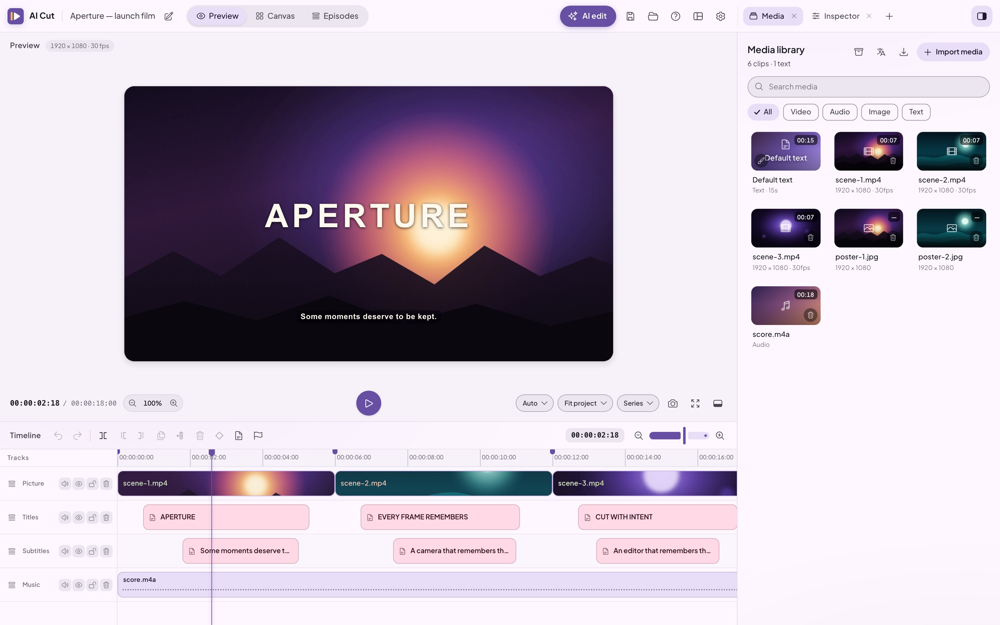
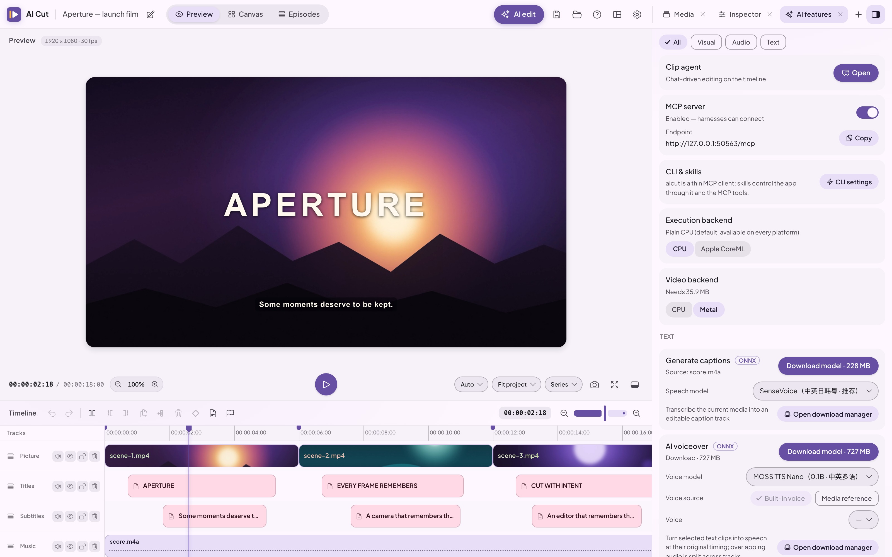

<p align="center">
  
</p>

<p align="center">
  <a href="https://github.com/heshengtao/ai-cut/releases"></a>
  <a href="LICENSE"></a>
  
  <a href="https://hub.docker.com/r/ailm32442/ai-cut"></a>
</p>

<p align="center">
  <a href="README_zh.md">简体中文</a> ·
  <a href="README_zh-TW.md">繁體中文</a> ·
  <a href="README.md">English</a> ·
  <a href="README_ja.md">日本語</a> ·
  <a href="README_ko.md">한국어</a> ·
  <a href="README_es.md">Español</a> ·
  <a href="README_fr.md">Français</a> ·
  <a href="README_de.md"><b>Deutsch</b></a> ·
  <a href="README_ru.md">Русский</a> ·
  <a href="README_ar.md">العربية</a>
</p>

<p align="center">
  <a href="https://hub.docker.com/r/ailm32442/ai-cut"><b>Docker Hub</b></a> ·
  <a href="https://github.com/heshengtao/ai-cut/releases">Download</a>
</p>

## Was ist AI Cut?

**AI Cut ist ein kleiner, KI-nativer Video-Editor für den Desktop** — schneiden, untertiteln, vertonen, mischen und exportieren in einer einzigen leichtgewichtigen App, und ein KI-Agent arbeitet dabei in der Timeline mit.

Es ist ein echter Editor: eine mehrspurige Timeline, **eine unendliche Canvas für nodebasierte Workflows**, **ein verzweigter Episoden-Graph**, eine Medienbibliothek, ein Inspector, Text-Clips, Untertitel, Voiceover, Audio- und Video-KI-Werkzeuge, **OpenFX-(OFX-)Effekt-Plugins** und Export nach MP4, ProRes oder GIF. Timeline, Canvas und Episoden-Graph sind drei Ansichten desselben Projekts. Der Editor ist außerdem darauf ausgelegt, **von einem Modell bedient zu werden** — ein mitgeliefertes Skill bringt jedem KI-Harness bei, die laufende App über MCP zu steuern, sodass ein Agent Medien importieren, Spuren anlegen, Clips platzieren und trimmen, Text umschreiben, eine Canvas aufbauen oder eine Verzweigung neu verdrahten und das Projekt zurücklesen kann, während die Oberfläche live mitzieht.

Alles läuft auf dem eigenen Rechner. Kein Konto, keine Uploads und für den Editor selbst kein API-Schlüssel.

<p align="center">
  
</p>

## Warum das wichtig ist

Modelle wurden gut im Schreiben von Code, weil sie ihn über ein Coding-Agent-Framework **ausführen** konnten; Modelle wurden gut in 3D-Modellierung, weil sie echte Modellierungssoftware über Blender MCP steuern konnten. In beiden Fällen bekommt das Modell ein echtes Werkzeug, ein echtes Ergebnis und eine echte Rückkopplungsschleife — und genau das macht schnelle Iteration möglich.

Video hat diese Schleife bisher weitgehend gefehlt. Ein Modell kann einen Clip generieren, aber es kann nicht *an einer Timeline arbeiten* wie ein Editor: keine Anordnung zum Bearbeiten, keine Spuren zum Ausbalancieren, keine Undo-Historie, keine Möglichkeit zu bemerken, dass der letzte Schnitt alles verschlechtert hat.

**AI Cut ist ein kleiner, bewusster Versuch, diese Lücke zu schließen.** Es ist ein echter Editor, den ein KI-Agent über ein Skill und MCP bedienen kann — nützlich für:

- **Prüfen, was ein Modell tatsächlich über Schnitt weiß** — nicht, ob es Material generieren kann, sondern ob es eine Sequenz aufbaut, Einstellungen wählt und das Timing korrigiert.
- **Echte Schnitt-Traces sammeln** — jede Agent-Bearbeitung landet in einem normalen Projekt mit normaler Undo-Historie, sodass eine Session zu Daten darüber wird, wie ein Modell über Video denkt.
- **Ein Schritt hin zu Modellen, die Video so schneiden wie Code** — mit einer Timeline, die zurückspricht.

## Leichtgewichtig aus Prinzip

Klein zu sein ist ein Feature, kein Kompromiss.

- **Ein leichtgewichtiger Footprint** — kein Electron, keine Cloud, kein gebündelter Modell-Zoo. Die App ist ein Tauri-Build, und ffmpeg / ffprobe werden als statische Sidecars ausgeliefert, ffmpeg muss also nicht installiert sein.
- **Schnellstartfähig** — beim Start wird nichts Schwergewichtiges geladen; KI-Modelle kommen erst zum Einsatz, wenn sie gebraucht werden.
- **Schwere KI bleibt, wo sie hingehört** — die Generierung ist bewusst extern. Das eigene KI-Harness kann Material generieren oder beschaffen und die Dateien anschließend an AI Cut zum Schneiden, Untertiteln, Mischen und Exportieren übergeben.
- **Auf Erweiterbarkeit ausgelegt** — jede Bearbeitung ist ein serialisierbarer Befehl, neue Schnittoperationen brauchen also weder ein neues CLI noch ein neues MCP-Tool; die Canvas läuft auf demselben Befehlsmodell, und App-Erweiterungen können eigene Nodes, Datentypen, Panes und Befehle beisteuern.
- **OFX-Plugin-Manager** — der Download-Manager verwaltet installierte / externe / verfügbare OpenFX-Plugins samt Suche, Import, Updates und Entfernen; der Bereich für OFX-Plugins öffnet die Oberfläche eines installierten Plugins. Freie/Open-Source-Einträge stammen aus dem [AI Cut OFX Registry](https://github.com/heshengtao/ai-cut-ofx-registry), mit SHA-256-Prüfung. GPL/AGPL-Einträge dürfen aus dem Upstream-Release des Autors herunterladen, die App hostet oder bündelt deren Binaries jedoch nie. Der native Host (`crates/ofx-host`, CLI `ofx-host probe|render`) lädt OFX-1.5.1-Bundles in der Größe der Eingabe und unterstützt alle sechs Bild-Effekt-Kontexte: filter / general / generator / paint / retimer hängen sich an die `effects[]`-Kette eines Clips, während transition an eine Clip-Kante hängt und als Vollbild-Overlay eingebacken wird. Parameter liegen in einem eigenen Parameters-Pane. Das Einbinden eines Effekts startet ein Hintergrund-Prebake (mit Fortschritt), damit Video- und Bildvorschauen den Effekt während der Wiedergabe behalten; der Export backt in finaler Größe (paint ist parametergetrieben, retimer fragt das Plugin nach `SourceTime`).

## Aus jedem KI-Harness steuern

AI Cut liefert ein **Skill** (`skills/aicut`) mit, das einem KI-Agenten beibringt, die laufende App zu bedienen — Projekt lesen und schreiben, Medien importieren, Spuren und Clips hinzufügen, Verschieben / Trimmen / Teilen, Text und Clip-Eigenschaften ändern, Undo und Redo, dazu Produktions-, Storyboard-, Framework-, Review- und Asset-Referenzen, die bei Bedarf geladen werden. Es arbeitet über den eingebauten **MCP**-Server, sodass jedes Harness, das Agent Skills unterstützt, es aufnehmen kann.

**Option 1 · Installation über die Kommandozeile**

```bash
npx skills add heshengtao/ai-cut
```

**Option 2 · Den Agenten bitten, es zu installieren**

```
Install this Skill: https://github.com/heshengtao/ai-cut
```

Die App liefert außerdem `aicut` mit, einen schlanken MCP-Client, der sich aus den Einstellungen in den `PATH` installieren lässt. Die Befehlsfläche ist die Werkzeugfläche:

```bash
aicut status
aicut tools
aicut call get_project
```

Jede Bearbeitung eines Agenten läuft durch dieselbe Befehlspipeline wie die UI: Sie landet in der Undo-Historie, erscheint in der Oberfläche und wird dem Agenten zugeordnet — was er getan hat, ist also immer sichtbar und lässt sich rückgängig machen.

## Funktionen

### Timeline-Bearbeitung — Auf einer echten Timeline komponieren

Ein Video so anordnen, wie man es hört. Clips über Spuren hinweg ziehen, an den Stellen teilen, an denen die Geschichte wechselt, die Ränder trimmen und dabei Snapping und Frame-Raster alles ausrichten lassen. Video-, Audio-, Bild- und Text-Clips teilen dieselbe Timeline, und jede Bearbeitung ist ein Befehl in einer Undo-Historie.

- **Mehrspuriges Arrangieren** — Video-, Audio-, Bild- und Text-Clips nebeneinander; Drag and Drop über Spuren hinweg; Rechteckauswahl
- **Ein echtes Schnitt-Toolkit** — Verschieben, Teilen, Trimmen, Snapping, Frame-Raster
- **Undo, das Gesten respektiert** — Ziehen und Slider werden zu einem Schritt zusammengefasst, Undo springt also vor die Geste zurück
- **Sichere Sessions** — Autosave, Wiederherstellung von Crash-Entwürfen und Projekt-Historie
- **Text auf der Timeline** — Titel- und Untertitel-Clips mit editierbarem Styling

<p align="center">
  
</p>

### Medien & Inspector — Das Material lesen, den Shot formen

Eine Datei importieren, und AI Cut probet sie sofort: Dauer, Auflösung, Bildrate und Audio. Die Medienbibliothek zeigt Thumbnails und Wellenformen; der Inspector liefert die Parameter hinter dem ausgewählten Clip, sodass Bildausschnitt, Ebenen und Ton direkt vor Ort statt in einem separaten Dialog bearbeitet werden.

- **Import per Drag and Drop** — ffprobe-Metadaten, Thumbnails, Wellenformen und gecachte Vorschauen
- **Transform** — Position, Skalierung, Rotation, Deckkraft, Blend-Modi, Eckenradius
- **Audio pro Clip** — Gain, Fades, Pitch, Stereo-Balance, Stumm
- **Text-Styling** — Schrift, Größe, Farbe, Laufweite, Hintergrund, Kontur, Schatten, Glow
- **Projektausgabe** — Änderungen an Auflösung und Bildrate passen Clips proportional neu an
- **Ausgabe-Helfer** — Medien in `<project>-media/` neben dem Projekt sammeln

<p align="center">
  
</p>

### Canvas & Workflows — Den Shot bauen, bevor geschnitten wird

Die Canvas-Ansicht ist eine unendliche Node-Canvas für die Teile eines Videos, die sich leichter zeichnen als ziehen lassen. Ein Poster, einen Referenz-Clip oder eine Textzeile auf die Canvas legen, mit einem Modell- oder Anzeige-Node verdrahten, die Kette ausführen und das Ergebnis in den aktuellen Teil übernehmen.

- **Ein Projekt, viele Canvases** — jedes Projekt kann mehrere benannte Canvases halten; eine öffnen, umbenennen, duplizieren oder leeren, ohne den Schnitt anzutasten.
- **Ein Node für jeden Schritt** — Bild- / Video- / Audio- / Text- / Wert-Eingänge, Anzeigen und Wert-Ausgaben, lokale und Cloud-Modell-Nodes, Workflow-Grenzen, Loops und Gruppen.
- **Ein Eingang, ein Ausgang** — jede Karte hat genau eine Leitung hinein und hinaus; der Inspector entscheidet, welchen logischen Wert diese Leitung trägt, sodass ein Graph ohne Neuverdrahten umgebaut werden kann.
- **Läuft im Hintergrund** — manuelle, bei Änderung oder wiederholte Läufe mit Live-Status, Fortschritt und Timing; Ausgaben landen in der Medienbibliothek und lassen sich mit einem Klick in den aktuellen Teil einsetzen.
- **Workflows sind wiederverwendbar** — eine Start-/End-Signatur deklarieren, in der Workflow-Bibliothek speichern, als API veröffentlichen oder eine Canvas aus einer anderen aufrufen (verschachtelt bis zu 8 Ebenen).
- **Offen für Plugins** — App-Erweiterungen registrieren Node-Typen, Datentypen, Panes, Steuerelemente und Befehle; derselbe Graph ist über die Board-MCP-Tools auch headless beschreibbar.

Vollständige Design-Notiz: [`docs/canvas-workflow.md`](docs/canvas-workflow.md) · Plugin-Guide: [`docs/plugins.md`](docs/plugins.md).

<p align="center">
  
</p>

### Episoden & Verzweigungen — Ein Projekt, viele Schnitte

Ein Projekt ist nicht ein Schnitt. Es hält viele Teile, die dieselbe Medienbibliothek und dieselben Canvases teilen, und der Serien-Graph entscheidet, welcher Teil als Nächstes läuft. Am Ende eines verzweigenden Teils hält die Vorschau auf dem letzten Frame an und macht die ausgehenden Kanten zu Buttons, sodass eine Entscheidung nur eine weitere Bearbeitung ist.

- **Teile teilen alles andere** — Medien, Canvases und Einstellungen gelten projektweit; jeder Teil behält seine eigenen Spuren und Marker.
- **Zwei Sichten auf die Geschichte** — Kachelansicht für ein Storyboard-Raster, Flussansicht für eine freie Canvas mit einer Karte pro Teil.
- **Echte Verzweigungen, echte Labels** — einen Teil mit zwei verbinden, jede Kante benennen, und die Namen werden zu den Auswahl-Buttons auf dem Bildschirm.
- **Einzelner Teil oder Serie** — einen Teil abspielen und stoppen oder dem Graphen durch alle Verzweigungen folgen, bis er endet.
- **Schnelle Teileverwaltung** — Umbenennen, Duplizieren, Löschen, Mehrfachauswahl, Kopieren / Einfügen und Ziehen zum Umsortieren; einen Griff ins Leere ziehen, um den nächsten Teil bereits verbunden anzulegen.
- **Die Timeline bleibt die Timeline** — Verzweigungen ändern, was als Nächstes läuft, nicht wie ein Teil bearbeitet, rückgängig gemacht oder exportiert wird.

<p align="center">
  
</p>

### OFX-Plugins — Eigene Effekte mitbringen

AI Cut hostet Plugins für **OpenFX (OFX) 1.5.1**, die vorhandenen Finishing-Werkzeuge kommen also mit: Farbkorrektur, Blurs, Glows, Keyer, Warps, Übergänge. Ein Plugin-Manager durchsucht das [AI Cut OFX Registry](https://github.com/heshengtao/ai-cut-ofx-registry) mit SHA-256-Prüfung und findet auch Plugins, die anderswo auf der Festplatte installiert sind.

- **Alle sechs OFX-Kontexte** — filter, general, generator, paint und retimer hängen sich an die Effektkette eines Clips; transition hängt an einer Clip-Kante
- **Eigene UI oder Parameter** — die eigene Oberfläche des Plugins öffnen oder seine Parameter im eigenen Parameters-Pane steuern
- **Die Vorschau bleibt live** — das Einbinden eines Effekts startet ein Hintergrund-Prebake, sodass Video- und Bildvorschauen den Look während der Wiedergabe behalten
- **Beim Export eingebacken** — der Render wendet jeden Effekt in finaler Größe an (paint ist parametergetrieben, retimer fragt das Plugin nach `SourceTime`)
- **Registry + lokaler Import** — Suche, Ein-Klick-Installation / Update / Entfernen oder auf ein lokales Bundle zeigen

<p align="center">
  
</p>

### KI & Automatisierung — Aus Material weiterbearbeitbares Material machen

Die KI-Funktionen sind für echte Sessions gebaut, nicht für Demos. Auf einen Clip ansetzen und etwas zurückbekommen, das weiter bearbeitbar bleibt: eine korrigierbare Untertitelspur, ein auf sein Original-Timing ausgerichtetes Voiceover, eine sauberere Gesangsaufnahme, getrennte Stems zum Neumischen. Lokale Werkzeuge laufen auf der eigenen Hardware.

- **Untertitel** — lokale Spracherkennung in eine editierbare Untertitelspur
- **Voiceover** — lokales TTS plus OpenAI, ElevenLabs, Azure, Google, Baidu, MiniMax, Volcengine oder eigenes HTTP
- **Smart Cut** — Wortgenaue Zeitstempel finden Füllwörter und lange Pausen und schneiden sie in einem Durchgang heraus; Filterwörter, Pausen-Schwellen und Cut-Point-Padding liegen in einem Einstellungsdialog, und Schnitte reichen ein Stück in die umgebende Stille hinein, damit kein halber Laut übrig bleibt; das Transkript streicht jedes entfernte Wort durch, ein Klick stellt es wieder her, und die Timeline markiert jeden Schnitt
- **Audio-KI** — Loudness-Abgleich, Denoise, Vocal-Polish, Quellentrennung, Audio-Übersetzung
- **Video-KI** — Super Resolution, Frame-Interpolation, Smart Reframing, Kamera-Tracking
- **Medien-Probe** — ein Aufruf liefert Metadaten, Motion-/Cut-Samples, Gesichter-/Personen-Boxen und ein lokales Transkript
- **Review-Loop** — `film.json`-Import, strukturierte Review-Notizen (`severity`, `sceneId`, `resolved`), Erkennung unsauberer Segmente, Neu-Rendern von Bereichen mit Content-Hash-Cache, Take-Vergleich (SSIM + Side-by-Side-Frames) und Kontaktabzüge
- **Offline aus Prinzip** — der Editor und seine lokalen Modelle brauchen kein Konto und keinen Upload

<p align="center">
  
</p>

### MCP-Server & Clip-Agent — Einen KI-Agenten in der eigenen Session arbeiten lassen

Ein Schalter, und das Projekt wird zu etwas, das ein KI-Assistent bedienen kann. Der eingebaute **MCP-(Model Context Protocol-)Server** stellt die Session über HTTP auf `127.0.0.1` bereit — Agent verbinden, Aufgabe übergeben und zusehen, wie Spuren hinzugefügt, Clips platziert oder Texte umgeschrieben werden, während die UI in Echtzeit mitzieht. Dieselben Tool-Definitionen treiben auch den eingebauten **Clip-Agenten**, ein OpenAI-kompatibles Chat-Panel mit Streaming, Tool-Aufrufen und einem verzweigenden Session-Baum.

- **MCP über HTTP** — ein nur an Loopback gebundener Endpunkt, JSON- und SSE-Transport
- **Projekt-Lebenszyklus** — `new_project` / `open_project` / `save_project` lesen und schreiben das Projekt-JSON direkt, ohne Speichern-/Öffnen-Dialoge
- **Live-Bearbeitung** — Agent-Aktionen erscheinen sofort als ganz normale Projektänderungen
- **`aicut` CLI** — ein schlanker Client; neue Tools brauchen keine CLI-Änderungen
- **`aicut start`** — findet die installierte App automatisch und löst sie vom Job des Launchers (inklusive Windows)
- **Clip-Agent** — OpenAI-kompatibler Endpunkt, Streaming-Antworten, Tool-Karten, Session-Verzweigungen
- **Canvas-Tools** — Canvases anlegen, Board-Ops anwenden und veröffentlichte Workflows über denselben Endpunkt auflisten oder ausführen
- **Skills** — Bearbeitungs- und Produktions-Dokumentation, die der Agent bei Bedarf lädt

<p align="center">
  
</p>

### Export & Updates — Fertigstellen und ausliefern

Wenn der Schnitt stimmt, rendern. Ein Ausgabeformat wählen, und AI Cut schreibt im Hintergrund eine releasefertige Datei, während man weiterarbeitet. Installierte Apps prüfen GitHub Releases auf signierte Updates, eine neue Version ist also einen Klick entfernt.

- **Formate** — MP4 / H.264, ProRes 422, GIF
- **Ausgabesteuerung** — Presets oder eigene Breite/Höhe, Contain-/Cover-Fit, Bildrate, Qualität; GIF-Palette, Dithering und Loop
- **Export im Hintergrund** — Live-Fortschritt und Abbruch
- **Signiertes Auto-Update** — Prüfung beim Start, manuelle Prüfung, Download, Installation, Neustart
- **Verifizierte Bundles** — der öffentliche Updater-Schlüssel ist eingebettet; der private Schlüssel liegt nur in der Release-Umgebung

<p align="center">
  
</p>

## Installation

Vorgebaute Binaries werden auf der Seite [GitHub Releases](https://github.com/heshengtao/ai-cut/releases) veröffentlicht.

### Voraussetzungen

- Rust (stable) mit Cargo
- Node.js ≥ 20 und [pnpm](https://pnpm.io/) (pnpm 11 empfohlen)
- Tauri-v2-Systemvoraussetzungen — siehe <https://tauri.app/start/prerequisites/>

### Aus dem Quellcode bauen

```bash
git clone https://github.com/heshengtao/ai-cut.git
cd ai-cut

pnpm install
pnpm tauri dev        # run the app in development
pnpm tauri build      # produce a release build
```

Weitere nützliche Befehle:

```bash
pnpm build            # type-check the frontend and build it
pnpm test             # unit tests (Vitest)
pnpm fetch:sidecars   # prepare the ffmpeg / ffprobe sidecars
pnpm build:aicut      # build the aicut CLI
```

ffmpeg und ffprobe werden als statische Binaries ausgeliefert, ffmpeg muss also nicht installiert sein. Modelldateien liegen in `src-tauri/resources/models/`; größere Modelle werden bei Bedarf heruntergeladen.

### Datenordner

Modelle, ONNX Runtime, OFX-Plugins, Projekt-Historie und Einstellungen liegen standardmäßig im Benutzerdatenordner (`%APPDATA%\com.aicut.editor` unter Windows) und können mehrere Gigabyte erreichen. Es gibt zwei Wege, sie von der Systemplatte fernzuhalten:

- **Beim Installieren wählen**: der Windows-NSIS-Installer fragt bei einer **Erstinstallation** nach einem Datenordner (silent installs und Auto-Updates fragen nie). Die Wahl wird in `HKCU\Software\AI Cut\DataDir` gespeichert.
- **Später verschieben**: **Einstellungen → Speicher → Ordner wählen & migrieren**. Die App kopiert die aktuellen Daten in den neuen Ordner und schreibt eine Pointer-Datei; wirksam wird das **nach einem Neustart**. Der alte Ordner bleibt erhalten, bis er auf derselben Seite aufgeräumt wird — eine Migration löscht nie etwas.

Auflösungsreihenfolge: `--data-dir <path>` > `AICUT_DATA_DIR` > der Einstellungs-Pointer (`data-dir.json`) > Installer-Registry > Systemstandard. Die ersten beiden sind der „Portable-Modus“; für sie ist die Migration auf der Einstellungsseite deaktiviert.

Einige Dateien bleiben bewusst liegen: `cli-path` / `app-path` / `mcp-url` sind Discovery-Dateien, die das `aicut`-CLI und externe KI-Harnesses über die Bundle-ID finden (siehe [`skills/aicut/SKILL.md`](skills/aicut/SKILL.md)). Sie sind ein paar Dutzend Bytes groß und bleiben im Standardordner.

### Plattform-Unterstützung

| Plattform | Status |
| --- | --- |
| Windows (x86_64) | Unterstützt |
| macOS (Apple Silicon) |  Unterstützt (siehe den Hinweis „App ist beschädigt“ unten) |
| Linux (x86_64 / arm64) |  Unterstützt |

> **macOS meldet „App ist beschädigt“?** Die App ist ad-hoc signiert (nicht notarisiert), daher
> quarantäniert macOS Downloads. Diesen Befehl im Terminal ausführen und die App danach normal öffnen:
>
> ```bash
> xattr -cr "/Applications/AI Cut.app"
> ```

> **Intel-Macs werden von der aktuellen Release-Pipeline nicht unterstützt.** Release-Builds
> entstehen ausschließlich für Apple Silicon (`aarch64-apple-darwin`).

## Browserzugriff & Headless

Die Desktop-App enthält einen HTTP-Server, der an Loopback gebunden ist: **Einstellungen → Allgemein → Webzugriff**,
dann die Adresse im Browser öffnen — es ist derselbe Editor. **Kein Login, kein Token**: Adresse öffnen und arbeiten. Zugriffskontrolle ist Aufgabe des Deployments
(LAN, Container-Netzwerk oder ein Reverse-Proxy).

Er teilt die Live-Session mit der Desktop-App: beide Seiten sind schreibberechtigt, und Änderungen fließen in dasselbe Projekt. „LAN-Zugriff“ aktivieren und neu starten, um vom Tablet oder von einem zweiten Rechner im selben Netzwerk zuzugreifen.

### Docker

```bash
docker build -t ai-cut .
docker run -d --name ai-cut -p 28440:28440 -p 50563:50563 -v aicut-data:/data ai-cut
```

Das Image basiert auf Debian slim (Multi-Stage, ~434 MB) und bringt dasselbe statische ffmpeg/ffprobe mit wie die Desktop-App, dazu die 5 gebündelten Modelle und ONNX Runtime (die Architektur wird beim Build gegen den ELF-Header geprüft, und ein `libonnxruntime.so`-Alias wird angelegt); <http://localhost:28440> öffnen.

MCP bindet im Container an `0.0.0.0` (die `--lan`-Semantik), nach dem Veröffentlichen von `50563` kann ein MCP-Client auf dem Host (Claude Desktop / IDE) sich mit `http://<host>:50563/mcp` verbinden und erhält dieselben 62 Tools wie die Desktop-App.

**Der Container entspricht der Desktop-App** — außer dort, wo die Physik anders entscheidet:

| Fähigkeit | Desktop | Container / Browser |
| --- | --- | --- |
| Bearbeitung / Untertitel / Export / Schriften | ✅ | ✅ dieselbe Daemon-Implementierung |
| Lokale Inferenz: ASR, TTS, Denoise, Stem-Trennung, Upscale, Interpolation, Stimmwechsel | ✅ | ✅ dieselbe Daemon-Implementierung (CPU, langsamer) |
| Modell- & Runtime-Verwaltung, Cloud-Bild/TTS, Loudness, Videoverarbeitung | ✅ | ✅ |
| Agent / MCP | ✅ 62 Tools | ✅ dieselben 62 Tools (Bearbeitungs-Makros, Clip-KI, Export & Render, Projekt-Lebenszyklus, Undo/Redo, Review-Notizen, Film-Manifeste, Hintergrund-Jobs) |
| OFX-Effekte | ✅ inklusive Bakes über den ganzen Clip | ✅ Frame- / Bild- / Übergangs-Vorschauen **und** Baking über den ganzen Clip + Übergänge (sequentielles Baking im Einzelprozess) |
| Plugin installieren / importieren / entfernen | ✅ | ✅ (`reveal in file manager` braucht den Desktop) |
| Native Plugin-GUIs, Systemdialoge / Browser-Start | ✅ | ⛔ kein Fenstersystem / keine Desktop-Session |
| Lokale Bild- / Video-Generierung (sd.cpp) | ✅ | ✅ dieselbe Daemon-Implementierung: Engine und Gewichte werden bei Bedarf heruntergeladen; Container nutzen CPU / Vulkan / ROCm (Upstream hat keinen Linux-CUDA-Build) |

**Plugin-Binaries müssen zur Architektur des Images passen.** Das Image wird für die
Architektur des Build-Rechners gebaut (arm64 auf Apple Silicon), und OFX-Plugins sind native
Binaries: ein Plugin, das nur einen x86_64-Build ausliefert (z. B. Flame LTX AlphaGen), lässt sich
in einem arm64-Container nicht laden. Der Editor meldet jetzt „Plugin-Binary-Architektur
stimmt nicht überein“ statt des kryptischen `cannot open shared object file`; solche Plugins
stattdessen in einem amd64-Image ausführen:

```bash
docker build --platform linux/amd64 -t ai-cut .
docker run -d --platform linux/amd64 -p 28440:28440 -v aicut-data:/data ai-cut
```

(Auf Apple Silicon läuft das über Rosetta-Emulation und ist langsamer; auf einem x86_64-
Linux-Host ändert sich nichts.)

Modelle werden bei der ersten Verwendung heruntergeladen (Einstellungen → Modelle) — über den konfigurierten Proxy; die 5 gebündelten Modelle funktionieren sofort.

### Headless-Binary

```bash
cargo run --manifest-path crates/daemon/Cargo.toml --bin aicutd -- \
  --data-dir ./data --port 28440 --lan --dist dist
```

### Umgebungsvariablen

| Variable | Standard | Zweck |
| --- | --- | --- |
| `AICUT_DATA_DIR` | `./data` | Projekte, importierte Medien, Exporte |
| `AICUT_NO_AUDIO` | nicht gesetzt | das Öffnen eines Audiogeräts überspringen |

### HTTP-API

| Methode | Pfad | Zweck |
| --- | --- | --- |
| `POST` | `/rpc/{command}` | Bearbeitungsbefehle, gleiche Namen wie die IPC der App |
| `GET` | `/events` | Server-Sent Events: Dokument + Job-Fortschritt |
| `GET` | `/session` | WebSocket: Synchronisierung der Live-Session |
| `GET` | `/file` · `POST /upload` | Medien lesen / importieren |
| `GET` | `/health` | Liveness |

## Architektur

```
src-tauri/          Tauri shell: windows, native dialogs, auto-updater
crates/daemon/      backend: document model, media, render engine, HTTP
crates/aicut/       the CLI
src/                Vue 3 frontend — identical for desktop and browser
```

`src/platform/` tauscht den Transport (`Tauri IPC` ↔ `HTTP + WebSocket`) hinter einer einzigen API aus, sodass
jeder Screen in beiden Shells funktioniert; der Browser-Build ist dieselbe App, die über das Netzwerk
mit demselben Backend spricht.

Im Headless-Modus liegen Projekte, importierte Medien und Exporte im Datenverzeichnis; ffmpeg
kommt aus dem Image.

Lokale KI (ASR / TTS / Denoise / Separation / Upscale / Stimmwechsel), Modell- und Runtime-
Verwaltung, Plugins/OFX und der Bearbeitungs-Agent sind **noch nicht an das Headless-Backend
angebunden** — das ist Migrationsschuld, keine Produktgrenze. `GET /rpc/capabilities` deklariert
pro Feature, ob es verfügbar ist, eine Komponente fehlt oder es noch nicht portiert wurde, und die UI
entscheidet darauf basierend, statt mit `isTauri()` zu raten.

## FAQ

### Ist AI Cut kostenlos?

Ja. AI Cut ist Open Source unter Apache 2.0. Es gibt keine bezahlten Stufen und keine Feature-Gates.

### Funktioniert es offline?

Ja. Bearbeitung, Export und die lokalen KI-Modelle laufen auf dem eigenen Rechner. Netzwerkzugriff findet nur statt, wenn ein Modell-Download gestartet, nach Updates gesucht oder ein Cloud-Dienst wie ein OpenAI-kompatibler Agent-Endpunkt oder Cloud-TTS konfiguriert wird.

### Braucht man eine GPU?

Nein. Die gebündelten KI-Modelle laufen auf der CPU; CUDA oder ein Treiber-Setup ist nicht nötig. Größere Modelle brauchen auf langsameren Rechnern länger, setzen aber keine GPU voraus. Mit einer NVIDIA-GPU lässt sich unter Einstellungen → KI → Ausführungs-Backend CUDA 12 oder CUDA 13 wählen: Beide laden bei Bedarf ein vollständig aufeinander abgestimmtes Set aus ONNX Runtime + CUDA über den Download-Manager herunter, ohne System-CUDA-Installation (Neustart zum Anwenden).

### Welche KI-Modelle sind in der App enthalten?

Kleine Modelle liegen im Bundle, damit Basisfunktionen sofort funktionieren. Größere Modelle — Spracherkennung, TTS, Quellentrennung, Super Resolution und Frame-Interpolation — werden bei Bedarf aus dem integrierten Modell-Manager geladen und außerhalb des Quellbaums gespeichert. Lizenzen — einschließlich der community-lizenzierten Videomodelle und der nicht-kommerziellen FLUX.1 [dev]-Gewichte — stehen in [MODELS.md](MODELS.md).

### Welche Effekt-Plugin-Formate werden unterstützt?

**OpenFX (OFX) 1.5.1** — alle sechs Bild-Effekt-Kontexte (filter, general, generator, paint, retimer, transition). Plugins können aus der eingebauten Registry oder von der eigenen Festplatte kommen. Audio-Effekt-Formate (VST3 / AU / CLAP) werden nicht gehostet: die eigenen Audio-Werkzeuge von AI Cut decken Gain, Fades, Pitch und Mischung ab.

### Muss die App laufen, damit ein Agent sie steuern kann?

Ja. Das Skill und das `aicut`-CLI sprechen über MCP mit einem laufenden AI Cut, die App muss also zuerst gestartet werden (`aicut status` zeigt, ob sie läuft).

### Lassen sich verzweigende Videos erstellen?

Ja. Ein Projekt kann mehrere Teile halten; die Episoden-Ansicht verbindet sie mit benannten Kanten, und der Modus „Serie“ in der Vorschau folgt diesen Kanten. Am Ende eines Teils erscheinen die ausgehenden Labels als Auswahl-Buttons, der nächste Teil wird also auf dem Bildschirm gewählt.

### Braucht man ein Modell für die Canvas?

Nein. Input-, Anzeige-, Wert-, Loop- und Workflow-Nodes funktionieren ohne jedes Modell. Modell-Nodes brauchen ein lokales Modell oder einen konfigurierten Cloud-Anbieter; bis eines bereit ist, bleibt der Rest des Graphen weiterhin editierbar und speicherbar.

### Kann ein Agent das finale Video exportieren?

Ja. `export_video` rendert die Timeline über MCP — MP4, ProRes oder GIF. `outputPath` ist optional: wird er weggelassen, schreibt AI Cut neben die Projektdatei (bei einem ungespeicherten Projekt in den Downloads-Ordner) und gibt den finalen Pfad zurück. Untertitel, Voiceover, Audio-/Video-KI und Export stehen alle als Tools bereit, der Agent kann die Timeline also vorbereiten, rendern und die Datei zur Prüfung zurückgeben.

## Support

### Mit einem Stern unterstützen
⭐ Ihre Unterstützung ist der Antrieb, weiterzumachen!

### Trinkgeld willkommen!
<div align="center" style="display: flex; gap: 20px; justify-content: center; flex-wrap: wrap;">

[](https://ko-fi.com/agentparty)
[](https://afdian.com/a/agentparty)

</div>

### Uns folgen
<div align="center">
  <a href="https://space.bilibili.com/26978344">
    
  </a>
  <a href="https://www.youtube.com/@agentParty">
    
  </a>
</div>

### Der Community beitreten
Bei Fragen oder Problemen mit dem Projekt ist man in unserer Community willkommen.

1. QQ-Gruppe: `931057213` (voll) / `902882342` (Gruppe 2)

2. Discord: [Discord-Einladung](https://discord.gg/f2dsAKKr2V)

## Mitwirkende

<a href="https://github.com/heshengtao/ai-cut/graphs/contributors">
  
</a>

## Lizenz

Der **Code** der Anwendung steht unter Apache-2.0 — siehe [LICENSE](LICENSE).

Die **Gewichte** der Modelle sind eine eigene Schicht: das Repository und die Installer enthalten nur die
fünf kleinen, permissiv lizenzierten Modelle, die mit der App ausgeliefert werden; alles andere wird bei
Bedarf beim jeweiligen Herausgeber heruntergeladen und gegen ein festgeschriebenes `sha256` verifiziert. Jedes Modell behält seine
eigene Lizenz — die vollständige Tabelle steht in **[MODELS.md](MODELS.md)**, einschließlich der Community-
Lizenzen (LTX-2, Hunyuan, MiniMax-H3), der CreativeML Open RAIL Modelle und der
nicht-kommerziellen FLUX.1 [dev]-Gewichte.

## Lizenzen Dritter

Dieses Projekt baut auf Open-Source-Software Dritter auf. Abhängigkeitslizenzen sind in
`package.json`, `src-tauri/Cargo.toml` und den Manifesten unter `crates/` deklariert. Gebündelte
FFmpeg-Binaries behalten ihre eigenen Upstream-Lizenzen. Modell-Gewichte — gebündelt und on-
demand, mit ihren Lizenzen, Quellen und Einschränkungen — stehen in [MODELS.md](MODELS.md); die
unveränderten Texte für die gebündelten Modelle liegen in `src-tauri/resources/models/LICENSES/`.
