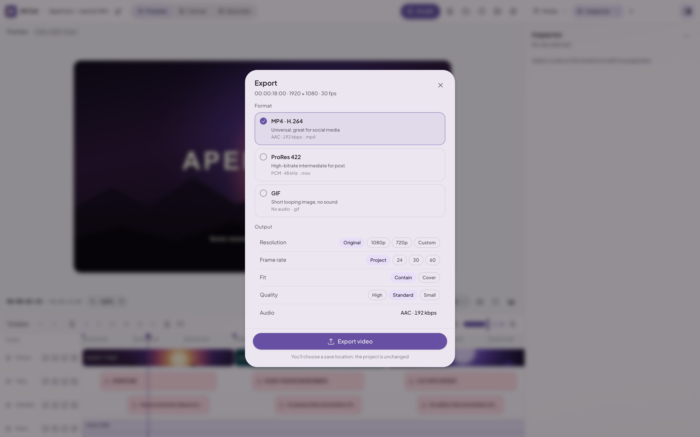

<p align="center">
  
</p>

<p align="center">
  <a href="https://github.com/heshengtao/ai-cut/releases"></a>
  <a href="LICENSE"></a>
  
  <a href="https://hub.docker.com/r/ailm32442/ai-cut"></a>
</p>

<p align="center">
  <a href="README_zh.md">简体中文</a> ·
  <a href="README_zh-TW.md">繁體中文</a> ·
  <a href="README.md">English</a> ·
  <a href="README_ja.md">日本語</a> ·
  <a href="README_ko.md">한국어</a> ·
  <a href="README_es.md">Español</a> ·
  <a href="README_fr.md"><b>Français</b></a> ·
  <a href="README_de.md">Deutsch</a> ·
  <a href="README_ru.md">Русский</a> ·
  <a href="README_ar.md">العربية</a>
</p>

<p align="center">
  <a href="https://hub.docker.com/r/ailm32442/ai-cut"><b>Docker Hub</b></a> ·
  <a href="https://github.com/heshengtao/ai-cut/releases">Télécharger</a>
</p>

## Qu'est-ce qu'AI Cut ?

**AI Cut est un éditeur vidéo compact et AI-native pour votre poste de travail** — couper, sous-titrer, doubler, mixer et exporter dans une seule application légère, et laisser un agent IA travailler dans la timeline à vos côtés.

C'est un véritable éditeur : une timeline multi-piste, **un canvas infini pour les workflows à nœuds**, **un graphe d'épisodes à embranchements**, une bibliothèque de médias, un inspector, des clips texte, des sous-titres, de la voix off, des outils IA audio et vidéo, **des plugins d'effets OpenFX (OFX)**, et l'export en MP4, ProRes ou GIF. La timeline, le canvas et le graphe d'épisodes sont trois vues du même projet. Il est aussi conçu pour être **piloté par un modèle** — un Skill embarqué apprend à n'importe quel harness IA à conduire l'application en cours d'exécution via MCP : un agent peut importer des médias, ajouter des pistes, placer et rogner des clips, réécrire du texte, construire un canvas ou recâbler un embranchement, et relire le projet pendant que vous voyez l'interface se mettre à jour.

Tout s'exécute sur votre propre machine. Aucun compte, aucun envoi de fichiers, et aucune clé d'API nécessaire pour l'éditeur lui-même.

<p align="center">
  
</p>

## Pourquoi c'est important

Les modèles sont devenus bons en écriture de code parce qu'ils pouvaient l'**exécuter** à travers un framework d'agent de codage ; ils sont devenus bons en modélisation 3D parce qu'ils pouvaient piloter un véritable logiciel de modélisation via Blender MCP. Dans les deux cas, le modèle dispose d'un vrai outil, d'un vrai résultat et d'une vraie boucle de rétroaction — et c'est ce qui rend l'itération rapide possible.

La vidéo a longtemps manqué cette boucle. Un modèle peut générer un clip, mais il ne peut pas *travailler sur une timeline* comme le fait un monteur : pas d'arrangement à éditer, pas de pistes à équilibrer, pas d'historique d'annulation, aucun moyen de remarquer que sa dernière coupe a dégradé le résultat.

**AI Cut est une petite tentative délibérée de combler cet écart.** C'est un véritable éditeur qu'un agent IA peut piloter via un Skill et MCP, ce qui le rend utile pour :

- **Tester ce qu'un modèle sait réellement du montage** — pas sa capacité à générer des images, mais sa capacité à construire une séquence, choisir des plans et corriger le rythme.
- **Collecter de vraies traces de montage** — chaque modification de l'agent atterrit dans un projet normal avec un historique d'annulation normal : une session devient donc une donnée sur la façon dont un modèle raisonne à propos de la vidéo.
- **Un pas vers des modèles capables de monter de la vidéo comme ils écrivent du code** — avec une timeline qui répond.

## Léger par conception

La légèreté est une fonctionnalité, pas un compromis.

- **Une empreinte légère** — pas d'Electron, pas de cloud, pas de zoo de modèles embarqué. L'application est un build Tauri, et ffmpeg / ffprobe sont livrés comme sidecars statiques : l'utilisateur n'a donc pas besoin d'installer ffmpeg.
- **Démarrage rapide** — rien de lourd ne se charge au démarrage ; les modèles IA ne sont récupérés que lorsque vous les utilisez.
- **L'IA lourde reste à sa place** — la génération est volontairement externe. Votre harness IA peut générer ou sourcer des rushes, puis confier les fichiers à AI Cut pour le montage, les sous-titres, le mixage et l'export.
- **Conçu pour être étendu** — chaque modification est une commande sérialisable : les nouvelles opérations de montage n'ont besoin ni d'une nouvelle CLI ni d'un nouvel outil MCP ; le canvas repose sur le même modèle de commandes, et les extensions de l'application peuvent ajouter leurs propres nœuds, types de données, panneaux et commandes.
- **Gestionnaire de plugins OFX** — le gestionnaire de téléchargement gère les plugins OpenFX installés / externes / disponibles, la recherche, l'import, les mises à jour et la suppression ; le panneau des plugins OFX ouvre l'interface d'un plugin installé. Les entrées libres / open source proviennent de l'[AI Cut OFX Registry](https://github.com/heshengtao/ai-cut-ofx-registry), avec vérification SHA-256. Les entrées GPL/AGPL peuvent être téléchargées depuis la release amont de l'auteur, mais l'application n'héberge ni ne distribue jamais leurs binaires. L'hôte natif (`crates/ofx-host`, CLI `ofx-host probe|render`) charge les bundles OFX 1.5.1 à la taille d'entrée et prend en charge les six contextes d'effet d'image : filter / general / generator / paint / retimer s'attachent à la chaîne `effects[]` d'un clip, tandis que transition s'attache au bord d'un clip et est précalculé comme une surcouche plein cadre. Les paramètres vivent dans un panneau Parameters dédié. Monter un effet déclenche un précalcul en arrière-plan (avec progression) afin que les aperçus vidéo et image conservent l'effet pendant la lecture ; l'export précalcule à la taille finale (paint est piloté par ses paramètres ; retimer demande au plugin le `SourceTime`).

## Piloter depuis n'importe quel harness IA

AI Cut embarque un **Skill** (`skills/aicut`) qui apprend à un agent IA à piloter l'application en cours d'exécution — lire et écrire le projet, importer des médias, ajouter des pistes et des clips, déplacer / rogner / diviser, modifier le texte et les propriétés des clips, annuler et rétablir, ainsi que des références production, storyboard, framework, review et assets chargées à la demande. Il fonctionne via le serveur **MCP** intégré : n'importe quel harness prenant en charge les Agent Skills peut donc l'utiliser.

**Option 1 · Installer depuis la ligne de commande**

```bash
npx skills add heshengtao/ai-cut
```

**Option 2 · Demander à votre agent de l'installer**

```
Install this Skill: https://github.com/heshengtao/ai-cut
```

L'application embarque aussi `aicut`, un client MCP minimal installable dans votre `PATH` depuis les Paramètres. La surface de commandes est la surface d'outils :

```bash
aicut status
aicut tools
aicut call get_project
```

Chaque modification effectuée par un agent passe par le même pipeline de commandes que l'interface : elle entre dans l'historique d'annulation, apparaît dans l'interface et est attribuée à l'agent — vous pouvez donc toujours voir ce qu'il a fait et l'annuler.

## Fonctionnalités

### Montage sur la timeline — Composer sur une vraie timeline

Disposez une vidéo comme vous l'entendez. Faites glisser des clips entre les pistes, divisez-les là où l'histoire change, rognez les bords, et laissez l'aimantation et la grille d'images garder l'ensemble aligné. Les clips vidéo, audio, image et texte partagent la même timeline, et chaque modification est une commande dans un seul historique d'annulation.

- **Arrangement multi-piste** — des clips vidéo, audio, image et texte côte à côte ; glisser-déposer entre pistes ; sélection au lasso
- **Une vraie boîte à outils de montage** — déplacer, diviser, rogner, aimantation, grille d'images
- **Une annulation qui respecte les gestes** — les glissements et les curseurs sont regroupés en une seule étape, si bien que l'annulation revient à l'état d'avant le geste
- **Des sessions sûres** — sauvegarde automatique, récupération de brouillon après un plantage et historique du projet
- **Du texte sur la timeline** — des clips de titre et de sous-titre avec un style modifiable

<p align="center">
  
</p>

### Médias et inspector — Lire la matière, façonner le plan

Importez un fichier et AI Cut l'analyse immédiatement : durée, résolution, fréquence d'images et audio. La bibliothèque de médias affiche des vignettes et des formes d'onde ; l'inspector expose les paramètres du clip sélectionné, si bien que le cadrage, les calques et le son se modifient sur place plutôt que dans une boîte de dialogue séparée.

- **Import par glisser-déposer** — métadonnées ffprobe, vignettes, formes d'onde et aperçus en cache
- **Transformation** — position, échelle, rotation, opacité, modes de fusion, rayon des coins
- **Audio par clip** — gain, fondus, hauteur, balance stéréo, sourdine
- **Style du texte** — police, taille, couleur, espacement, fond, contour, ombre, halo
- **Sortie du projet** — les changements de résolution et de fréquence d'images réajustent les clips proportionnellement
- **Aides à la livraison** — rassembler les médias dans `<project>-media/` à côté du projet

<p align="center">
  
</p>

### Canvas et workflows — Construire le plan avant de le monter

La vue Canvas est un canvas de nœuds infini pour les parties d'une vidéo qui sont plus faciles à dessiner qu'à glisser. Déposez une affiche, un clip de référence ou une ligne de texte sur le canvas, reliez-la à un nœud de modèle ou d'affichage, exécutez la chaîne et envoyez le résultat à la partie courante.

- **Un projet, plusieurs canvas** — chaque projet peut contenir plusieurs canvas nommés ; ouvrir, renommer, dupliquer ou vider l'un d'eux sans toucher au montage.
- **Un nœud pour chaque étape** — entrées image / vidéo / audio / texte / valeur, affichages et lectures de valeurs, nœuds de modèles locaux et cloud, frontières de workflow, boucles et groupes.
- **Une entrée, une sortie** — chaque carte expose un seul lien entrant et un seul sortant ; l'inspector choisit quelle valeur logique ce lien transporte, si bien qu'un graphe peut être restructuré sans recâblage.
- **Exécution en arrière-plan** — exécutions manuelles, au changement ou répétées, avec état, progression et chronométrage en direct ; les sorties arrivent dans la bibliothèque de médias et peuvent être insérées dans la partie courante en un clic.
- **Des workflows réutilisables** — déclarer une signature début/fin, l'enregistrer dans la bibliothèque de workflows, la publier comme API, ou appeler un canvas depuis un autre (imbrication jusqu'à 8 niveaux).
- **Ouvert aux plugins** — les extensions de l'application enregistrent des types de nœuds, des types de données, des panneaux, des contrôles et des commandes ; le même graphe est modifiable en headless via les outils MCP board.

Note de conception complète : [`docs/canvas-workflow.md`](docs/canvas-workflow.md) · guide des plugins : [`docs/plugins.md`](docs/plugins.md).

<p align="center">
  
</p>

### Épisodes et embranchements — Un projet, plusieurs montages

Un projet n'est pas un seul montage. Il contient plusieurs parties qui partagent la même bibliothèque de médias et les mêmes canvas, et le graphe de série décide quelle partie se joue ensuite. À la fin d'une partie à embranchements, l'aperçu s'arrête sur la dernière image et transforme les arêtes sortantes en boutons : un choix n'est donc qu'une modification de plus.

- **Les parties partagent tout le reste** — médias, canvas et réglages sont communs au projet ; chaque partie conserve ses propres pistes et marqueurs.
- **Deux façons de voir l'histoire** — la vue tuiles pour une grille de storyboard, la vue flux pour un canvas libre avec une carte par partie.
- **De vrais embranchements, de vrais libellés** — relier une partie à deux autres, nommer chaque arête, et les noms deviennent les boutons de choix à l'écran.
- **Partie seule ou série** — jouer une partie puis s'arrêter, ou suivre le graphe à travers chaque embranchement jusqu'à la fin.
- **Gestion rapide des parties** — renommer, dupliquer, supprimer, sélection multiple, copier / coller et glisser pour réordonner ; faire glisser une poignée dans un espace vide pour créer la partie suivante déjà connectée.
- **La timeline reste la timeline** — les embranchements changent ce qui se joue ensuite, pas la façon dont une partie est montée, annulée ou exportée.

<p align="center">
  
</p>

### Plugins OFX — Apporter ses propres effets

AI Cut héberge les plugins **OpenFX (OFX) 1.5.1** : vos outils de finition habituels vous accompagnent donc — étalonnage, flous, halos, keyers, déformations, transitions. Un gestionnaire de plugins parcourt l'[AI Cut OFX Registry](https://github.com/heshengtao/ai-cut-ofx-registry) avec vérification SHA-256, et récupère aussi les plugins installés ailleurs sur le disque.

- **Les six contextes OFX** — filter, general, generator, paint et retimer s'attachent à la chaîne d'effets d'un clip ; transition s'attache au bord d'un clip
- **Interface propre ou paramètres** — ouvrir l'interface du plugin, ou piloter ses paramètres dans le panneau Parameters dédié
- **Aperçu toujours en direct** — monter un effet lance un précalcul en arrière-plan, si bien que les aperçus vidéo et image conservent le rendu pendant la lecture
- **Précalculé à l'export** — le rendu applique chaque effet à la taille finale (paint est piloté par ses paramètres, retimer demande le `SourceTime` au plugin)
- **Registre + import local** — recherche, installation / mise à jour / suppression en un clic, ou pointer vers un bundle local

<p align="center">
  
</p>

### IA et automatisation — Transformer les rushes en matière montable

Les fonctionnalités IA sont conçues pour de vraies sessions, pas pour des démos. Pointez-les sur un clip et elles renvoient quelque chose que vous pouvez continuer à monter : une piste de sous-titres que vous pouvez corriger, une voix off alignée sur son timing d'origine, une prise vocale plus propre, des stems séparés que vous pouvez rééquilibrer. Les outils locaux tournent sur votre propre matériel.

- **Sous-titres** — reconnaissance vocale locale vers une piste de sous-titres modifiable
- **Voix off** — TTS local plus OpenAI, ElevenLabs, Azure, Google, Baidu, MiniMax, Volcengine ou HTTP personnalisé
- **Montage intelligent** — des horodatages au niveau du mot repèrent les mots parasites et les longues pauses et les coupent en une passe ; mots à filtrer, seuils de pause et marge autour des points de coupe se règlent dans une seule boîte de dialogue, et les coupes débordent légèrement dans le silence environnant afin de ne laisser aucun demi-son ; la transcription barre chaque mot supprimé, un clic le restaure, et la timeline marque chaque coupe
- **IA audio** — alignement de sonie, débruitage, polissage vocal, séparation des sources, traduction audio
- **IA vidéo** — super résolution, interpolation d'images, recadrage intelligent, suivi de caméra
- **Analyse des médias** — un seul appel renvoie les métadonnées, des échantillons de mouvement / coupe, des boîtes visage / personne et une transcription locale
- **Boucle de review** — import de `film.json`, notes de review structurées (`severity`, `sceneId`, `resolved`), détection de segments sales, re-rendu par plage avec cache basé sur le hash de contenu, comparaison de prises (SSIM + images côte à côte) et planches de contacts
- **Hors ligne par conception** — l'éditeur et ses modèles locaux ne demandent ni compte ni envoi

<p align="center">
  
</p>

### Serveur MCP et clip agent — Laisser un agent IA travailler dans votre session

Basculez un interrupteur et votre projet devient quelque chose qu'un assistant IA peut piloter. Le serveur **MCP (Model Context Protocol)** intégré expose la session via HTTP sur `127.0.0.1` — connectez votre agent, confiez-lui une tâche et regardez-le ajouter des pistes, placer des clips ou réécrire du texte pendant que l'interface se met à jour en temps réel. Les mêmes définitions d'outils alimentent aussi le **clip agent** intégré, un panneau de chat compatible OpenAI avec streaming, appels d'outils et arbre de session à embranchements.

- **MCP sur HTTP** — un endpoint limité à la boucle locale, transports JSON et SSE
- **Cycle de vie du projet** — `new_project` / `open_project` / `save_project` lisent et écrivent directement le JSON du projet, sans boîte de dialogue d'enregistrement ou d'ouverture
- **Modifications en direct** — les actions de l'agent apparaissent immédiatement comme des modifications ordinaires du projet
- **CLI `aicut`** — un client minimal ; les nouveaux outils ne nécessitent aucune modification de la CLI
- **`aicut start`** — découvre automatiquement l'application installée et la détache de la tâche du lanceur (Windows compris)
- **Clip agent** — endpoint compatible OpenAI, réponses en streaming, cartes d'outils, branches de session
- **Outils canvas** — créer des canvas, appliquer des board ops, et lister ou exécuter les workflows publiés via le même endpoint
- **Skills** — documentation de montage et de production chargée à la demande par l'agent

<p align="center">
  
</p>

### Export et mises à jour — Finaliser et livrer

Quand le montage est bon, il reste à le rendre. Choisissez un format de livraison et AI Cut écrit un fichier prêt à diffuser en arrière-plan pendant que vous continuez à travailler. Les applications installées vérifient les GitHub Releases pour des mises à jour signées : une nouvelle version est à un clic.

- **Formats** — MP4 / H.264, ProRes 422, GIF
- **Réglages de sortie** — préréglages ou largeur/hauteur personnalisée, ajustement contain/cover, fréquence d'images, qualité ; palette, dithering et boucle GIF
- **Export en arrière-plan** — progression en direct et annulation
- **Mise à jour automatique signée** — vérification au démarrage, vérification manuelle, téléchargement, installation, redémarrage
- **Bundles vérifiés** — la clé publique de l'updater est intégrée ; la clé privée ne vit que dans l'environnement de release

<p align="center">
  
</p>

## Installation

Des binaires précompilés sont publiés sur la page [GitHub Releases](https://github.com/heshengtao/ai-cut/releases).

### Prérequis

- Rust (stable) avec Cargo
- Node.js ≥ 20 et [pnpm](https://pnpm.io/) (pnpm 11 recommandé)
- Les prérequis système de Tauri v2 — voir <https://tauri.app/start/prerequisites/>

### Construire depuis les sources

```bash
git clone https://github.com/heshengtao/ai-cut.git
cd ai-cut

pnpm install
pnpm tauri dev        # run the app in development
pnpm tauri build      # produce a release build
```

Autres commandes utiles :

```bash
pnpm build            # type-check the frontend and build it
pnpm test             # unit tests (Vitest)
pnpm fetch:sidecars   # prepare the ffmpeg / ffprobe sidecars
pnpm build:aicut      # build the aicut CLI
```

ffmpeg et ffprobe sont livrés comme binaires statiques : les utilisateurs n'ont donc pas besoin d'installer ffmpeg. Les fichiers de modèles vivent dans `src-tauri/resources/models/` ; les modèles plus volumineux sont téléchargés à la demande.

### Dossier de données

Les modèles, ONNX Runtime, les plugins OFX, l'historique du projet et les réglages résident par défaut dans le dossier de données utilisateur (`%APPDATA%\com.aicut.editor` sous Windows) et peuvent atteindre plusieurs gigaoctets. Deux façons de les garder hors du disque système :

- **Le choisir à l'installation** : l'installateur NSIS Windows demande un dossier de données lors d'une **première installation** (les installations silencieuses et les mises à jour automatiques ne posent jamais la question). Le choix est stocké dans `HKCU\Software\AI Cut\DataDir`.
- **Le déplacer ensuite** : **Paramètres → Stockage → Choisir un dossier et migrer**. L'application copie les données actuelles dans le nouveau dossier et écrit un fichier pointeur ; la prise en compte a lieu **après un redémarrage**. L'ancien dossier est conservé jusqu'à ce que vous le nettoyiez depuis la même page — la migration ne supprime jamais rien.

Ordre de résolution : `--data-dir <path>` > `AICUT_DATA_DIR` > le pointeur des réglages (`data-dir.json`) > le registre de l'installateur > le système par défaut. Les deux premiers relèvent du “mode portable” ; la page de réglages désactive la migration pour eux.

Quelques fichiers restent volontairement en place : `cli-path` / `app-path` / `mcp-url` sont des fichiers de découverte que la CLI `aicut` et les harness IA externes trouvent par bundle id (voir [`skills/aicut/SKILL.md`](skills/aicut/SKILL.md)). Ils pèsent quelques dizaines d'octets et restent dans le dossier par défaut.

### Prise en charge des plateformes

| Plateforme | État |
| --- | --- |
| Windows (x86_64) |  Pris en charge |
| macOS (Apple Silicon) |  Pris en charge (voir la note “application endommagée” ci-dessous) |
| Linux (x86_64 / arm64) |  Pris en charge |

> **macOS affiche “App is damaged” ?** L'application est signée ad hoc (non notariée), macOS
> met donc les téléchargements en quarantaine. Il suffit d'exécuter ceci dans le Terminal, puis d'ouvrir l'application normalement :
>
> ```bash
> xattr -cr "/Applications/AI Cut.app"
> ```

> **Les Mac Intel ne sont pas pris en charge par le pipeline de release actuel.** Les builds de
> release sont produits pour Apple Silicon (`aarch64-apple-darwin`) uniquement.

## Accès navigateur et headless

L'application de bureau embarque un serveur HTTP lié à la boucle locale : **Paramètres → Général → Accès web**,
puis ouvrez l'adresse dans un navigateur — c'est le même éditeur. **Ni connexion, ni jeton** : ouvrez l'adresse et travaillez. Le contrôle d'accès relève du déploiement
(LAN, réseau de conteneurs ou proxy inverse).

Le serveur partage la session live avec l'application de bureau : les deux côtés sont en lecture-écriture, et les modifications fusionnent dans le même projet. Activez “Accès LAN” et redémarrez pour y accéder depuis une tablette ou une seconde machine du même réseau.

### Docker

```bash
docker build -t ai-cut .
docker run -d --name ai-cut -p 28440:28440 -p 50563:50563 -v aicut-data:/data ai-cut
```

L'image est basée sur Debian slim (multi-étapes, ~434 Mo) et embarque les mêmes ffmpeg/ffprobe statiques que l'application de bureau, plus les 5 modèles intégrés et ONNX Runtime (l'architecture est vérifiée par rapport à l'en-tête ELF au moment du build, et un alias `libonnxruntime.so` est créé) ; ouvrez <http://localhost:28440>.

MCP s'attache à `0.0.0.0` dans le conteneur (la sémantique de `--lan`) : après publication de `50563`, un client MCP sur l'hôte (Claude Desktop / IDE) peut se connecter à `http://<host>:50563/mcp` et obtient les mêmes 62 outils que l'application de bureau.

**Le conteneur est identique à l'application de bureau** sauf là où la physique en décide autrement :

| Capacité | Bureau | Conteneur / navigateur |
| --- | --- | --- |
| Montage / sous-titres / export / polices | ✅ | ✅ même implémentation du daemon |
| Inférence locale : ASR, TTS, débruitage, séparation des stems, upscale, interpolation, changement de voix | ✅ | ✅ même implémentation du daemon (CPU, plus lent) |
| Gestion des modèles et du runtime, images / TTS cloud, sonie, traitement vidéo | ✅ | ✅ |
| Agent / MCP | ✅ 62 outils | ✅ les mêmes 62 outils (macros de montage, IA au niveau du clip, export et rendu, cycle de vie du projet, annuler/rétablir, notes de review, manifestes film, tâches en arrière-plan) |
| Effets OFX | ✅ y compris les précalculs sur tout le clip | ✅ aperçus frame / image / transition **et** précalcul de clips entiers + transitions (précalcul séquentiel mono-processus) |
| Installation / import / suppression de plugins | ✅ | ✅ (`reveal in file manager` nécessite le bureau) |
| Interfaces natives des plugins, boîtes de dialogue système / lancement du navigateur | ✅ | ⛔ pas de système de fenêtrage / session de bureau |
| Génération locale d'images / vidéos (sd.cpp) | ✅ | ✅ même implémentation du daemon : moteur et poids téléchargés à la demande ; les conteneurs utilisent CPU / Vulkan / ROCm (l'amont n'a pas de build CUDA Linux) |

**Les binaires des plugins doivent correspondre à l'architecture de l'image.** L'image est construite pour
l'architecture de la machine de build (arm64 sur Apple Silicon), et les plugins OFX sont des binaires
natifs : un plugin qui ne fournit qu'un build x86_64 (par ex. Flame LTX AlphaGen) ne peut pas
se charger dans un conteneur arm64. L'éditeur affiche désormais “plugin binary architecture
mismatch” au lieu du cryptique `cannot open shared object file` ; exécutez plutôt ces plugins
dans une image amd64 :

```bash
docker build --platform linux/amd64 -t ai-cut .
docker run -d --platform linux/amd64 -p 28440:28440 -v aicut-data:/data ai-cut
```

(Sur Apple Silicon, cela passe par l'émulation Rosetta et c'est plus lent ; sur un hôte Linux
x86_64, rien ne change.)

Les modèles sont téléchargés à la première utilisation (Paramètres → Modèles) via le proxy configuré ; les 5 modèles intégrés fonctionnent immédiatement.

### Binaire headless

```bash
cargo run --manifest-path crates/daemon/Cargo.toml --bin aicutd -- \
  --data-dir ./data --port 28440 --lan --dist dist
```

### Variables d'environnement

| Variable | Valeur par défaut | Rôle |
| --- | --- | --- |
| `AICUT_DATA_DIR` | `./data` | projets, médias importés, exports |
| `AICUT_NO_AUDIO` | non défini | ne pas ouvrir de périphérique audio |

### API HTTP

| Méthode | Chemin | Rôle |
| --- | --- | --- |
| `POST` | `/rpc/{command}` | commandes de montage, mêmes noms que l'IPC de l'application |
| `GET` | `/events` | Server-Sent Events : document + progression des tâches |
| `GET` | `/session` | WebSocket : synchronisation de la session live |
| `GET` | `/file` · `POST /upload` | lecture / import de médias |
| `GET` | `/health` | vivacité |

## Architecture

```
src-tauri/          Tauri shell: windows, native dialogs, auto-updater
crates/daemon/      backend: document model, media, render engine, HTTP
crates/aicut/       the CLI
src/                Vue 3 frontend — identical for desktop and browser
```

`src/platform/` échange le transport (`Tauri IPC` ↔ `HTTP + WebSocket`) derrière une seule API, si bien que
chaque écran fonctionne dans les deux coquilles ; le build navigateur est la même application parlant au même
backend sur le réseau.

En mode headless, les projets, les médias importés et les exports vivent dans le dossier de données ; ffmpeg
vient de l'image.

L'IA locale (ASR / TTS / débruitage / séparation / upscale / changement de voix), la gestion des modèles et du runtime,
les plugins/OFX et l'agent de montage ne sont **pas encore câblés dans le backend headless**
— c'est une dette de migration, pas une frontière produit. `GET /rpc/capabilities` déclare,
pour chaque fonctionnalité, si elle est disponible, s'il lui manque un composant ou si elle n'est pas encore
portée, et l'interface s'appuie là-dessus au lieu de deviner avec `isTauri()`.

## FAQ

### AI Cut est-il gratuit ?

Oui. AI Cut est open source sous Apache 2.0. Il n'y a pas d'offres payantes ni de fonctionnalités verrouillées.

### Fonctionne-t-il hors ligne ?

Oui. Le montage, l'export et les modèles IA locaux tournent sur votre machine. L'accès réseau n'a lieu que lorsque vous lancez le téléchargement d'un modèle, vérifiez les mises à jour, ou configurez un service cloud tel qu'un endpoint d'agent compatible OpenAI ou un TTS cloud.

### Faut-il un GPU ?

Non. Les modèles IA intégrés tournent sur CPU ; aucune installation de CUDA ni de pilote n'est nécessaire. Les modèles plus volumineux prennent plus de temps sur des machines plus lentes, mais ils n'exigent pas de GPU. Si vous disposez d'un GPU NVIDIA, vous pouvez choisir CUDA 12 ou CUDA 13 dans Paramètres → IA → Backend d'exécution : l'un ou l'autre télécharge à la demande, depuis le gestionnaire de téléchargement, un ensemble ONNX Runtime + CUDA parfaitement apparié, sans installation système de CUDA (redémarrage nécessaire pour l'appliquer).

### Quels modèles IA sont livrés avec l'application ?

Les petits modèles sont inclus dans le bundle pour que les fonctionnalités de base fonctionnent immédiatement. Les modèles plus volumineux — reconnaissance vocale, TTS, séparation des sources, super résolution et interpolation d'images — se téléchargent à la demande depuis le gestionnaire de modèles de l'application et sont stockés hors de l'arborescence des sources. Les licences — y compris celles des modèles vidéo sous licence communautaire et des poids non commerciaux FLUX.1 [dev] — sont listées dans [MODELS.md](MODELS.md).

### Quels formats de plugins d'effets sont pris en charge ?

**OpenFX (OFX) 1.5.1** — les six contextes d'effet d'image (filter, general, generator, paint, retimer, transition). Les plugins peuvent venir du registre intégré ou de votre propre disque. Les formats d'effets audio (VST3 / AU / CLAP) ne sont pas hébergés : les outils audio propres à AI Cut couvrent le gain, les fondus, la hauteur et le mixage.

### L'application doit-elle tourner pour qu'un agent la pilote ?

Oui. Le Skill et la CLI `aicut` parlent à une instance AI Cut en cours d'exécution via MCP : démarrez donc l'application d'abord (`aicut status` vous dira si elle est lancée).

### Puis-je faire une vidéo à embranchements ?

Oui. Un projet peut contenir plusieurs parties ; la vue Episodes les relie par des arêtes libellées, et le mode “Series” de l'aperçu suit ces arêtes. À la fin d'une partie, les libellés sortants apparaissent comme boutons de choix, si bien que la partie suivante se choisit à l'écran.

### Faut-il un modèle pour utiliser le canvas ?

Non. Les nœuds d'entrée, d'affichage, de valeur, de boucle et de workflow fonctionnent sans aucun modèle. Les nœuds de modèle nécessitent un modèle local ou un fournisseur cloud configuré ; tant qu'aucun n'est prêt, le reste du graphe reste modifiable et enregistrable.

### Un agent peut-il exporter la vidéo finale ?

Oui. `export_video` rend la timeline via MCP — MP4, ProRes ou GIF. `outputPath` est optionnel : s'il est omis, AI Cut écrit à côté du fichier de projet (ou dans votre dossier Téléchargements pour un projet non enregistré) et renvoie le chemin final. Les sous-titres, la voix off, l'IA audio / vidéo et l'export sont tous disponibles comme outils : l'agent peut donc préparer la timeline, la rendre et remettre le fichier pour review.

## Support

### Mettez-nous une étoile !
⭐ Votre soutien est le moteur qui nous fait avancer !

### Les pourboires sont bienvenus !
<div align="center" style="display: flex; gap: 20px; justify-content: center; flex-wrap: wrap;">

[](https://ko-fi.com/agentparty)
[](https://afdian.com/a/agentparty)

</div>

### Suivez-nous
<div align="center">
  <a href="https://space.bilibili.com/26978344">
    
  </a>
  <a href="https://www.youtube.com/@agentParty">
    
  </a>
</div>

### Rejoindre la communauté
Si vous avez des questions ou des problèmes avec le projet, vous êtes les bienvenus dans notre communauté.

1. Groupe QQ : `931057213` (complet) / `902882342` (groupe 2)

2. Discord : [lien Discord](https://discord.gg/f2dsAKKr2V)

## Contributeurs

<a href="https://github.com/heshengtao/ai-cut/graphs/contributors">
  
</a>

## Licence

Le **code** de l'application est sous Apache-2.0 — voir [LICENSE](LICENSE).

Les **poids** des modèles constituent une couche séparée : le dépôt et les installateurs ne transportent que les
cinq petits modèles permissifs livrés avec l'application ; tout le reste est téléchargé à la
demande depuis son éditeur et vérifié par rapport à un `sha256` épinglé. Chaque modèle conserve sa
propre licence — voir **[MODELS.md](MODELS.md)** pour le tableau complet, y compris les licences
communautaires (LTX-2, Hunyuan, MiniMax-H3), les modèles CreativeML Open RAIL et les
poids non commerciaux FLUX.1 [dev].

## Licences tierces

Ce projet s'appuie sur des logiciels open source tiers. Les licences des dépendances sont déclarées
dans `package.json`, `src-tauri/Cargo.toml` et les manifestes sous `crates/`. Les binaires
FFmpeg embarqués conservent leurs propres licences amont. Les poids des modèles — intégrés et à la
demande, avec leurs licences, sources et restrictions — sont listés dans [MODELS.md](MODELS.md) ; les
textes intégraux des modèles intégrés se trouvent dans `src-tauri/resources/models/LICENSES/`.
