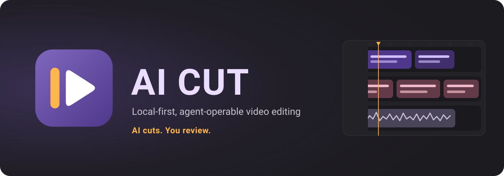
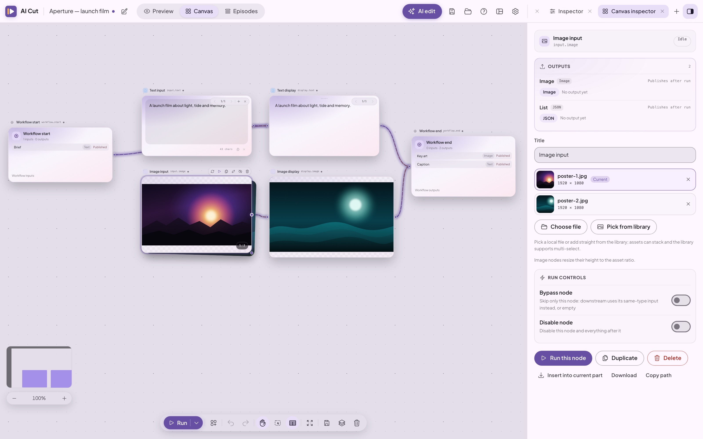

<p align="center">
  
</p>

<p align="center">
  <a href="https://github.com/heshengtao/ai-cut/releases"></a>
  <a href="LICENSE"></a>
  
  <a href="https://hub.docker.com/r/ailm32442/ai-cut"></a>
</p>

<p align="center">
  <a href="README_zh.md">简体中文</a> ·
  <a href="README_zh-TW.md">繁體中文</a> ·
  <a href="README.md">English</a> ·
  <a href="README_ja.md"><b>日本語</b></a> ·
  <a href="README_ko.md">한국어</a> ·
  <a href="README_es.md">Español</a> ·
  <a href="README_fr.md">Français</a> ·
  <a href="README_de.md">Deutsch</a> ·
  <a href="README_ru.md">Русский</a> ·
  <a href="README_ar.md">العربية</a>
</p>

<p align="center">
  <a href="https://hub.docker.com/r/ailm32442/ai-cut"><b>Docker Hub</b></a> ·
  <a href="https://github.com/heshengtao/ai-cut/releases">Download</a>
</p>

## AI Cut とは？

**AI Cut は、デスクトップ向けの小型で AI ネイティブな動画エディターです** — カット、字幕、ボイス、ミックス、書き出しを 1 つの軽量アプリで完結でき、さらに AI エージェントと並んでタイムライン上で作業できます。

これは本物のエディターです。マルチトラックのタイムライン、**ノードベースのワークフロー向けの無限キャンバス**、**分岐するエピソードグラフ**、メディアライブラリ、インスペクター、テキストクリップ、字幕、ボイスオーバー、音声・動画の AI ツール、**OpenFX（OFX）エフェクトプラグイン**、そして MP4 / ProRes / GIF への書き出しを備えています。タイムライン、キャンバス、エピソードグラフは、同じプロジェクトの 3 つのビューです。さらに、**モデルから操作されること**を前提に設計されています — 同梱の Skill が任意の AI ハーネスに、MCP 経由で実行中のアプリを操作する方法を教えるので、エージェントはメディアを取り込み、トラックを追加し、クリップを配置・トリムし、テキストを書き換え、キャンバスを組んだり分岐を配線し直したり、プロジェクトを読み戻したりできます。その様子は UI の更新としてリアルタイムに見えます。

すべてはあなた自身のマシン上で動作します。アカウントもアップロードも不要で、エディター自体に API キーは必要ありません。

<p align="center">
  
</p>

## なぜこれが重要なのか

モデルがコードを書けるようになったのは、コーディングエージェントのフレームワークを通してコードを**実行**できたからです。3D モデリングができるようになったのは、Blender MCP を通して実際のモデリングソフトを操作できたからです。どちらの場合も、モデルは本物のツール、本物の結果、本物のフィードバックループを手に入れました — 高速な反復が可能になるのは、まさにそこです。

動画には、そのループがほとんどありませんでした。モデルはクリップを生成できますが、編集者と同じようには*タイムライン上で作業*できません。編集すべき配置も、バランスを取るべきトラックも、アンドゥ履歴も、直前のカットが状況を悪化させたことに気づく手段もないのです。

**AI Cut は、そのギャップを埋めるための小さく意図的な試みです。** AI エージェントが Skill と MCP を通して操作できる本物のエディターであり、次のような用途に役立ちます。

- **モデルが編集について実際に何を知っているかを試す** — フッテージを生成できるかではなく、シーケンスを組み、ショットを選び、テンポを直せるかどうか。
- **実際の編集トレースを集める** — エージェントの編集はすべて通常のプロジェクトと通常のアンドゥ履歴に残るので、1 回のセッションが「モデルが動画をどう推論するか」というデータになります。
- **モデルがコードを書くように動画を編集できる未来への一歩** — 応答を返してくれるタイムラインとともに。

## 設計からして軽量

小さいことは妥協ではなく、機能です。

- **軽量なフットプリント** — Electron なし、クラウドなし、同梱のモデル群なし。アプリは Tauri ビルドで、ffmpeg / ffprobe は静的サイドカーとして同梱されるため、ユーザーが ffmpeg をインストールする必要はありません。
- **起動が速い** — 起動時に重いものは読み込みません。AI モデルは使うときだけ読み込まれます。
- **重い AI はあるべき場所に** — 生成は意図的に外部化しています。AI ハーネスがフッテージを生成または調達し、そのファイルを AI Cut に渡して編集、字幕、ミックス、書き出しを行えます。
- **拡張できる設計** — すべての編集はシリアライズ可能なコマンドなので、新しい編集操作に新しい CLI や MCP ツールは不要です。キャンバスも同じコマンドモデルで動作し、アプリ拡張は独自のノード、データ型、ペイン、コマンドを追加できます。
- **OFX プラグインマネージャー** — ダウンロードマネージャーがインストール済み / 外部 / 利用可能な OpenFX プラグインを扱い、検索、インポート、更新、削除ができます。OFX プラグインペインはインストール済みプラグインのインターフェースを開きます。無料 / オープンソースの項目は [AI Cut OFX Registry](https://github.com/heshengtao/ai-cut-ofx-registry) から取得し、SHA-256 で検証します。GPL/AGPL の項目は作者の上流リリースからダウンロードできますが、アプリがそのバイナリをホストしたり同梱したりすることはありません。ネイティブホスト（`crates/ofx-host`、CLI は `ofx-host probe|render`）は OFX 1.5.1 バンドルを入力サイズでロードし、6 つの画像エフェクトコンテキストすべてをサポートします。filter / general / generator / paint / retimer はクリップの `effects[]` チェーンに付き、transition はクリップの端に付いてフルフレームのオーバーレイとしてベイクされます。パラメーターは専用の Parameters ペインにあります。エフェクトをマウントするとバックグラウンドのプリベイク（進捗表示あり）が始まるので、動画・画像のプレビューは再生中もエフェクトを保ちます。書き出し時は最終サイズでベイクします（paint はパラメーター駆動、retimer はプラグインに `SourceTime` を問い合わせます）。

## 任意の AI ハーネスから操作する

AI Cut には **Skill**（`skills/aicut`）が同梱されており、AI エージェントに実行中のアプリの操作方法を教えます — プロジェクトの読み書き、メディアの取り込み、トラックとクリップの追加、移動 / トリム / 分割、テキストとクリッププロパティの変更、アンドゥとリドゥ、さらに必要に応じて読み込まれる制作、絵コンテ、フレームワーク、レビュー、アセットのリファレンス。組み込みの **MCP** サーバー経由で動作するため、Agent Skills をサポートする任意のハーネスが利用できます。

**オプション 1 · コマンドラインからインストール**

```bash
npx skills add heshengtao/ai-cut
```

**オプション 2 · エージェントにインストールを頼む**

```
Install this Skill: https://github.com/heshengtao/ai-cut
```

アプリには `aicut` も同梱されています。設定から `PATH` にインストールできる薄い MCP クライアントです。コマンド面がそのままツール面になります。

```bash
aicut status
aicut tools
aicut call get_project
```

エージェントが行うすべての編集は、UI と同じコマンドパイプラインを通ります。アンドゥ履歴に残り、インターフェースに反映され、エージェントによるものとして記録されるので、何をしたかをいつでも確認して取り消せます。

## 機能

### タイムライン編集 — 本物のタイムラインで構成する

聴こえるとおりに動画を並べましょう。クリップをトラック間でドラッグし、物語が変わる位置で分割し、端をトリムし、スナップとフレームグリッドで全体を揃えます。動画、音声、画像、テキストのクリップは同じタイムラインを共有し、どの編集も 1 つのアンドゥ履歴の 1 コマンドになります。

- **マルチトラックの配置** — 動画、音声、画像、テキストのクリップを並べて扱い、トラック間のドラッグ＆ドロップ、矩形選択
- **本物の編集ツールキット** — 移動、分割、トリム、スナップ、フレームグリッド
- **ジェスチャーを尊重するアンドゥ** — ドラッグやスライダーは 1 ステップにまとまるので、アンドゥはジェスチャー前まで戻ります
- **安全なセッション** — 自動保存、クラッシュ時の下書き復元、プロジェクト履歴
- **タイムライン上のテキスト** — スタイルを編集できるタイトル / 字幕クリップ

<p align="center">
  
</p>

### メディア & インスペクター — 素材を読み、ショットを整える

ファイルをインポートすると、AI Cut は即座に解析します。長さ、解像度、フレームレート、音声。メディアライブラリはサムネイルと波形を表示し、インスペクターは選択中のクリップの背後にあるパラメーターを提示するので、フレーミング、レイヤー、音は別ダイアログではなくその場で編集できます。

- **ドラッグイン取り込み** — ffprobe によるメタデータ、サムネイル、波形、キャッシュされたプレビュー
- **トランスフォーム** — 位置、スケール、回転、不透明度、ブレンドモード、角丸
- **クリップごとの音声** — ゲイン、フェード、ピッチ、ステレオバランス、ミュート
- **テキストスタイリング** — フォント、サイズ、色、字間、背景、縁取り、影、グロー
- **プロジェクト出力** — 解像度とフレームレートを変更すると、クリップが比例して合わせ直されます
- **納品用ヘルパー** — メディアをプロジェクト隣の `<project>-media/` にまとめる

<p align="center">
  
</p>

### キャンバス & ワークフロー — カットする前にショットを組み立てる

Canvas ビューは、ドラッグするよりも描くほうが速い作業のための無限ノードキャンバスです。ポスター、参照クリップ、コピーの一行をキャンバスに置き、モデルや表示ノードに配線し、チェーンを実行して、結果を現在のパートに送ります。

- **1 プロジェクトに多数のキャンバス** — すべてのプロジェクトは名前付きキャンバスを複数持てます。編集に触れずに開く、名前を変更する、複製する、クリアすることができます。
- **すべてのステップにノード** — 画像 / 動画 / 音声 / テキスト / 値の入力、表示と値の読み出し、ローカル / クラウドのモデルノード、ワークフローの境界、ループ、グループ。
- **1 入力 1 出力** — 各カードは入力と出力のワイヤーを 1 本ずつだけ出します。そのワイヤーがどの論理値を運ぶかはインスペクターで選ぶので、配線し直さずにグラフを組み替えられます。
- **バックグラウンドで実行** — 手動、変更時、繰り返しの実行に対応し、状態、進捗、所要時間をライブ表示。出力はメディアライブラリに入り、ワンクリックで現在のパートに挿入できます。
- **ワークフローは再利用可能** — 開始 / 終了のシグネチャを宣言し、ワークフローライブラリに保存し、API として公開し、あるいは別のキャンバスから呼び出せます（最大 8 階層のネスト）。
- **プラグインに開かれている** — アプリ拡張はノード型、データ型、ペイン、コントロール、コマンドを登録できます。同じグラフは board MCP ツールからヘッドレスに書き込み可能です。

設計ドキュメント: [`docs/canvas-workflow.md`](docs/canvas-workflow.md) · プラグインガイド: [`docs/plugins.md`](docs/plugins.md)。

<p align="center">
  
</p>

### エピソード & 分岐 — 1 プロジェクトに多数のカット

プロジェクトは 1 つのカットではありません。同じメディアライブラリとキャンバスを共有する多数のパートを持ち、次にどのパートを再生するかはシリーズグラフが決めます。分岐するパートの終わりで、プレビューは最終フレームで止まり、出ていくエッジをボタンに変えるので、選択もまた 1 つの編集になります。

- **パートはそれ以外を共有する** — メディア、キャンバス、設定はプロジェクト全体。各パートは自分のトラックとマーカーを保ちます。
- **物語を見る 2 つの方法** — 絵コンテグリッドのタイルビューと、パートごとに 1 枚のカードを置く自由キャンバスのフロービュー。
- **本物の分岐、本物のラベル** — 1 つのパートを 2 つに接続し、各エッジに名前を付けると、その名前が画面上の選択ボタンになります。
- **単体パートまたはシリーズ** — 1 つのパートを再生して止めるか、終わるまでグラフをたどってすべての分岐を再生します。
- **高速なパート管理** — 名前を変更、複製、削除、複数選択、コピー / ペースト、ドラッグで並べ替え。ハンドルを空白にドラッグすると、接続済みの次のパートを作成できます。
- **タイムラインはタイムラインのまま** — 分岐が変えるのは次に再生されるものであり、パートの編集、アンドゥ、書き出しの方法ではありません。

<p align="center">
  
</p>

### OFX プラグイン — 手持ちのエフェクトを持ち込む

AI Cut は **OpenFX（OFX）1.5.1** プラグインをホストするので、すでに持っている仕上げツールをそのまま使えます。カラーコレクション、ブラー、グロー、キーヤー、ワープ、トランジション。プラグインマネージャーは SHA-256 検証付きで [AI Cut OFX Registry](https://github.com/heshengtao/ai-cut-ofx-registry) を参照し、ディスク上の別の場所にインストールされたプラグインも拾います。

- **6 つの OFX コンテキストすべて** — filter、general、generator、paint、retimer はクリップのエフェクトチェーンに付き、transition はクリップの端に付きます
- **独自 UI またはパラメーター** — プラグイン自身のインターフェースを開くか、専用の Parameters ペインでパラメーターを操作します
- **プレビューはライブのまま** — エフェクトをマウントするとバックグラウンドのプリベイクが始まり、動画・画像のプレビューは再生中もルックを保ちます
- **書き出し時にベイク** — レンダーはすべてのエフェクトを最終サイズで適用します（paint はパラメーター駆動、retimer はプラグインに `SourceTime` を問い合わせます）
- **レジストリ + ローカルインポート** — 検索、ワンクリックのインストール / 更新 / 削除、またはローカルのバンドルを指定

<p align="center">
  
</p>

### AI & 自動化 — フッテージを編集し続けられる素材に変える

AI 機能はデモではなく、実際のセッション向けに作られています。クリップを指定すると、編集し続けられるものを返します。修正できる字幕トラック、元のタイミングに揃ったボイスオーバー、よりクリーンなボーカルテイク、バランスを取り直せる分離ステム。ローカルツールはあなた自身のハードウェアで動作します。

- **字幕** — ローカル音声認識で、編集可能な字幕トラックを生成
- **ボイスオーバー** — ローカル TTS に加え、OpenAI、ElevenLabs、Azure、Google、Baidu、MiniMax、Volcengine、またはカスタム HTTP
- **スマートカット** — 単語レベルのタイムスタンプでフィラーワードと長い無音を見つけ、1 パスでカットします。フィルター語、無音のしきい値、カット点のパディングは 1 つの設定ダイアログにまとまり、カットは周囲の無音に少し食い込むので中途半端な音が残りません。書き起こしでは削除した単語に取り消し線が入り、ワンクリックで復元でき、タイムラインには各カットが表示されます
- **音声 AI** — ラウドネス合わせ、ノイズ除去、ボーカル補正、音源分離、音声翻訳
- **動画 AI** — 超解像、フレーム補間、スマートリフレーミング、カメラトラッキング
- **メディアプローブ** — 1 回の呼び出しでメタデータ、モーション / カットのサンプル、顔 / 人物のボックス、ローカルの書き起こしを返します
- **レビューループ** — `film.json` のインポート、構造化されたレビューノート（`severity`、`sceneId`、`resolved`）、ダーティセグメントの検出、コンテンツハッシュキャッシュを使った範囲再レンダー、テイク比較（SSIM + 並べたフレーム）、コンタクトシート
- **設計からしてオフライン** — エディターとそのローカルモデルはアカウントもアップロードも必要としません

<p align="center">
  
</p>

### MCP サーバー & クリップエージェント — AI エージェントをセッションで働かせる

スイッチを 1 つ切り替えるだけで、プロジェクトは AI アシスタントが操作できるものになります。組み込みの **MCP（Model Context Protocol）** サーバーは、セッションを `127.0.0.1` にバインドした HTTP で公開します — エージェントを接続してタスクを渡せば、トラックの追加、クリップの配置、テキストの書き換えをしながら、UI がリアルタイムに更新されるのを見られます。同じツール定義が組み込みの**クリップエージェント**も支えます。ストリーミング、ツールコール、分岐するセッションツリーを備えた OpenAI 互換のチャットパネルです。

- **HTTP 上の MCP** — ループバック専用のエンドポイント、JSON と SSE のトランスポート
- **プロジェクトのライフサイクル** — `new_project` / `open_project` / `save_project` はプロジェクト JSON を直接読み書きし、保存 / 開くダイアログは使いません
- **ライブ編集** — エージェントの操作は通常のプロジェクト変更として即座に現れます
- **`aicut` CLI** — 薄いクライアント。新しいツールに CLI の変更は不要です
- **`aicut start`** — インストール済みのアプリを自動検出し、ランチャーのジョブから切り離します（Windows も含む）
- **クリップエージェント** — OpenAI 互換エンドポイント、ストリーミング応答、ツールカード、セッション分岐
- **キャンバスツール** — キャンバスの作成、board オペレーションの適用、公開済みワークフローの一覧と実行を同じエンドポイントで
- **Skills** — エージェントが必要に応じて読み込む編集・制作ドキュメント

<p align="center">
  
</p>

### 書き出し & 更新 — 仕上げて届ける

カットが決まったら、レンダーしましょう。納品フォーマットを選ぶと、AI Cut が作業を続けている間にバックグラウンドでリリース可能なファイルを書き出します。インストール済みのアプリは GitHub Releases で署名済みアップデートを確認するので、新しいバージョンはワンクリックで手に入ります。

- **フォーマット** — MP4 / H.264、ProRes 422、GIF
- **出力コントロール** — プリセットまたはカスタムの幅 / 高さ、contain / cover フィット、フレームレート、品質。GIF のパレット、ディザ、ループ
- **バックグラウンド書き出し** — ライブの進捗とキャンセル
- **署名済み自動更新** — 起動時の確認、手動確認、ダウンロード、インストール、再起動
- **検証済みバンドル** — アップデーターの公開鍵は埋め込まれており、秘密鍵はリリース環境にのみ存在します

<p align="center">
  
</p>

## インストール

ビルド済みのバイナリは [GitHub Releases](https://github.com/heshengtao/ai-cut/releases) ページで公開されています。

### 要件

- Rust（stable）と Cargo
- Node.js 20 以上と [pnpm](https://pnpm.io/)（pnpm 11 を推奨）
- Tauri v2 のシステム前提条件 — <https://tauri.app/start/prerequisites/> を参照

### ソースからビルド

```bash
git clone https://github.com/heshengtao/ai-cut.git
cd ai-cut

pnpm install
pnpm tauri dev        # run the app in development
pnpm tauri build      # produce a release build
```

その他の便利なコマンド:

```bash
pnpm build            # type-check the frontend and build it
pnpm test             # unit tests (Vitest)
pnpm fetch:sidecars   # prepare the ffmpeg / ffprobe sidecars
pnpm build:aicut      # build the aicut CLI
```

ffmpeg と ffprobe は静的バイナリとして同梱されるため、ユーザーが ffmpeg をインストールする必要はありません。モデルファイルは `src-tauri/resources/models/` にあり、大きなモデルはオンデマンドでダウンロードされます。

### データフォルダー

モデル、ONNX Runtime、OFX プラグイン、プロジェクト履歴、設定は既定でユーザーデータフォルダー（Windows では `%APPDATA%\com.aicut.editor`）に置かれ、数ギガバイトに達することがあります。これらをシステムドライブから外す方法は 2 つあります:

- **インストール時に選ぶ**: Windows の NSIS インストーラーは**初回インストール**時にデータフォルダーを尋ねます（サイレントインストールと自動更新では尋ねません）。選択内容は `HKCU\Software\AI Cut\DataDir` に保存されます。
- **後から移動する**: **設定 → ストレージ → フォルダーを選択して移行**。アプリは現在のデータを新しいフォルダーにコピーし、ポインターファイルを書き込みます。反映は**再起動後**です。古いフォルダーは同じページからクリーンアップするまで保持されます — 移行が何かを削除することはありません。

解決順序: `--data-dir <path>` > `AICUT_DATA_DIR` > 設定のポインター（`data-dir.json`）> インストーラーのレジストリ > システム既定。最初の 2 つは「ポータブルモード」で、設定ページではそれらの移行が無効になります。

一部のファイルは意図的にそのまま残ります: `cli-path` / `app-path` / `mcp-url` は、`aicut` CLI と外部の AI ハーネスがバンドル ID で見つける検出用ファイルです（[`skills/aicut/SKILL.md`](skills/aicut/SKILL.md) を参照）。数十バイトのもので、既定のフォルダーに残ります。

### プラットフォームサポート

| プラットフォーム | 状態 |
| --- | --- |
| Windows (x86_64) | サポート |
| macOS (Apple Silicon) | サポート（下記の「アプリが破損しています」の注記を参照） |
| Linux (x86_64 / arm64) | サポート |

> **macOS で「アプリが破損しています」と表示される場合** アプリは ad-hoc 署名（公証なし）なので、
> macOS はダウンロードを隔離します。ターミナルで次を実行してから、通常どおりアプリを開いてください:
>
> ```bash
> xattr -cr "/Applications/AI Cut.app"
> ```

> **Intel Mac は現在のリリースパイプラインではサポートされていません。** リリースビルドは
> Apple Silicon（`aarch64-apple-darwin`）向けにのみ生成されます。

## ブラウザーアクセス & ヘッドレス

デスクトップアプリはループバックにバインドした HTTP サーバーを内蔵しています: **設定 → 一般 → Web アクセス** を開き、
そのアドレスをブラウザーで開けば、同じエディターです。**ログインもトークンも不要**: アドレスを開けばそのまま作業できます。アクセス制御はデプロイ側の責任です
（LAN、コンテナーネットワーク、またはリバースプロキシ）。

デスクトップアプリとライブセッションを共有します: 両側とも読み書き可能で、編集は同じプロジェクトにマージされます。「LAN アクセス」を有効にして再起動すれば、タブレットや同じネットワーク上の 2 台目から開けます。

### Docker

```bash
docker build -t ai-cut .
docker run -d --name ai-cut -p 28440:28440 -p 50563:50563 -v aicut-data:/data ai-cut
```

イメージは Debian slim ベース（マルチステージ、約 434 MB）で、デスクトップアプリと同じ静的 ffmpeg/ffprobe に加え、同梱の 5 つのモデルと ONNX Runtime を含みます（アーキテクチャはビルド時に ELF ヘッダーと照合され、`libonnxruntime.so` のエイリアスが作成されます）。<http://localhost:28440> を開いてください。

MCP はコンテナー内で `0.0.0.0` にバインドされる（`--lan` の意味）ため、`50563` を公開すればホスト上の MCP クライアント（Claude Desktop / IDE）が `http://<host>:50563/mcp` に接続でき、デスクトップアプリと同じ 62 のツールを利用できます。

**コンテナーはデスクトップアプリと同等です**が、物理法則が許さない部分は除きます:

| 機能 | デスクトップ | コンテナー / ブラウザー |
| --- | --- | --- |
| 編集 / 字幕 / 書き出し / フォント | ✅ | ✅ 同じデーモン実装 |
| ローカル推論: ASR、TTS、ノイズ除去、ステム分離、アップスケール、補間、声質変換 | ✅ | ✅ 同じデーモン実装（CPU、より低速） |
| モデルとランタイムの管理、クラウド画像 / TTS、ラウドネス、動画処理 | ✅ | ✅ |
| エージェント / MCP | ✅ 62 のツール | ✅ 同じ 62 のツール（編集マクロ、クリップレベルの AI、書き出しとレンダー、プロジェクトのライフサイクル、アンドゥ / リドゥ、レビューノート、film マニフェスト、バックグラウンドジョブ） |
| OFX エフェクト | ✅ クリップ全体のベイクを含む | ✅ フレーム / 画像 / トランジションのプレビュー**に加え**、クリップ全体とトランジションのベイク（単一プロセスの逐次ベイク） |
| プラグインのインストール / インポート / 削除 | ✅ | ✅（`reveal in file manager` はデスクトップが必要） |
| ネイティブなプラグイン GUI、システムダイアログ / ブラウザー起動 | ✅ | ⛔ ウィンドウシステム / デスクトップセッションなし |
| ローカルの画像 / 動画生成（sd.cpp） | ✅ | ✅ 同じデーモン実装: エンジンとウェイトはオンデマンドでダウンロード。コンテナーは CPU / Vulkan / ROCm を使用（上流に Linux 向け CUDA ビルドがない） |

**プラグインバイナリはイメージのアーキテクチャと一致している必要があります。** イメージは
ビルドマシンのアーキテクチャ（Apple Silicon では arm64）でビルドされ、OFX プラグインはネイティブ
バイナリです: x86_64 ビルドしか提供しないプラグイン（例: Flame LTX AlphaGen）は
arm64 のコンテナーではロードできません。エディターは不可解な `cannot open shared object file`
の代わりに「プラグインバイナリのアーキテクチャが一致しません」と表示するようになりました。そのような
プラグインは代わりに amd64 イメージで実行してください:

```bash
docker build --platform linux/amd64 -t ai-cut .
docker run -d --platform linux/amd64 -p 28440:28440 -v aicut-data:/data ai-cut
```

（Apple Silicon では Rosetta エミュレーション経由になるため遅くなります。x86_64 の
Linux ホストでは何も変わりません。）

モデルは初回使用時に（設定 → モデル）設定済みのプロキシ経由でダウンロードされます。同梱の 5 つのモデルはそのまま動作します。

### ヘッドレスバイナリ

```bash
cargo run --manifest-path crates/daemon/Cargo.toml --bin aicutd -- \
  --data-dir ./data --port 28440 --lan --dist dist
```

### 環境変数

| 変数 | 既定値 | 用途 |
| --- | --- | --- |
| `AICUT_DATA_DIR` | `./data` | プロジェクト、インポートしたメディア、書き出し |
| `AICUT_NO_AUDIO` | 未設定 | オーディオデバイスのオープンをスキップ |

### HTTP API

| メソッド | パス | 用途 |
| --- | --- | --- |
| `POST` | `/rpc/{command}` | 編集コマンド。アプリの IPC と同じ名前 |
| `GET` | `/events` | Server-Sent Events: ドキュメント + ジョブの進捗 |
| `GET` | `/session` | WebSocket: ライブセッションの同期 |
| `GET` | `/file` · `POST /upload` | メディアの読み出し / インポート |
| `GET` | `/health` | 死活監視 |

## アーキテクチャ

```
src-tauri/          Tauri shell: windows, native dialogs, auto-updater
crates/daemon/      backend: document model, media, render engine, HTTP
crates/aicut/       the CLI
src/                Vue 3 frontend — identical for desktop and browser
```

`src/platform/` は 1 つの API の背後でトランスポート（`Tauri IPC` ↔ `HTTP + WebSocket`）を差し替えるので、
すべての画面が両方のシェルで動作します。ブラウザービルドは、ネットワーク越しに同じ
バックエンドと通信する同じアプリです。

ヘッドレスモードでは、プロジェクト、インポートしたメディア、書き出しはデータディレクトリに置かれ、
ffmpeg はイメージから供給されます。

ローカル AI（ASR / TTS / ノイズ除去 / 分離 / アップスケール / 声質変換）、モデルとランタイムの
管理、プラグイン / OFX、編集エージェントは**まだヘッドレスバックエンドに接続されていません** —
これは移行の負債であり、製品の境界ではありません。`GET /rpc/capabilities` は機能ごとに、
利用可能か、コンポーネントが欠けているか、まだ移植されていないかを宣言し、
UI は `isTauri()` で推測する代わりにそれに従ってゲートします。

## FAQ

### AI Cut は無料ですか？

はい。AI Cut は Apache 2.0 のオープンソースです。有料プランも機能制限もありません。

### オフラインで動作しますか？

はい。編集、書き出し、ローカル AI モデルはあなたのマシンで動作します。ネットワークアクセスが発生するのは、モデルのダウンロードを開始したとき、アップデートを確認したとき、あるいは OpenAI 互換のエージェントエンドポイントやクラウド TTS などのクラウドサービスを設定したときだけです。

### GPU は必要ですか？

いいえ。同梱の AI モデルは CPU で動作し、CUDA やドライバーのセットアップは不要です。大きなモデルは遅いマシンでは時間がかかりますが、GPU を必要としません。NVIDIA GPU があれば、設定 → AI → 実行バックエンドで CUDA 12 か CUDA 13 を選べます。どちらも必要に応じてダウンロードマネージャーから完全に一致した ONNX Runtime + CUDA セットをダウンロードし、システムへの CUDA インストールは不要です（反映には再起動が必要）。

### どの AI モデルがアプリに同梱されていますか？

基本機能がすぐ動くよう、小さなモデルはバンドルに含まれています。大きなモデル — 音声認識、TTS、音源分離、超解像、フレーム補間 — は、アプリ内のモデルマネージャーからオンデマンドでダウンロードされ、ソースツリーの外に保存されます。ライセンス — コミュニティライセンスの動画モデルや非商用の FLUX.1 [dev] ウェイトを含む — は [MODELS.md](MODELS.md) に記載されています。

### どのエフェクトプラグインフォーマットに対応していますか？

**OpenFX（OFX）1.5.1** — 6 つの画像エフェクトコンテキストすべて（filter、general、generator、paint、retimer、transition）。プラグインは組み込みレジストリからも、自分のディスクからも利用できます。音声エフェクトのフォーマット（VST3 / AU / CLAP）はホストしません: AI Cut 自身の音声ツールがゲイン、フェード、ピッチ、ミックスをカバーします。

### エージェントに操作させるにはアプリを起動しておく必要がありますか？

はい。Skill と `aicut` CLI は MCP 経由で実行中の AI Cut と通信するので、まずアプリを起動してください（`aicut status` で起動中かどうかが分かります）。

### 分岐する動画は作れますか？

はい。プロジェクトは複数のパートを持て、エピソードビューがラベル付きのエッジでそれらを接続し、プレビューの「シリーズ」モードがそのエッジをたどります。パートの終わりで出ていくラベルが選択ボタンとして現れるので、次のパートは画面上で選ばれます。

### キャンバスを使うのにモデルは必要ですか？

いいえ。入力、表示、値、ループ、ワークフローの各ノードはモデルなしで動作します。モデルノードにはローカルモデルか設定済みのクラウドプロバイダーが必要ですが、用意できるまでもグラフの残りは編集も保存も可能です。

### エージェントは最終動画を書き出せますか？

はい。`export_video` は MCP 経由でタイムラインをレンダリングします — MP4、ProRes、GIF。`outputPath` は省略可能で、省略した場合は AI Cut がプロジェクトファイルの隣（未保存のプロジェクトならダウンロードフォルダー）に書き出し、最終パスを返します。字幕、ボイスオーバー、音声 / 動画 AI、書き出しはすべてツールとして利用できるので、エージェントはタイムラインを準備し、レンダーし、レビュー用にファイルを返せます。

## サポート

### スターをお願いします！
⭐ あなたの支援が、私たちが前進する力になります！

### チップ歓迎！
<div align="center" style="display: flex; gap: 20px; justify-content: center; flex-wrap: wrap;">

[](https://ko-fi.com/agentparty)
[](https://afdian.com/a/agentparty)

</div>

### フォローする
<div align="center">
  <a href="https://space.bilibili.com/26978344">
    
  </a>
  <a href="https://www.youtube.com/@agentParty">
    
  </a>
</div>

### コミュニティに参加
プロジェクトについての質問やお困りごとがあれば、ぜひコミュニティにご参加ください。

1. QQ グループ: `931057213`（満員） / `902882342`（グループ 2）

2. Discord: [Discord リンク](https://discord.gg/f2dsAKKr2V)

## コントリビューター

<a href="https://github.com/heshengtao/ai-cut/graphs/contributors">
  
</a>

## ライセンス

アプリケーションの**コード**は Apache-2.0 です — [LICENSE](LICENSE) を参照してください。

モデルの**ウェイト**は別のレイヤーです: リポジトリとインストーラーに含まれるのは、
アプリに同梱される 5 つの小規模で寛容なモデルだけで、それ以外はすべて発行元から
オンデマンドでダウンロードされ、固定された `sha256` で検証されます。各モデルは
独自のライセンスを保ちます — 完全な表は **[MODELS.md](MODELS.md)** を参照してください
（コミュニティライセンスの LTX-2、Hunyuan、MiniMax-H3、CreativeML Open RAIL 系モデル、
非商用の FLUX.1 [dev] ウェイトを含みます）。

## サードパーティライセンス

このプロジェクトはサードパーティのオープンソースソフトウェアの上に成り立っています。依存ライセンスは
`package.json`、`src-tauri/Cargo.toml`、および `crates/` 配下のマニフェストで宣言されています。同梱の
FFmpeg バイナリはそれぞれの上流ライセンスを保ちます。モデルのウェイト — 同梱分とオンデマンド分、
そのライセンス、出典、制限 — は [MODELS.md](MODELS.md) に記載されており、同梱モデルの
ライセンス原文は `src-tauri/resources/models/LICENSES/` にあります。
