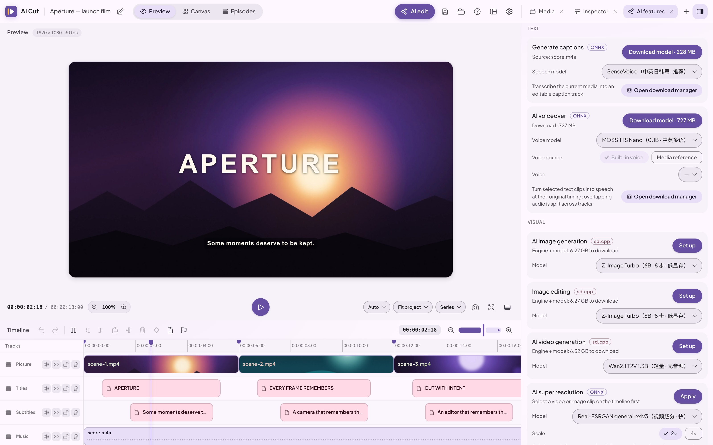

<p align="center">
  
</p>

<p align="center">
  <a href="https://github.com/heshengtao/ai-cut/releases"></a>
  <a href="LICENSE"></a>
  
  <a href="https://hub.docker.com/r/ailm32442/ai-cut"></a>
</p>

<p align="center">
  <a href="README_zh.md">简体中文</a> ·
  <a href="README_zh-TW.md">繁體中文</a> ·
  <a href="README.md">English</a> ·
  <a href="README_ja.md">日本語</a> ·
  <a href="README_ko.md"><b>한국어</b></a> ·
  <a href="README_es.md">Español</a> ·
  <a href="README_fr.md">Français</a> ·
  <a href="README_de.md">Deutsch</a> ·
  <a href="README_ru.md">Русский</a> ·
  <a href="README_ar.md">العربية</a>
</p>

<p align="center">
  <a href="https://hub.docker.com/r/ailm32442/ai-cut"><b>Docker Hub</b></a> ·
  <a href="https://github.com/heshengtao/ai-cut/releases">Download</a>
</p>

## AI Cut이란?

**AI Cut은 데스크톱을 위한 작고 AI 네이티브한 영상 편집기**입니다 — 자르기, 자막, 보이스, 믹싱, 내보내기를 하나의 가벼운 앱에서 끝내고, AI 에이전트가 같은 타임라인에서 함께 작업하도록 둘 수 있습니다.

이것은 진짜 편집기입니다: 멀티트랙 타임라인, **노드 기반 워크플로를 위한 무한 캔버스**, **분기형 에피소드 그래프**, 미디어 라이브러리, 인스펙터, 텍스트 클립, 자막, 보이스오버, 오디오·비디오 AI 도구, **OpenFX(OFX) 이펙트 플러그인**, 그리고 MP4 / ProRes / GIF 내보내기까지. 타임라인과 캔버스, 에피소드 그래프는 같은 프로젝트를 보는 세 가지 뷰입니다. 또한 **모델이 조작하도록** 만들어졌습니다 — 함께 제공되는 Skill이 어떤 AI 하네스든 MCP를 통해 실행 중인 앱을 다루도록 가르쳐 주므로, 에이전트가 미디어를 가져오고, 트랙을 추가하고, 클립을 배치하고 트리밍하며, 텍스트를 다시 쓰고, 캔버스를 만들거나 분기 연결을 바꾸고, 프로젝트를 다시 읽어 오는 동안 UI가 실시간으로 갱신되는 것을 볼 수 있습니다.

모든 것이 여러분의 컴퓨터에서 실행됩니다. 계정도, 업로드도 필요 없고, 편집기 자체에는 API 키가 필요하지 않습니다.

<p align="center">
  
</p>

## 왜 중요한가

모델이 코드를 잘 쓰게 된 것은 코딩 에이전트 프레임워크를 통해 코드를 **실행**할 수 있었기 때문이고, 3D 모델링을 잘하게 된 것은 Blender MCP로 실제 모델링 소프트웨어를 다룰 수 있었기 때문입니다. 두 경우 모두 모델에게 진짜 도구와 진짜 결과, 진짜 피드백 루프가 주어졌고, 그것이 빠른 반복을 가능하게 했습니다.

영상에는 그 루프가 거의 없었습니다. 모델이 클립을 생성할 수는 있어도, 편집자처럼 *타임라인 위에서 작업*할 수는 없습니다. 편집할 구성도, 균형을 맞출 트랙도, 되돌릴 히스토리도, 방금 한 컷이 결과를 더 나쁘게 만들었다는 것을 알아챌 방법도 없습니다.

**AI Cut은 그 간극을 좁히려는 작고 의도적인 시도입니다.** AI 에이전트가 Skill과 MCP를 통해 조작할 수 있는 진짜 편집기이며, 그래서 다음과 같은 일에 유용합니다:

- **모델이 편집에 대해 실제로 무엇을 아는지 시험하기** — 푸티지를 생성할 수 있는지가 아니라, 시퀀스를 구성하고, 숏을 고르고, 템포를 고칠 수 있는지.
- **실제 편집 트레이스 수집하기** — 에이전트의 모든 편집이 평범한 프로젝트와 평범한 undo 히스토리에 남으므로, 한 세션이 곧 모델이 영상을 어떻게 추론하는지에 대한 데이터가 됩니다.
- **코드를 쓰듯 영상을 편집하는 모델로 가는 한 걸음** — 응답하는 타임라인과 함께.

## 설계부터 가볍게

작다는 것은 타협이 아니라 기능입니다.

- **가벼운 풋프린트** — Electron도, 클라우드도, 함께 묶여 오는 모델 사육장도 없습니다. 앱은 Tauri 빌드이고 ffmpeg / ffprobe는 정적 사이드카로 함께 배포되므로 사용자가 ffmpeg를 설치할 필요가 없습니다.
- **빠른 시작** — 부팅 시 무거운 것은 아무것도 로드되지 않으며, AI 모델은 사용할 때만 불러옵니다.
- **무거운 AI는 제자리에** — 생성은 의도적으로 외부에 둡니다. 여러분의 AI 하네스가 푸티지를 생성하거나 구해 오면, AI Cut이 그 파일을 편집·자막·믹싱·내보내기로 넘겨받습니다.
- **확장을 전제로 설계** — 모든 편집은 직렬화 가능한 커맨드이므로 새 편집 동작에 새 CLI나 MCP 도구가 필요하지 않습니다. 캔버스도 같은 커맨드 모델 위에서 돌고, 앱 확장은 자체 노드·데이터 타입·패널·커맨드를 추가할 수 있습니다.
- **OFX 플러그인 관리자** — 다운로드 관리자가 설치된 / 외부 / 사용 가능한 OpenFX 플러그인을 다루며 검색, 가져오기, 업데이트, 삭제를 지원합니다. OFX 플러그인 패널은 설치된 플러그인의 인터페이스를 엽니다. 무료/오픈소스 항목은 [AI Cut OFX Registry](https://github.com/heshengtao/ai-cut-ofx-registry)에서 오고 SHA-256으로 검증합니다. GPL/AGPL 항목은 저자의 업스트림 릴리스에서 내려받을 수 있지만, 앱이 그 바이너리를 호스팅하거나 번들하지는 않습니다. 네이티브 호스트(`crates/ofx-host`, CLI `ofx-host probe|render`)는 OFX 1.5.1 번들을 입력 크기로 로드하고 여섯 가지 이미지 이펙트 컨텍스트를 모두 지원합니다: filter / general / generator / paint / retimer는 클립의 `effects[]` 체인에 붙고, transition은 클립 가장자리에 붙어 풀프레임 오버레이로 베이크됩니다. 파라미터는 전용 Parameters 패널에 있습니다. 이펙트를 마운트하면 백그라운드 프리베이크가 (진행률과 함께) 시작되어 재생 중에도 비디오·이미지 프리뷰가 이펙트를 유지합니다. 내보낼 때는 최종 크기로 베이크합니다(paint는 파라미터 기반이고, retimer는 플러그인에 `SourceTime`을 요청합니다).

## 어떤 AI 하네스에서든 조작하기

AI Cut은 실행 중인 앱을 AI 에이전트가 어떻게 다루는지 가르치는 **Skill**(`skills/aicut`)을 함께 제공합니다 — 프로젝트 읽고 쓰기, 미디어 가져오기, 트랙과 클립 추가, 이동 / 트리밍 / 분할, 텍스트와 클립 속성 변경, undo와 redo, 그리고 필요할 때 불러오는 제작·스토리보드·프레임워크·리뷰·에셋 레퍼런스까지. 내장 **MCP** 서버 위에서 동작하므로 Agent Skills를 지원하는 어떤 하네스든 그대로 사용할 수 있습니다.

**옵션 1 · 커맨드 라인에서 설치**

```bash
npx skills add heshengtao/ai-cut
```

**옵션 2 · 에이전트에게 설치 요청하기**

```
Install this Skill: https://github.com/heshengtao/ai-cut
```

앱에는 설정에서 `PATH`에 설치할 수 있는 얇은 MCP 클라이언트 `aicut`도 함께 제공됩니다. 커맨드 표면이 곧 도구 표면입니다:

```bash
aicut status
aicut tools
aicut call get_project
```

에이전트가 하는 모든 편집은 UI와 같은 커맨드 파이프라인을 지납니다. undo 히스토리에 남고, 인터페이스에 표시되며, 에이전트의 것으로 귀속되므로 무엇을 했는지 언제든 확인하고 되돌릴 수 있습니다.

## 기능

### 타임라인 편집 — 실제 타임라인 위에서 구성

영상을 들리는 방식대로 배치하세요. 클립을 트랙 사이로 끌어다 놓고, 이야기가 바뀌는 지점에서 나누고, 가장자리를 트리밍하고, 스내핑과 프레임 그리드가 모든 것을 정렬해 두게 하세요. 비디오·오디오·이미지·텍스트 클립이 같은 타임라인을 공유하고, 모든 편집은 하나의 undo 히스토리에 남는 하나의 커맨드입니다.

- **멀티트랙 배치** — 비디오·오디오·이미지·텍스트 클립을 나란히; 트랙 간 드래그 앤 드롭; 마퀴 선택
- **진짜 편집 도구 세트** — 이동, 분할, 트리밍, 스내핑, 프레임 그리드
- **제스처를 존중하는 undo** — 드래그와 슬라이더는 한 단계로 합쳐지므로, undo는 제스처 이전으로 돌아갑니다
- **안전한 세션** — 자동 저장, 크래시 임시 복구, 프로젝트 히스토리
- **타임라인 위의 텍스트** — 스타일을 편집할 수 있는 타이틀·자막 클립

<p align="center">
  
</p>

### 미디어 & 인스펙터 — 소스를 읽고 숏을 다듬기

파일을 가져오면 AI Cut이 즉시 프로브합니다: 길이, 해상도, 프레임 레이트, 오디오. 미디어 라이브러리는 썸네일과 파형을 보여 주고, 인스펙터는 선택한 클립 뒤의 파라미터를 보여 주므로 프레이밍, 레이어링, 사운드를 별도 대화상자 대신 그 자리에서 편집합니다.

- **끌어다 놓기 가져오기** — ffprobe 메타데이터, 썸네일, 파형, 캐시된 프리뷰
- **변형** — 위치, 크기, 회전, 불투명도, 블렌드 모드, 모서리 반경
- **클립별 오디오** — 게인, 페이드, 피치, 스테레오 밸런스, 음소거
- **텍스트 스타일링** — 폰트, 크기, 색상, 자간, 배경, 스트로크, 그림자, 글로우
- **프로젝트 출력** — 해상도와 프레임 레이트를 바꾸면 클립이 비율에 맞게 다시 맞춰집니다
- **전달 도우미** — 미디어를 프로젝트 옆 `<project>-media/`로 모아 줍니다

<p align="center">
  
</p>

### 캔버스 & 워크플로 — 자르기 전에 먼저 만들기

캔버스 뷰는 영상에서 끌어다 놓기보다 그려 두는 편이 쉬운 부분을 위한 무한 노드 캔버스입니다. 포스터나 레퍼런스 클립, 한 줄의 카피를 캔버스에 놓고, 모델이나 디스플레이 노드에 연결하고, 체인을 실행한 뒤 결과를 현재 에피소드로 보내세요.

- **하나의 프로젝트, 여러 캔버스** — 모든 프로젝트는 이름 붙은 캔버스를 여러 개 담을 수 있고, 편집은 건드리지 않은 채 열고, 이름을 바꾸고, 복제하거나 비울 수 있습니다.
- **모든 단계에 노드 하나** — 이미지 / 비디오 / 오디오 / 텍스트 / 값 입력, 디스플레이와 값 리드아웃, 로컬·클라우드 모델 노드, 워크플로 경계, 루프, 그룹.
- **입력 하나, 출력 하나** — 각 카드는 선 하나가 들어오고 하나가 나가며, 그 선이 어떤 논리 값을 나르는지는 인스펙터에서 고릅니다. 그래서 그래프를 다시 배선하지 않고도 구조를 바꿀 수 있습니다.
- **백그라운드 실행** — 수동·변경 시·반복 실행에 실시간 상태, 진행률, 소요 시간; 출력은 미디어 라이브러리에 쌓이고 클릭 한 번으로 현재 에피소드에 삽입됩니다.
- **재사용 가능한 워크플로** — start/end 시그니처를 선언하고 워크플로 라이브러리에 저장하거나 API로 게시하고, 다른 캔버스에서 호출할 수 있습니다(최대 8단계 중첩).
- **플러그인에 열려 있음** — 앱 확장이 노드 타입, 데이터 타입, 패널, 컨트롤, 커맨드를 등록하고, 같은 그래프를 board MCP 도구로 헤드리스에서도 다룰 수 있습니다.

전체 설계 노트: [`docs/canvas-workflow.md`](docs/canvas-workflow.md) · 플러그인 가이드: [`docs/plugins.md`](docs/plugins.md).

<p align="center">
  
</p>

### 에피소드 & 분기 — 하나의 프로젝트, 여러 개의 컷

프로젝트는 하나의 컷이 아닙니다. 같은 미디어 라이브러리와 캔버스를 공유하는 여러 에피소드를 담고, 어느 에피소드가 다음에 재생될지는 시리즈 그래프가 정합니다. 분기 에피소드의 끝에서 프리뷰는 마지막 프레임에 멈춰 나가는 엣지를 버튼으로 바꾸므로, 선택도 그저 또 하나의 편집입니다.

- **에피소드는 나머지를 공유** — 미디어, 캔버스, 설정은 프로젝트 전역이고, 각 에피소드는 자기 트랙과 마커를 가집니다.
- **이야기를 보는 두 가지 방법** — 스토리보드 격자를 위한 타일 뷰, 에피소드마다 카드 하나가 놓이는 자유 캔버스를 위한 플로우 뷰.
- **진짜 분기, 진짜 라벨** — 한 에피소드를 둘에 연결하고 각 엣지에 이름을 붙이면, 그 이름이 화면의 선택 버튼이 됩니다.
- **단일 에피소드 또는 시리즈** — 한 에피소드를 재생하고 멈추거나, 끝날 때까지 모든 분기를 따라 그래프를 진행합니다.
- **빠른 에피소드 관리** — 이름 변경, 복제, 삭제, 다중 선택, 복사 / 붙여넣기, 드래그로 순서 변경; 핸들을 빈 공간으로 끌면 이미 연결된 다음 에피소드가 만들어집니다.
- **타임라인은 그대로 타임라인** — 분기는 다음에 무엇이 재생되는지를 바꿀 뿐, 에피소드를 편집·되돌리기·내보내는 방식을 바꾸지 않습니다.

<p align="center">
  
</p>

### OFX 플러그인 — 쓰던 이펙트 그대로

AI Cut은 **OpenFX(OFX) 1.5.1** 플러그인을 호스트하므로, 이미 가진 피니싱 도구를 그대로 가져올 수 있습니다: 색 보정, 블러, 글로우, 키어, 워프, 트랜지션. 플러그인 관리자가 SHA-256 검증과 함께 [AI Cut OFX Registry](https://github.com/heshengtao/ai-cut-ofx-registry)를 둘러보고, 디스크 다른 곳에 설치된 플러그인도 함께 찾아냅니다.

- **여섯 가지 OFX 컨텍스트 전부** — filter, general, generator, paint, retimer는 클립의 이펙트 체인에 붙고, transition은 클립 가장자리에 붙습니다
- **자체 UI 또는 파라미터** — 플러그인 자체 인터페이스를 열거나, 전용 Parameters 패널에서 파라미터를 조작합니다
- **프리뷰는 계속 살아 있음** — 이펙트를 마운트하면 백그라운드 프리베이크가 시작되어 재생 중에도 비디오·이미지 프리뷰가 룩을 유지합니다
- **내보낼 때 베이크** — 렌더가 최종 크기로 모든 이펙트를 적용합니다(paint는 파라미터 기반이고, retimer는 플러그인에 `SourceTime`을 요청합니다)
- **레지스트리 + 로컬 가져오기** — 검색, 원클릭 설치 / 업데이트 / 삭제, 또는 로컬 번들 지정

<p align="center">
  
</p>

### AI & 자동화 — 푸티지를 계속 편집할 수 있는 소재로

AI 기능은 데모가 아니라 실제 작업 세션을 위해 만들어졌습니다. 클립을 지정하면 계속 편집할 수 있는 결과를 돌려줍니다: 고칠 수 있는 자막 트랙, 원래 타이밍에 맞춘 보이스오버, 더 깨끗한 보컬 테이크, 다시 밸런스를 잡을 수 있는 분리 스템. 로컬 도구는 여러분의 하드웨어에서 실행됩니다.

- **자막** — 로컬 음성 인식으로 편집 가능한 자막 트랙 생성
- **보이스오버** — 로컬 TTS와 OpenAI, ElevenLabs, Azure, Google, Baidu, MiniMax, Volcengine, 커스텀 HTTP
- **스마트 컷** — 단어 단위 타임스탬프로 군더더기 말과 긴 침묵을 찾아 한 번에 잘라 냅니다; 필터 단어, 침묵 임계값, 컷 지점 패딩은 하나의 설정 대화상자에 모여 있고, 컷은 주변 침묵으로 조금씩 확장되어 반쯤 남은 소리가 생기지 않습니다; 트랜스크립트는 삭제된 단어마다 취소선을 긋고 클릭 한 번으로 복원되며, 타임라인에 컷마다 표시가 남습니다
- **오디오 AI** — 라우드니스 매칭, 노이즈 제거, 보컬 다듬기, 소스 분리, 오디오 번역
- **비디오 AI** — 초해상도, 프레임 보간, 스마트 리프레이밍, 카메라 트래킹
- **미디어 프로브** — 한 번의 호출로 메타데이터, 모션/컷 샘플, 얼굴/사람 박스, 로컬 트랜스크립트를 반환
- **리뷰 루프** — `film.json` 가져오기, 구조화된 리뷰 노트(`severity`, `sceneId`, `resolved`), 문제 구간 감지, 콘텐츠 해시 캐시를 사용한 구간 재렌더링, 테이크 비교(SSIM + 나란히 보기 프레임), 콘택트 시트
- **설계부터 오프라인** — 편집기와 로컬 모델은 계정도 업로드도 필요로 하지 않습니다

<p align="center">
  
</p>

### MCP 서버 & 클립 에이전트 — AI 에이전트가 세션에서 일하게 하기

스위치 하나만 켜면 프로젝트가 AI 어시스턴트가 다룰 수 있는 대상이 됩니다. 내장 **MCP(Model Context Protocol)** 서버가 `127.0.0.1`에 바인딩된 HTTP로 세션을 노출하므로, 에이전트를 연결해 작업을 맡기면 UI가 실시간으로 갱신되는 가운데 트랙을 추가하고, 클립을 배치하고, 텍스트를 다시 쓰는 것을 지켜볼 수 있습니다. 같은 도구 정의가 내장 **클립 에이전트**도 구동합니다 — 스트리밍, 도구 호출, 분기형 세션 트리를 갖춘 OpenAI 호환 채팅 패널입니다.

- **HTTP 기반 MCP** — 루프백 전용 엔드포인트, JSON 및 SSE 전송
- **프로젝트 수명 주기** — `new_project` / `open_project` / `save_project`가 저장/열기 대화상자 없이 프로젝트 JSON을 직접 읽고 씁니다
- **실시간 편집** — 에이전트 동작이 평범한 프로젝트 변경으로 즉시 나타납니다
- **`aicut` CLI** — 얇은 클라이언트라 새 도구에 CLI 변경이 필요하지 않습니다
- **`aicut start`** — 설치된 앱을 자동으로 찾아 런처의 잡에서 분리합니다(Windows 포함)
- **클립 에이전트** — OpenAI 호환 엔드포인트, 스트리밍 응답, 도구 카드, 세션 분기
- **캔버스 도구** — 같은 엔드포인트로 캔버스를 만들고 board 연산을 적용하며, 게시된 워크플로를 조회·실행합니다
- **Skills** — 에이전트가 필요할 때 불러오는 편집·제작 문서

<p align="center">
  
</p>

### 내보내기 & 업데이트 — 마무리하고 배포하기

컷이 맞으면 렌더하세요. 전달 형식을 고르면 AI Cut이 작업을 계속하는 동안 백그라운드에서 바로 납품 가능한 파일을 씁니다. 설치된 앱은 서명된 업데이트를 GitHub Releases에서 확인하므로 새 버전까지 클릭 한 번입니다.

- **형식** — MP4 / H.264, ProRes 422, GIF
- **출력 제어** — 프리셋 또는 사용자 지정 너비/높이, contain/cover 맞춤, 프레임 레이트, 품질; GIF 팔레트, 디더링, 루프
- **백그라운드 내보내기** — 실시간 진행률과 취소
- **서명된 자동 업데이트** — 시작 시 확인, 수동 확인, 다운로드, 설치, 재시작
- **검증된 번들** — 업데이터 공개 키가 내장되어 있고, 개인 키는 릴리스 환경에만 있습니다

<p align="center">
  
</p>

## 설치

빌드된 바이너리는 [GitHub Releases](https://github.com/heshengtao/ai-cut/releases) 페이지에 게시됩니다.

### 요구 사항

- Rust(stable)와 Cargo
- Node.js ≥ 20 및 [pnpm](https://pnpm.io/) (pnpm 11 권장)
- Tauri v2 시스템 사전 요구 사항 — <https://tauri.app/start/prerequisites/> 참고

### 소스에서 빌드

```bash
git clone https://github.com/heshengtao/ai-cut.git
cd ai-cut

pnpm install
pnpm tauri dev        # run the app in development
pnpm tauri build      # produce a release build
```

그 밖에 유용한 커맨드:

```bash
pnpm build            # type-check the frontend and build it
pnpm test             # unit tests (Vitest)
pnpm fetch:sidecars   # prepare the ffmpeg / ffprobe sidecars
pnpm build:aicut      # build the aicut CLI
```

ffmpeg와 ffprobe는 정적 바이너리로 함께 배포되므로 사용자가 ffmpeg를 설치할 필요가 없습니다. 모델 파일은 `src-tauri/resources/models/`에 있고, 더 큰 모델은 필요할 때 내려받습니다.

### 데이터 폴더

모델, ONNX Runtime, OFX 플러그인, 프로젝트 히스토리, 설정은 기본적으로 사용자 데이터 폴더(Windows에서는 `%APPDATA%\com.aicut.editor`)에 저장되고, 몇 기가바이트까지 늘어날 수 있습니다. 시스템 드라이브에서 떼어 두는 방법은 두 가지입니다:

- **설치할 때 지정하기**: Windows NSIS 설치 프로그램이 **첫 설치** 시 데이터 폴더를 묻습니다(자동 설치와 자동 업데이트는 절대 묻지 않습니다). 선택은 `HKCU\Software\AI Cut\DataDir`에 저장됩니다.
- **나중에 옮기기**: **설정 → 저장소 → 폴더 선택 및 마이그레이션**. 앱이 현재 데이터를 새 폴더로 복사하고 포인터 파일을 씁니다. 적용은 **재시작 후**입니다. 이전 폴더는 같은 페이지에서 정리하기 전까지 유지되며, 마이그레이션은 아무것도 삭제하지 않습니다.

해석 순서: `--data-dir <path>` > `AICUT_DATA_DIR` > 설정 포인터(`data-dir.json`) > 설치 프로그램 레지스트리 > 시스템 기본값. 앞의 둘은 "포터블 모드"이며, 설정 페이지는 이 경우 마이그레이션을 비활성화합니다.

일부 파일은 의도적으로 제자리에 남습니다: `cli-path` / `app-path` / `mcp-url`은 `aicut` CLI와 외부 AI 하네스가 번들 id로 찾는 탐색 파일입니다([`skills/aicut/SKILL.md`](skills/aicut/SKILL.md) 참고). 수십 바이트에 불과하며 기본 폴더에 남습니다.

### 플랫폼 지원

| 플랫폼 | 상태 |
| --- | --- |
| Windows (x86_64) |  지원됨 |
| macOS (Apple Silicon) |  지원됨(아래 "앱이 손상되었습니다" 안내 참고) |
| Linux (x86_64 / arm64) |  지원됨 |

> **macOS에서 "앱이 손상되었습니다"라고 나오나요?** 앱은 ad-hoc 서명만 되어 있고(공증 없음) macOS가 다운로드를 격리합니다. 터미널에서 다음을 실행한 뒤 앱을 정상적으로 여세요:
>
> ```bash
> xattr -cr "/Applications/AI Cut.app"
> ```

> **Intel Mac은 현재 릴리스 파이프라인에서 지원하지 않습니다.** 릴리스 빌드는 Apple Silicon(`aarch64-apple-darwin`)용으로만 만들어집니다.

## 브라우저 접속 & 헤드리스

데스크톱 앱에는 루프백에 바인딩된 HTTP 서버가 내장되어 있습니다: **설정 → 일반 → 웹 액세스**에서 주소를 열면 같은 편집기가 나옵니다. **로그인도 토큰도 없습니다**: 주소를 열고 바로 작업하세요. 접근 제어는 배포 환경의 몫입니다
(랜, 컨테이너 네트워크, 또는 리버스 프록시).

데스크톱 앱과 라이브 세션을 공유합니다: 양쪽 모두 읽기·쓰기가 가능하고, 편집은 같은 프로젝트로 병합됩니다. "LAN 액세스"를 켜고 재시작하면 같은 네트워크의 태블릿이나 두 번째 기기에서 열 수 있습니다.

### Docker

```bash
docker build -t ai-cut .
docker run -d --name ai-cut -p 28440:28440 -p 50563:50563 -v aicut-data:/data ai-cut
```

이미지는 Debian slim 기반(멀티 스테이지, 약 434 MB)이며 데스크톱 앱과 같은 정적 ffmpeg/ffprobe, 그리고 함께 묶인 5개 모델과 ONNX Runtime을 담고 있습니다(빌드 시 ELF 헤더로 아키텍처를 확인하고 `libonnxruntime.so` 별칭을 만듭니다); <http://localhost:28440>을 여세요.

컨테이너 안에서 MCP는 `0.0.0.0`에 바인딩되므로(`--lan`과 같은 의미), `50563`을 게시하면 호스트의 MCP 클라이언트(Claude Desktop / IDE)가 `http://<host>:50563/mcp`에 접속해 데스크톱 앱과 동일한 62개 도구를 사용합니다.

**컨테이너는 데스크톱 앱과 동일합니다** — 물리 법칙이 다른 경우는 예외입니다:

| 기능 | 데스크톱 | 컨테이너 / 브라우저 |
| --- | --- | --- |
| 편집 / 자막 / 내보내기 / 폰트 | ✅ | ✅ 동일한 데몬 구현 |
| 로컬 추론: ASR, TTS, 노이즈 제거, 스템 분리, 업스케일, 보간, 변성 | ✅ | ✅ 동일한 데몬 구현(CPU, 더 느림) |
| 모델 & 런타임 관리, 클라우드 이미지/TTS, 라우드니스, 비디오 처리 | ✅ | ✅ |
| 에이전트 / MCP | ✅ 62개 도구 | ✅ 동일한 62개 도구(편집 매크로, 클립 단위 AI, 내보내기 & 렌더, 프로젝트 수명 주기, undo/redo, 리뷰 노트, film 매니페스트, 백그라운드 잡) |
| OFX 이펙트 | ✅ 클립 전체 베이크 포함 | ✅ 프레임 / 이미지 / 트랜지션 프리뷰 **및** 클립 전체 + 트랜지션 베이크(단일 프로세스 순차 베이크) |
| 플러그인 설치 / 가져오기 / 삭제 | ✅ | ✅ (`reveal in file manager`는 데스크톱 필요) |
| 네이티브 플러그인 GUI, 시스템 대화상자 / 브라우저 실행 | ✅ | ⛔ 윈도우 시스템 / 데스크톱 세션 없음 |
| 로컬 이미지 / 영상 생성(sd.cpp) | ✅ | ✅ 동일한 데몬 구현: 엔진과 가중치를 필요할 때 내려받음; 컨테이너는 CPU / Vulkan / ROCm 사용(업스트림에 Linux CUDA 빌드가 없음) |

**플러그인 바이너리는 이미지 아키텍처와 일치해야 합니다.** 이미지는 빌드 머신의
아키텍처(Apple Silicon에서는 arm64)로 만들어지고, OFX 플러그인은 네이티브
바이너리입니다: x86_64 빌드만 제공하는 플러그인(예: Flame LTX AlphaGen)은
arm64 컨테이너에서 로드할 수 없습니다. 이제 편집기는 알 수 없는 `cannot open shared object file`
대신 "플러그인 바이너리 아키텍처가 맞지 않습니다"라고 알려 줍니다. 그런 플러그인은
amd64 이미지에서 실행하세요:

```bash
docker build --platform linux/amd64 -t ai-cut .
docker run -d --platform linux/amd64 -p 28440:28440 -v aicut-data:/data ai-cut
```

(Apple Silicon에서는 Rosetta 에뮬레이션을 거치므로 더 느리고, x86_64
Linux 호스트에서는 달라지는 것이 없습니다.)

모델은 처음 사용할 때 설정 → 모델을 통해 설정된 프록시로 내려받습니다; 함께 묶인 5개 모델은 별도 설정 없이 바로 동작합니다.

### 헤드리스 바이너리

```bash
cargo run --manifest-path crates/daemon/Cargo.toml --bin aicutd -- \
  --data-dir ./data --port 28440 --lan --dist dist
```

### 환경 변수

| 변수 | 기본값 | 용도 |
| --- | --- | --- |
| `AICUT_DATA_DIR` | `./data` | 프로젝트, 가져온 미디어, 내보내기 |
| `AICUT_NO_AUDIO` | unset | 오디오 장치를 열지 않음 |

### HTTP API

| 메서드 | 경로 | 용도 |
| --- | --- | --- |
| `POST` | `/rpc/{command}` | 편집 커맨드, 앱 IPC와 동일한 이름 |
| `GET` | `/events` | Server-Sent Events: 문서 + 잡 진행률 |
| `GET` | `/session` | WebSocket: 라이브 세션 동기화 |
| `GET` | `/file` · `POST /upload` | 미디어 읽기 / 가져오기 |
| `GET` | `/health` | 생존 확인 |

## 아키텍처

```
src-tauri/          Tauri shell: windows, native dialogs, auto-updater
crates/daemon/      backend: document model, media, render engine, HTTP
crates/aicut/       the CLI
src/                Vue 3 frontend — identical for desktop and browser
```

`src/platform/`가 전송 계층(`Tauri IPC` ↔ `HTTP + WebSocket`)을 하나의 API 뒤에서 바꿔 주므로,
모든 화면이 두 셸에서 모두 동작합니다; 브라우저 빌드는 같은 앱이 네트워크로 같은
백엔드와 이야기하는 것입니다.

헤드리스 모드에서는 프로젝트, 가져온 미디어, 내보낸 결과가 데이터 디렉터리에 있고, ffmpeg는
이미지에서 옵니다.

로컬 AI(ASR / TTS / 노이즈 제거 / 분리 / 업스케일 / 변성), 모델·런타임 관리, 플러그인/OFX,
편집 에이전트는 **아직 헤드리스 백엔드에 연결되지 않았습니다** — 이는 제품 경계가 아니라
마이그레이션 부채입니다. `GET /rpc/capabilities`가 기능별로 사용 가능한지, 컴포넌트가 빠졌는지,
아직 이식되지 않았는지를 선언하고, UI는 `isTauri()`로 추측하는 대신 그에 따라
게이트합니다.

## FAQ

### AI Cut은 무료인가요?

네. AI Cut은 Apache 2.0으로 오픈소스입니다. 유료 티어도, 기능 제한도 없습니다.

### 오프라인에서 동작하나요?

네. 편집, 내보내기, 로컬 AI 모델이 여러분의 컴퓨터에서 실행됩니다. 네트워크 접속은 모델 다운로드를 시작하거나, 업데이트를 확인하거나, OpenAI 호환 에이전트 엔드포인트나 클라우드 TTS 같은 클라우드 서비스를 설정할 때만 일어납니다.

### GPU가 필요한가요?

아니요. 함께 제공되는 AI 모델은 CPU에서 실행되며 CUDA나 드라이버 설정이 필요 없습니다. 큰 모델은 느린 기기에서 더 오래 걸리지만 GPU가 필요한 것은 아닙니다. NVIDIA GPU가 있다면 설정 → AI → 실행 백엔드에서 CUDA 12 또는 CUDA 13을 고를 수 있고, 어느 쪽이든 완전히 맞춰진 ONNX Runtime + CUDA 세트를 다운로드 관리자가 필요할 때 내려받으므로 시스템에 CUDA를 설치할 필요가 없습니다(재시작 시 적용).

### 어떤 AI 모델이 함께 제공되나요?

작은 모델은 번들에 들어 있어 기본 기능이 즉시 동작합니다. 음성 인식, TTS, 소스 분리, 초해상도, 프레임 보간 같은 큰 모델은 앱 내 모델 관리자에서 필요할 때 내려받으며 소스 트리 밖에 저장됩니다. 커뮤니티 라이선스 비디오 모델과 비상업용 FLUX.1 [dev] 가중치를 포함한 라이선스는 [MODELS.md](MODELS.md)에 정리되어 있습니다.

### 어떤 이펙트 플러그인 형식을 지원하나요?

**OpenFX(OFX) 1.5.1** — 여섯 가지 이미지 이펙트 컨텍스트(filter, general, generator, paint, retimer, transition) 전부. 플러그인은 내장 레지스트리에서 오거나 여러분의 디스크에서 올 수 있습니다. 오디오 이펙트 형식(VST3 / AU / CLAP)은 호스트하지 않습니다: AI Cut 자체 오디오 도구가 게인, 페이드, 피치, 믹싱을 담당합니다.

### 에이전트가 조작하려면 앱이 실행 중이어야 하나요?

네. Skill과 `aicut` CLI는 MCP로 실행 중인 AI Cut과 통신하므로 앱을 먼저 실행하세요(`aicut status`로 실행 여부를 확인할 수 있습니다).

### 분기형 영상을 만들 수 있나요?

네. 하나의 프로젝트에 여러 에피소드를 담을 수 있고, 에피소드 뷰에서 라벨이 붙은 엣지로 연결하면 프리뷰의 "Series" 모드가 그 엣지를 따라갑니다. 에피소드 끝에서 나가는 라벨들이 선택 버튼으로 나타나 화면에서 다음 에피소드를 고릅니다.

### 캔버스를 쓰려면 모델이 필요한가요?

아니요. 입력, 디스플레이, 값, 루프, 워크플로 노드는 모델 없이도 동작합니다. 모델 노드는 로컬 모델이나 설정된 클라우드 프로바이더가 필요하지만, 준비되기 전에도 그래프의 나머지는 편집하고 저장할 수 있습니다.

### 에이전트가 최종 영상을 내보낼 수 있나요?

네. `export_video`가 MCP로 타임라인을 렌더링합니다 — MP4, ProRes, GIF. `outputPath`는 선택 사항이라 생략하면 AI Cut이 프로젝트 파일 옆(저장하지 않은 프로젝트라면 다운로드 폴더)에 쓰고 최종 경로를 반환합니다. 자막, 보이스오버, 오디오/비디오 AI, 내보내기가 모두 도구로 제공되므로 에이전트가 타임라인을 준비하고 렌더링한 뒤 파일을 검토용으로 넘길 수 있습니다.

## 지원

### Star를 눌러 주세요!
⭐ 여러분의 응원이 저희가 앞으로 나아가는 원동력입니다!

### 후원을 환영합니다!
<div align="center" style="display: flex; gap: 20px; justify-content: center; flex-wrap: wrap;">

[](https://ko-fi.com/agentparty)
[](https://afdian.com/a/agentparty)

</div>

### 팔로우
<div align="center">
  <a href="https://space.bilibili.com/26978344">
    
  </a>
  <a href="https://www.youtube.com/@agentParty">
    
  </a>
</div>

### 커뮤니티 참여
프로젝트를 쓰면서 궁금한 점이나 문제가 있다면 커뮤니티에 오셔서 함께 이야기해 주세요.

1. QQ 그룹: `931057213` (정원 마감) / `902882342` (2그룹)

2. Discord: [Discord 링크](https://discord.gg/f2dsAKKr2V)

## 기여자

<a href="https://github.com/heshengtao/ai-cut/graphs/contributors">
  
</a>

## 라이선스

애플리케이션 **코드**는 Apache-2.0입니다 — [LICENSE](LICENSE)를 참고하세요.

모델 **가중치**는 별개의 계층입니다: 저장소와 설치 프로그램에는 앱과 함께 배포되는
다섯 개의 작은 허용적 라이선스 모델만 들어 있고, 나머지는 모두 배포처에서
필요할 때 내려받아 고정된 `sha256`으로 검증합니다. 각 모델은 자체 라이선스를 유지합니다 —
커뮤니티 라이선스(LTX-2, Hunyuan, MiniMax-H3), CreativeML Open RAIL 모델,
비상업용 FLUX.1 [dev] 가중치를 포함한 전체 표는 **[MODELS.md](MODELS.md)**를 참고하세요.

## 서드파티 라이선스

이 프로젝트는 서드파티 오픈소스 소프트웨어 위에 서 있습니다. 의존성 라이선스는
`package.json`, `src-tauri/Cargo.toml`, 그리고 `crates/` 아래의 매니페스트에 선언되어 있습니다.
함께 배포되는 FFmpeg 바이너리는 각자의 업스트림 라이선스를 유지합니다. 모델 가중치는
번들 및 온디맨드 모두 라이선스·출처·제한과 함께 [MODELS.md](MODELS.md)에 정리되어 있고,
번들 모델의 원문 텍스트는 `src-tauri/resources/models/LICENSES/`에 있습니다.
