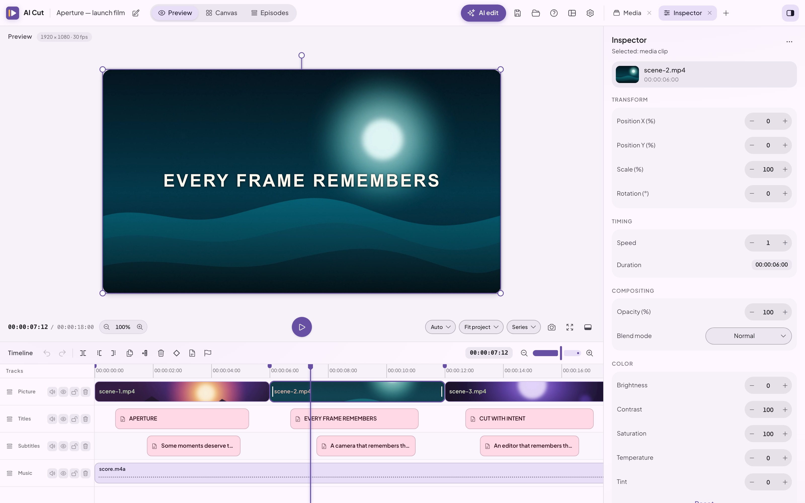
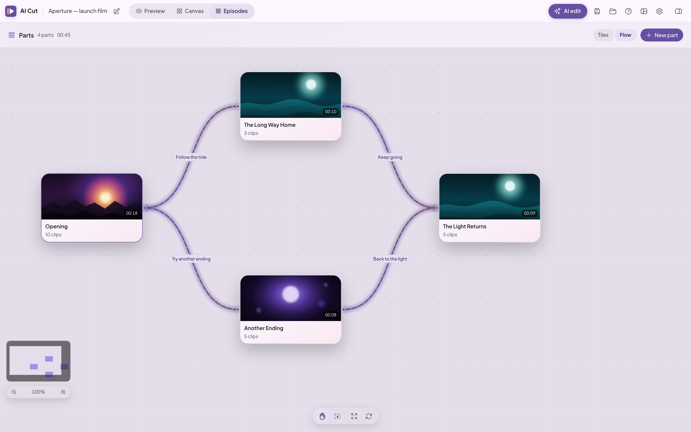

<p align="center">
  
</p>

<p align="center">
  <a href="https://github.com/heshengtao/ai-cut/releases"></a>
  <a href="LICENSE"></a>
  
  <a href="https://hub.docker.com/r/ailm32442/ai-cut"></a>
</p>

<p align="center">
  <a href="README_zh.md">简体中文</a> ·
  <a href="README_zh-TW.md"><b>繁體中文</b></a> ·
  <a href="README.md">English</a> ·
  <a href="README_ja.md">日本語</a> ·
  <a href="README_ko.md">한국어</a> ·
  <a href="README_es.md">Español</a> ·
  <a href="README_fr.md">Français</a> ·
  <a href="README_de.md">Deutsch</a> ·
  <a href="README_ru.md">Русский</a> ·
  <a href="README_ar.md">العربية</a>
</p>

<p align="center">
  <a href="https://hub.docker.com/r/ailm32442/ai-cut"><b>Docker Hub</b></a> ·
  <a href="https://github.com/heshengtao/ai-cut/releases">Download</a>
</p>

## AI Cut 是什麼？

**AI Cut 是一款輕巧、AI 原生的桌面影片剪輯器**——剪輯、字幕、配音、混音、匯出都在同一個輕量應用程式裡完成，同時還能讓 AI 代理和你在同一條時間軸上作業。

它是一款真正的剪輯器：多軌時間軸、**用於節點工作流程的無限畫布**、**可分叉的劇集圖**、素材庫、檢查器、文字片段、字幕、朗讀、音訊與影片 AI 工具、**OpenFX（OFX）特效外掛**，以及 MP4 / ProRes / GIF 匯出。時間軸、畫布和劇集圖只是同一份專案的三個檢視。它同時也是**為了被模型操控而設計的**——隨儲存庫附帶的 Skill 能教會任意 AI Harness 透過 MCP 驅動正在執行的軟體，代理可以匯入素材、建立軌道、擺放與裁剪片段、改寫文字、搭畫布或改劇集連線、讀取專案，而你在介面上即時看著它發生。

一切都在你自己的電腦上執行。不需要帳號、不上傳素材，編輯器本身也不需要 API Key。

<p align="center">
  
</p>

## 為什麼這件事值得做

模型之所以學會寫程式碼，是因為它們能透過程式設計智能體框架**真的把程式碼跑起來**；模型之所以學會 3D 建模，是因為它們能透過 Blender MCP 操控真實的建模軟體。這兩者都讓模型拿到了真實的工具、真實的結果和真實的回饋閉環——快速迭代正是從這裡來的。

影片領域一直缺這個閉環。模型可以生成一段畫面，但它沒辦法像剪輯師一樣**在一個專案上工作**：沒有可編輯的編排、沒有可調整平衡的軌道、沒有復原歷史，也無從判斷自己上一刀是不是把節奏剪壞了。

**AI Cut 就是為了填上這個缺口所做的一次小巧而認真的嘗試。** 它是一款真正的剪輯器，AI 代理可以透過 Skill 與 MCP 來操作它，因此它可以用來：

- **檢驗模型到底懂不懂剪輯**——不是看它能不能生成畫面，而是看它能不能搭起一條片子、選出合適的鏡頭、把節奏修好。
- **蒐集真實的剪輯軌跡**——代理的每一次修改都落在正常的專案裡、進入正常的復原歷史，於是一次工作階段就成了「模型如何思考影片」的資料。
- **朝著「模型能像寫程式碼一樣剪影片」再走一步**——給它一條會回話的時間軸。

## 輕量化是設計目標

小巧不是妥協，而是特性。

- **體積小**——沒有 Electron、不依賴雲端、不打包模型全家桶。應用程式是 Tauri 建置，ffmpeg / ffprobe 以靜態二進位檔隨包發佈，使用者不需要自己安裝 ffmpeg。
- **啟動快**——啟動時不載入任何笨重的東西，AI 模型只在你用到時才引入。
- **高算力的活交給該做的地方**——生成環節**刻意放在外部**。由你的 AI Harness 生成或尋找素材，再把檔案交給 AI Cut 做剪輯、字幕、混音與匯出。
- **生來可擴充**——每一次修改都是一條可序列化命令，新增剪輯操作不需要改 CLI 或 MCP 工具；畫布跑在同一套命令模型上，應用程式擴充功能可以註冊自己的節點、資料型別、面板與命令。
- **OFX 外掛管理器**——下載管理器負責「已安裝 / 外部 / 可下載」、搜尋、匯入、更新與刪除；OFX 外掛面板負責開啟已安裝外掛的介面。免費/開源項目來自 [AI Cut OFX Registry](https://github.com/heshengtao/ai-cut-ofx-registry)，帶 SHA-256 校驗。GPL/AGPL 項目可以從作者的上游 release 下載，但 App 不託管、不隨包發佈它們的二進位檔。原生宿主（`crates/ofx-host`，CLI `ofx-host probe|render`）依輸入尺寸載入 OFX 1.5.1 外掛，支援全部 6 種 image-effect context：filter / general / generator / paint / retimer 掛到片段 `effects[]` 鏈，transition 掛到片段邊緣並烘焙成整幀疊加影片。檢查器負責鏈管理，獨立的「參數」面板負責調參；掛上特效即開始背景預先烘焙並顯示進度，影片和圖片預覽在播放中也能常駐顯示效果；匯出前依最終尺寸烘焙（paint 只支援參數驅動，retimer 透過 `SourceTime` 詢問外掛來源時間）。

## 用任意 AI Harness 驅動它

AI Cut 附帶一個 **Skill**（`skills/aicut`），它教會 AI 代理如何操作正在執行的軟體——讀寫專案、匯入素材、增刪軌道與片段、移動 / 裁剪 / 分割、修改文字與片段屬性、復原與重做，並按需載入製作、分鏡、框架、審閱與素材文件。它透過內建的 **MCP** 伺服器運作，因此任何支援 Agent Skill 的 Harness 都能直接使用。

**方式一 · 命令列安裝**

```bash
npx skills add heshengtao/ai-cut
```

**方式二 · 讓你的代理自己安裝**

```
Install this Skill: https://github.com/heshengtao/ai-cut
```

應用程式還附帶 `aicut`，一個可以在設定裡掛到 `PATH` 的輕薄 MCP 用戶端。命令面就是工具面：

```bash
aicut status
aicut tools
aicut call get_project
```

代理做的每一次修改都走與介面完全相同的命令管線：進入復原歷史、顯示在介面上、並署名給代理——所以你隨時能看到它做了什麼，也能隨時復原。

## 功能

### 時間軸剪輯 —— 在真正的時間軸上剪輯

怎麼想的就怎麼擺。跨軌道拖曳片段，在故事變化處切分，修整兩端，吸附與幀格線讓一切保持對齊。影片、音訊、圖片與文字片段共用同一條時間軸，每一次修改都是同一條復原歷史裡的一條命令。

- **多軌道編排** —— 影片、音訊、圖片、文字片段並排；跨軌道拖放；框選
- **完整的編輯工具** —— 移動、分割、裁剪、吸附、幀格線
- **懂手勢的復原** —— 拖曳與滑桿合併成一步，復原直接回到手勢之前
- **專案更安全** —— 自動儲存、當機後草稿還原、歷史專案
- **時間軸上的文字** —— 標題與字幕片段，樣式可編輯

<p align="center">
  
</p>

### 素材與檢查器 —— 讀懂素材，塑造鏡頭

匯入檔案後立即探測：長度、解析度、幀率與音軌。素材庫顯示縮圖與波形；檢查器給出選取片段背後的參數，讓構圖、圖層與聲音就地編輯，而不是散落在另一個對話框裡。

- **拖入即匯入** —— ffprobe 中繼資料、縮圖、波形與預覽快取
- **畫面變換** —— 位置、縮放、旋轉、不透明度、混合模式、圓角
- **片段音訊** —— 增益、淡入淡出、音調、聲道平衡、靜音
- **文字樣式** —— 字型、字級、顏色、字距、背景、描邊、陰影、光暈
- **專案輸出** —— 修改解析度與幀率時，片段依比例重新適配
- **交付輔助** —— 一鍵整理專案素材到 `<工程名>-media/`，專案換機器也能開啟

<p align="center">
  
</p>

### 畫布與工作流程 —— 先把鏡頭想清楚，再落到時間軸

畫布檢視是一塊無限節點畫布，適合處理那些「畫出來比拖時間軸更順手」的部分。把海報、參考片段或一句文案放到畫布上，接到模型或顯示節點，執行整條鏈，再一鍵送進目前分P。

- **一個專案，多張畫布** —— 每張畫布都是專案裡的一份具名文件；開啟、重新命名、複製或清空其中一張，不影響剪輯本身。
- **每一步都有節點** —— 圖片 / 影片 / 音訊 / 文字 / 數值輸入，顯示與數值讀出，本地與雲端模型節點，工作流程開始 / 結束、迴圈與群組。
- **一進一出** —— 每張卡片只有一根輸入線和一根輸出線；實際傳遞哪個邏輯埠在檢查器裡選，所以重排畫布不用重新接線。
- **背景執行** —— 手動、自動或重複執行，節點狀態、進度與耗時即時可見；產出物自動進素材庫，也能一鍵插入目前分P。
- **工作流程可以重複使用** —— 用開始 / 結束節點宣告簽章，存進工作流程庫、發布成 API，或在另一張畫布裡呼叫（最多巢狀 8 層）。
- **對外掛開放** —— 應用程式擴充功能可以註冊節點型別、資料型別、面板、控制項與命令；同一張圖也能透過畫布 MCP 工具在無頭形態下讀寫。

完整設計說明：[`docs/canvas-workflow.md`](docs/canvas-workflow.md) · 外掛開發指南：[`docs/plugins.md`](docs/plugins.md)。

<p align="center">
  
</p>

### 劇集與分叉 —— 一個專案，多條片

一個專案不止一條片。它可以包含多個分P，共享同一份素材庫與畫布；分P 之間的播放關係由劇集圖決定。走到有分叉的分P 結尾，預覽會停在最後一幀，把出邊變成畫面裡的選項按鈕——選哪一條，也只是專案裡的一次編輯。

- **分P 共享其餘一切** —— 素材、畫布與設定屬於專案；每個分P 只保留自己的軌道與標記。
- **兩種看故事的方式** —— 平鋪檢視是分鏡網格；連線檢視是一張自由畫布，每個分P 一張卡片。
- **真正的分叉與選項** —— 把一個分P 連到兩個分P，給每條線命名，名字就是畫面上的選項。
- **單集播放或劇集連播** —— 播一條就停，或者沿劇集圖一路走完每條分支。
- **分P 管理很快** —— 重新命名、複製、刪除、多選、複製 / 貼上、拖曳換序；從連接點拖到空白處，會新建一集並自動接好線。
- **時間軸還是時間軸** —— 分叉只改變下一集播什麼，不改變一集怎麼剪、怎麼復原、怎麼匯出。

<p align="center">
  
</p>

### OFX 外掛 —— 帶來你自己的特效

AI Cut 支援 **OpenFX（OFX）1.5.1** 外掛，你既有的調色、模糊、輝光、去背、變形、轉場工具都能直接帶過來：既可以從 [AI Cut OFX Registry](https://github.com/heshengtao/ai-cut-ofx-registry) 搜尋安裝（帶 SHA-256 校驗），也能直接使用本機別處安裝好的外掛。

- **六種 OFX context 全支援** —— filter / general / generator / paint / retimer 掛到片段的特效鏈，transition 掛到片段邊緣
- **自帶介面或參數面板** —— 開啟外掛自己的介面，或在獨立的「參數」面板裡調參
- **預覽常駐** —— 掛上特效即開始背景預先烘焙，影片與圖片預覽在播放中也能保留效果
- **匯出時烘焙** —— 算圖依最終尺寸套用全部特效（paint 只支援參數驅動，retimer 透過 `SourceTime` 詢問外掛來源時間）
- **登錄庫 + 本機匯入** —— 搜尋、一鍵安裝 / 更新 / 刪除，或指向本機外掛套件

<p align="center">
  
</p>

### AI 與自動化 —— 把素材變成還能繼續修改的東西

這些 AI 功能是為真實的專案準備的，不是展示品。把一段素材交給它，拿回來的是能接著編輯的東西：可以校對的字幕軌、對齊原時間點的朗讀、更乾淨的人聲、可以重新配比的分軌。本機工具跑在你自己的硬體上。

- **字幕** —— 本機語音辨識生成可編輯字幕軌
- **朗讀** —— 本機 TTS，以及 OpenAI、ElevenLabs、Azure、Google、百度、MiniMax、火山引擎或自訂 HTTP
- **智慧剪口播** —— 詞級時間戳找出口頭禪與長停頓，一鍵剪掉；過濾詞、停頓閾值與切點延伸在同一個設定裡調，切點會向靜音多切一點，不會殘留半聲「嗯」；文稿裡剪掉的字以刪除線顯示，點一下就能還原，時間軸同步標註每處剪口
- **音訊 AI** —— 響度統一、降噪、人聲美化、人聲分離、音訊翻譯
- **影片 AI** —— 超解析度、補幀、智慧裁剪、鏡頭追蹤
- **素材預檢** —— 一次呼叫回傳中繼資料、運動/切點、人臉/人物框與本機轉寫
- **審片閉環** —— `film.json` 匯入、結構化審片註解（`severity` / `sceneId` / `resolved`）、髒段偵測、帶內容雜湊快取的區間重新算圖、take 比對（SSIM + 並排幀）與接觸表
- **生來離線** —— 編輯器與本機模型不需要帳號、不上傳素材

<p align="center">
  
</p>

### MCP 伺服器與剪輯智能體 —— 讓智能體在你的專案裡幹活

打開一個開關，你的專案就變成 AI 助理可以操作的對象。內建的 **MCP（Model Context Protocol）伺服器**把工作階段透過只監聽 `127.0.0.1` 的 HTTP 端點開放出去——接上你的代理、給它一個任務，就能看它建立軌道、放片段、改文字，介面即時跟著變。同一套工具定義也驅動內建的**剪輯智能體**：一個 OpenAI 相容的對話面板，支援串流回答、工具呼叫與工作階段樹分支。

- **MCP over HTTP** —— 只監聽回環位址的接入點，JSON 與 SSE 雙協定
- **專案生命週期** —— `new_project` / `open_project` / `save_project` 直接讀寫專案 JSON，不彈出儲存/開啟對話框
- **即時改專案** —— 代理的操作會立刻以正常的專案變更出現
- **`aicut` 命令列** —— 輕薄用戶端；新增工具不需要改 CLI
- **`aicut start`** —— 自動尋找本機安裝位置，並脫離啟動器的 Job Object（含 Windows）
- **剪輯智能體** —— OpenAI 相容端點、串流回答、工具卡片、工作階段分支
- **畫布工具** —— 建立畫布、執行畫布操作、列出並執行已發布的工作流程，都走同一個端點
- **Skills** —— 剪輯與製作文件，由智能體按需載入

<p align="center">
  
</p>

### 匯出與更新 —— 完成並交付

剪好了就算圖。選一個交付格式，AI Cut 在背景寫出可發布的檔案，你可以繼續工作。已安裝的應用程式會檢查 GitHub Releases 上的簽章更新，新版本一鍵即達。

- **格式** —— MP4 / H.264、ProRes 422、GIF
- **輸出控制** —— 預設或自訂寬高、contain/cover 畫面適配、幀率與品質；GIF 色數、抖動與循環
- **背景匯出** —— 即時進度與取消
- **簽章自動更新** —— 啟動時靜默檢查、手動檢查、下載、安裝、重新啟動
- **更新包校驗** —— 公開金鑰內建於應用程式，私密金鑰只存在於發布環境

<p align="center">
  
</p>

## 安裝

預先編譯的安裝包發布在 [GitHub Releases](https://github.com/heshengtao/ai-cut/releases) 頁面。

### 環境需求

- Rust（stable）與 Cargo
- Node.js ≥ 20 與 [pnpm](https://pnpm.io/)（建議 pnpm 11）
- Tauri v2 所需的系統相依套件 —— 見 <https://tauri.app/start/prerequisites/>

### 從原始碼建置

```bash
git clone https://github.com/heshengtao/ai-cut.git
cd ai-cut

pnpm install
pnpm tauri dev        # 開發模式執行
pnpm tauri build      # 打包發布版本
```

其他常用命令：

```bash
pnpm build            # 對前端做型別檢查並建置
pnpm test             # 單元測試（Vitest）
pnpm fetch:sidecars   # 準備 ffmpeg / ffprobe sidecar
pnpm build:aicut      # 建置 aicut CLI
```

ffmpeg 與 ffprobe 以靜態二進位檔隨包發佈，使用者不需要自己安裝。模型檔案位於 `src-tauri/resources/models/`；較大的模型會按需下載。

### 資料目錄

模型、ONNX Runtime、OFX 外掛、專案歷史與設定檔案預設放在使用者資料目錄（Windows 上是 `%APPDATA%\com.aicut.editor`），加起來可能有好幾 GB。不想讓它們佔系統碟，有兩條路：

- **安裝時選**：Windows 的 NSIS 安裝程式會在**首次安裝**時詢問資料目錄（靜默安裝與自動更新不會彈窗）。選擇結果寫入登錄檔 `HKCU\Software\AI Cut\DataDir`。
- **裝完之後再搬**：**設定 → 儲存空間 → 選擇目錄並遷移**。應用程式會把目前的資料複製到新目錄、寫好指標檔案，**重新啟動後生效**；舊目錄留到重新啟動後再一鍵清理，遷移過程中不刪任何東西。

解析優先順序：`--data-dir <path>` ＞ 環境變數 `AICUT_DATA_DIR` ＞ 設定頁寫的指標檔案 `data-dir.json` ＞ 安裝程式登錄檔 ＞ 系統預設。前兩者屬於「可攜模式」，設定頁會停用遷移。

少數檔案故意不跟著搬：`cli-path` / `app-path` / `mcp-url` 是給 `aicut` CLI 與外部 AI Harness 依 bundle id 尋找的探索檔案（見 [`skills/aicut/SKILL.md`](skills/aicut/SKILL.md)），它們只有幾十位元組，留在預設目錄裡。

### 平台支援

| 平台 | 狀態 |
| --- | --- |
| Windows (x86_64) |  支援 |
| macOS（Apple Silicon） |  支援（.dmg 首次開啟見「App 已損壞」說明） |
| Linux (x86_64 / arm64) |  支援 |

> **macOS 提示「App 已損壞，無法開啟」？** 應用程式為自行簽署（未公證），從網路下載會帶上隔離屬性。在終端機執行下面這行命令後即可正常開啟：
>
> ```bash
> xattr -cr "/Applications/AI Cut.app"
> ```

> **目前的發布流程暫不支援 Intel Mac。** 發布建置只為 Apple Silicon
> （`aarch64-apple-darwin`）產出安裝包。

## 瀏覽器存取與無頭運行

桌面端內嵌一個只監聽回環的 HTTP 服務：**設定 → 一般 → 網頁存取**，把位址複製到瀏覽器開啟
就是同一個編輯器。**沒有登入、沒有權杖**：開啟位址就能用。存取控制交給部署端（區域網路 / 容器網路 / 反向代理）。

瀏覽器端與桌面端共享同一個即時工作階段：兩邊都可寫入，變更會合併到同一個專案裡。
開啟「區域網路存取」並重新啟動，就能從平板或同一網路的第二台機器存取。

### Docker

```bash
docker build -t ai-cut .
docker run -d --name ai-cut -p 28440:28440 -p 50563:50563 -v aicut-data:/data ai-cut
```

映像檔基於 Debian slim（多階段，約 434 MB），自帶與桌面版同款的靜態 ffmpeg/ffprobe、隨包 5 個模型與 ONNX Runtime（依目標架構下載，建置期會做 ELF 架構自檢與 `libonnxruntime.so` 別名）；用瀏覽器開啟 <http://localhost:28440> 即可。

MCP 在容器裡綁定 `0.0.0.0`（`--lan` 的語意），所以把 `50563` 一起發布後，主機上的 Claude Desktop / IDE 可以直接接 `http://<宿主>:50563/mcp`，工具面與桌面是同一份 62 個。

**容器裡的能力與桌面基本一致**（差異只來自物理條件）：

| 功能 | 桌面 | 容器 / 瀏覽器 |
| --- | --- | --- |
| 剪輯 / 字幕 / 匯出 / 字型 | ✅ | ✅ 同一份 daemon 實作 |
| 本機推論：字幕辨識、AI 朗讀、降噪、音源分離、超解析度、補幀、變聲 | ✅ | ✅ 同一份 daemon 實作（在 CPU 上跑，慢一些） |
| 模型與執行階段管理、雲端出圖 / 朗讀、響度、影片處理 | ✅ | ✅ |
| 智能體 / MCP | ✅ 62 個工具 | ✅ 同一份 62 個工具（含編輯巨集、片段層級 AI、匯出算圖、專案生命週期、復原重做、審片註解、影片結構、背景工作） |
| OFX 效果 | ✅ 含整段烘焙 | ✅ 單幀 / 圖片 / 轉場預覽 + **整段烘焙**（片段與轉場，單一程序循序烘焙） |
| 外掛安裝 / 匯入 / 刪除 | ✅ | ✅（「在檔案管理員中顯示」需要桌面） |
| 原生外掛 GUI、系統層級檔案選擇框 / 瀏覽器拉起 | ✅ | ⛔ 物理上沒有視窗系統 / 桌面工作階段 |
| 本機出圖 / 出影片（sd.cpp） | ✅ | ✅ 同一份 daemon 實作：引擎與權重按需下載，容器裡可用 CPU / Vulkan / ROCm（上游沒有 Linux 的 CUDA 建置） |

**外掛二進位檔必須和映像檔架構一致。** 映像檔依建置機架構產出（Apple Silicon 上預設 arm64），
而 OFX 外掛是原生二進位檔：只提供 x86_64 建置的外掛（例如 Flame LTX AlphaGen）在 arm64
容器裡載入不了，介面會直接提示「外掛二進位檔架構不匹配」，而不是含糊的
`cannot open shared object file`。這類外掛請改用 amd64 映像檔：

```bash
docker build --platform linux/amd64 -t ai-cut .
docker run -d --platform linux/amd64 -p 28440:28440 -v aicut-data:/data ai-cut
```

（在 Apple Silicon 上走 Rosetta 模擬，會慢一些；x86_64 Linux 主機上則不需要。）

模型第一次使用時才下載（設定 → 模型），下載會走網路代理設定；隨包的 5 個模型開箱即可用。

### 無頭二進位檔

```bash
cargo run --manifest-path crates/daemon/Cargo.toml --bin aicutd -- \
  --data-dir ./data --port 28440 --lan --dist dist
```

### 環境變數

| 變數 | 預設值 | 作用 |
| --- | --- | --- |
| `AICUT_DATA_DIR` | `./data` | 專案、匯入素材、匯出結果 |
| `AICUT_NO_AUDIO` | 未設定 | 略過開啟音訊裝置 |

### HTTP 介面

| 方法 | 路徑 | 用途 |
| --- | --- | --- |
| `POST` | `/rpc/{command}` | 編輯命令，名稱與應用程式內 IPC 一致 |
| `GET` | `/events` | SSE：文件與工作進度 |
| `GET` | `/session` | WebSocket：工作階段即時同步 |
| `GET` | `/file` · `POST /upload` | 素材讀取 / 匯入 |
| `GET` | `/health` | 存活狀態 |

## 架構

```
src-tauri/          Tauri 外殼：視窗、原生對話框、自動更新
crates/daemon/      後端：文件模型、素材、算圖引擎、HTTP
crates/aicut/       命令列
src/                Vue 3 前端 —— 桌面與瀏覽器是同一份
```

`src/platform/` 把傳輸層（`Tauri IPC` ↔ `HTTP + WebSocket`）藏在同一套 API 後面，
所以每個介面在兩種殼裡都能用；瀏覽器版是同一個應用程式透過網路存取同一個後端。

無頭模式下專案、匯入素材與匯出結果都在資料目錄裡，ffmpeg 由映像檔提供。

本機 AI（ASR / TTS / 降噪 / 分離 / 超解析度 / 變聲）、模型與執行階段管理、外掛與 OFX、
剪輯智能體目前**還沒有接進無頭後端**——這是待還的遷移債，不是產品邊界。
`GET /rpc/capabilities` 會逐項宣告每個能力在當時的形態裡是可用、缺元件還是
"尚未接入"，前端依它顯示入口，不再用 `isTauri()` 猜。

## 常見問題

### AI Cut 是免費的嗎？

是。AI Cut 以 Apache 2.0 開源，沒有付費等級，也沒有功能閹割。

### 能離線使用嗎？

能。剪輯、匯出與本機 AI 模型都在本機執行。只有在你發起模型下載、檢查更新，或設定 OpenAI 相容的智能體端點、雲端 TTS 等雲端服務時，才會連網。

### 需要顯示卡嗎？

不需要。內建 AI 模型走 CPU，不需要 CUDA 或額外驅動程式。機器慢一些時大模型會跑得久一點，但不要求顯示卡。有 NVIDIA 顯示卡時，可以到「設定 → AI → 執行後端」選擇 CUDA 12 或 CUDA 13 加速：兩者都會在下載管理器裡按需下載整套匹配的 ONNX Runtime + CUDA 元件，不依賴系統裡裝沒裝 CUDA（裝完重新啟動生效）。

### 哪些 AI 模型隨應用程式一起提供？

小模型隨包發佈，裝好即可使用。較大的模型——語音辨識、TTS、音源分離、超解析度與補幀——由應用程式內的模型管理器按需下載，存放在原始碼樹之外。各模型的授權（包括社群授權的影片模型與**僅限非商業**的 FLUX.1 [dev]）見 [MODELS.md](MODELS.md)。

### 支援哪些特效外掛格式？

**OpenFX（OFX）1.5.1** —— 全部六種 image-effect context（filter、general、generator、paint、retimer、transition）。外掛可以來自內建儲存庫，也可以來自你自己的磁碟。音訊特效格式（VST3 / AU / CLAP）不託管：增益、淡入淡出、變調與混音由 AI Cut 自己的音訊工具涵蓋。

### 要讓智能體驅動它，需要 App 一直開著嗎？

需要。Skill 和 `aicut` CLI 透過 MCP 與正在執行的 AI Cut 通訊，所以先啟動應用程式（`aicut status` 能看出它是否在跑）。

### 能做成可分支的影片嗎？

可以。一個專案裡可以放多個分P；劇集檢視用帶名字的連線把它們連起來，預覽切到「劇集」模式後就會沿連線播放。走到有分叉的分P 結尾時，出邊的名字會變成畫面上的選項按鈕，下一集在畫面裡選。

### 不用模型也能用畫布嗎？

能。輸入、顯示、數值、迴圈與工作流程節點都不依賴模型。模型節點需要本機模型或設定好的雲端服務；在模型就緒之前，畫布其餘部分照樣能編輯和儲存。

### 智能體可以匯出成品嗎？

可以。`export_video` 透過 MCP 算圖時間軸——MP4、ProRes 或 GIF。`outputPath` 是選用的：不傳時 AI Cut 會寫到專案檔旁邊（未儲存的專案寫到下載資料夾），並回傳最終路徑。字幕、配音、音訊 / 影片 AI 與匯出都是可呼叫的工具，所以代理可以準備好時間軸、算圖、再把檔案交回來審閱。

## 支援

### 請給我們點個 Star！
⭐ 你的支持是我們前進的動力！

### 歡迎打賞！
<div align="center" style="display: flex; gap: 20px; justify-content: center; flex-wrap: wrap;">

[](https://ko-fi.com/agentparty)
[](https://afdian.com/a/agentparty)

</div>

### 關注我們
<div align="center">
  <a href="https://space.bilibili.com/26978344">
    
  </a>
  <a href="https://www.youtube.com/@agentParty">
    
  </a>
</div>

### 加入社群
如果你在使用過程中遇到任何問題，歡迎加入我們的社群交流。

1. QQ 群：`931057213`（1群已滿） `902882342`（2群）

2. Discord: [Discord 連結](https://discord.gg/f2dsAKKr2V)

## 貢獻者

<a href="https://github.com/heshengtao/ai-cut/graphs/contributors">
  
</a>

## 授權

**程式碼**是 Apache-2.0，見 [LICENSE](LICENSE)。

模型**權重**是另一層：儲存庫與安裝包裡只有隨包發佈的五個小型寬鬆授權模型，其餘權重由應用程式
按需從發布方下載（並逐個校驗 `sha256`），各自沿用發布方的授權。完整的模型 / 授權 / 來源
對照表見 **[MODELS.md](MODELS.md)**，其中包括社群授權（LTX-2、混元、MiniMax-H3）、
CreativeML Open RAIL 系列，以及**僅限非商業**的 FLUX.1 [dev] 權重。

## 第三方授權

本專案建立在第三方開源軟體之上。相依元件的授權見 `package.json`、`src-tauri/Cargo.toml` 與
`crates/` 下的清單。隨包發佈的 FFmpeg 二進位檔保留各自上游授權；模型權重（隨包與按需下載）
的授權、來源與限制見 [MODELS.md](MODELS.md)，隨包模型的授權原文在
`src-tauri/resources/models/LICENSES/`。
