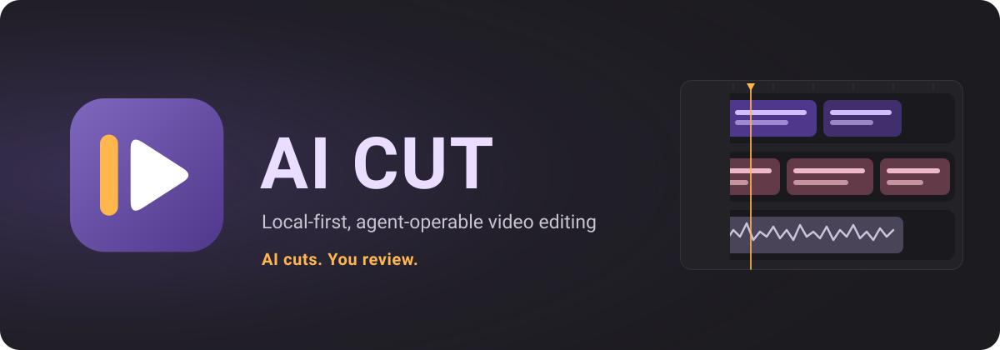
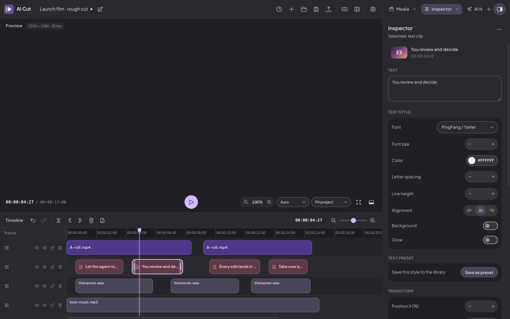
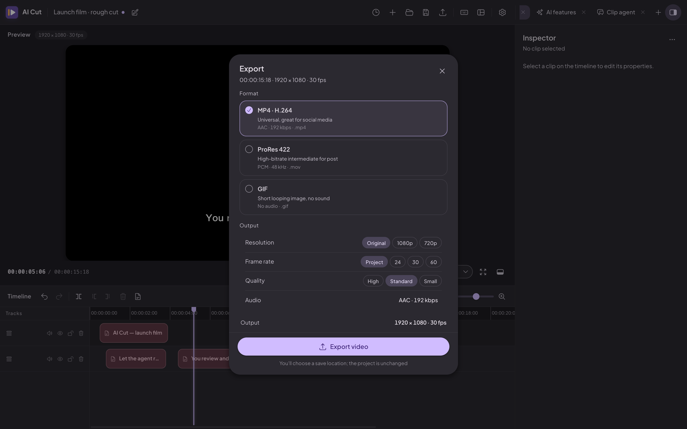

<p align="center">
  
</p>

<p align="center">
  
  <a href="LICENSE"></a>
  
</p>

<p align="center">
  <a href="README_zh.md"><b>简体中文</b></a> ·
  <a href="README.md"><b>English</b></a>
</p>

## AI Cut 是什么？

**AI Cut 是一款小巧、AI 原生的桌面视频剪辑器**——剪辑、字幕、配音、混音、导出都在一个轻量应用里完成，同时还能让 AI 代理和你在同一条时间线上干活。

它是一款真正的剪辑器：多轨道时间线、素材库、检查器、文字片段、字幕、朗读、音频与视频 AI 工具，以及 MP4 / ProRes / GIF 导出。它同时也是**为被模型操控而设计的**——随仓库附带的 Skill 能教会任意 AI Harness 通过 MCP 驱动正在运行的软件，代理可以导入素材、建轨、摆放与裁剪片段、改写文字、读取工程，而你在界面上实时看着它发生。

一切都在你自己的电脑上运行。不要账号、不上传素材，编辑器本身也不需要 API Key。

## 为什么这件事值得做

模型之所以学会写代码，是因为它们能通过编程智能体框架**真的把代码跑起来**；模型之所以学会 3D 建模，是因为它们能通过 Blender MCP 操控真实的建模软件。这两者都让模型拿到了真实的工具、真实的结果和真实的反馈闭环——快速迭代正是从这里来的。

视频领域一直缺这个闭环。模型可以生成一段画面，但它没法像剪辑师一样**在一个工程上工作**：没有可编辑的编排、没有可调平衡的轨道、没有撤销历史，也无从判断自己上一刀是不是把节奏剪坏了。

**AI Cut 就是为填上这个缺口做的一次小巧而认真的尝试。** 它是一款真正的剪辑器，AI 代理可以通过 Skill 与 MCP 来操作它，因此它可以用来：

- **检验模型到底懂不懂剪辑**——不是看它能不能生成画面，而是看它能不能搭起一条片子、选出合适的镜头、把节奏修好。
- **采集真实的剪辑轨迹**——代理的每一次修改都落在正常的工程里、进入正常的撤销历史，于是一次会话就成了「模型如何思考视频」的数据。
- **朝着「模型能像写代码一样剪视频」再走一步**——给它一条会回话的时间线。

## 轻量化是设计目标

小巧不是妥协，而是特性。

- **体积小**——没有 Electron、不依赖云、不打包模型全家桶。应用是 Tauri 构建，ffmpeg / ffprobe 以静态二进制随包分发，用户不需要自己装 ffmpeg。
- **启动快**——启动时不加载任何重东西，AI 模型只在你用到时才引入。
- **高算力的活交给该干的地方**——生成环节**刻意放在外部**。由你的 AI Harness 生成或寻找素材，再把文件交给 AI Cut 做剪辑、字幕、混音与导出。
- **生来可扩展**——每一次修改都是一条可序列化命令，新增剪辑操作不需要改 CLI 或 MCP 工具。

## 用任意 AI Harness 驱动它

AI Cut 附带一个 **Skill**（`skills/aicut`），它教会 AI 代理如何操作正在运行的软件——读写工程、导入素材、增删轨道与片段、移动 / 裁剪 / 分割、修改文字与片段属性、撤销重做，并按需加载生产、分镜、框架、审阅与素材文档。它通过内置的 **MCP** 服务器工作，因此任何支持 Agent Skill 的 Harness 都能直接用。

**方式一 · 命令行安装**

```bash
npx skills add heshengtao/ai-cut
```

**方式二 · 让你的代理自己装**

```
Install this Skill: https://github.com/heshengtao/ai-cut
```

应用还附带 `aicut`，一个可以在设置里挂到 `PATH` 的薄 MCP 客户端。命令面就是工具面：

```bash
aicut status
aicut tools
aicut call get_project
```

代理做的每一次修改都走与界面完全相同的命令管线：进入撤销历史、显示在界面上、并署名给代理——所以你随时能看到它做了什么，也能随时撤销。

## 功能

### 🎬 时间线剪辑 —— 在真正的时间线上剪辑

怎么想的就怎么摆。跨轨道拖拽片段，在故事变化处切分，修整两端，吸附与帧网格让一切保持对齐。视频、音频、图片与文字片段共用同一条时间线，每一次修改都是同一条撤销历史里的一条命令。

- **多轨道编排** —— 视频、音频、图片、文字片段并排；跨轨道拖放；框选
- **完整的编辑工具** —— 移动、分割、裁剪、吸附、帧网格
- **懂手势的撤销** —— 拖动与滑杆合并成一步，撤销直接回到手势之前
- **工程更安全** —— 自动保存、崩溃后草稿恢复、历史工程
- **时间线上的文字** —— 标题与字幕片段，样式可编辑

<p align="center">
  
</p>

### 🎞️ 素材与检查器 —— 读懂素材，塑造镜头

导入文件后立即探测：时长、分辨率、帧率与音轨。素材库显示缩略图与波形；检查器给出选中片段背后的参数，让构图、图层与声音就地编辑，而不是散落在另一个对话框里。

- **拖入即导入** —— ffprobe 元数据、缩略图、波形与预览缓存
- **画面变换** —— 位置、缩放、旋转、不透明度、混合模式、圆角
- **片段音频** —— 增益、淡入淡出、变调、声道平衡、静音
- **文字样式** —— 字体、字号、颜色、字距、背景、描边、阴影、发光
- **工程输出** —— 修改分辨率与帧率时，片段按比例重新适配

### 🤖 AI 与自动化 —— 把素材变成还能继续改的东西

这些 AI 功能是为真实的工程准备的，不是演示品。把一段素材交给它，拿回来的是能接着编辑的东西：可以校对的字幕轨、对齐原时间点的朗读、更干净的人声、可以重新配比的分轨。本地工具跑在你自己的硬件上。

- **字幕** —— 本地语音识别生成可编辑字幕轨
- **朗读** —— 本地 TTS，以及 OpenAI、ElevenLabs、Azure、Google、百度、MiniMax、火山引擎或自定义 HTTP
- **音频 AI** —— 响度统一、降噪、人声美化、人声分离、音频翻译
- **视频 AI** —— 超分、补帧、智能裁剪、镜头追踪
- **生来离线** —— 编辑器与本地模型不要账号、不上传素材

### 🔌 MCP 服务器与剪辑智能体 —— 让智能体在你的工程里干活

打开一个开关，你的工程就变成 AI 助手可以操作的对象。内置的 **MCP（Model Context Protocol）服务器**把会话通过只监听 `127.0.0.1` 的 HTTP 端点开放出去——接上你的代理、给它一个任务，就能看它建轨、放片段、改文字，界面实时跟着变。同一套工具定义也驱动内置的**剪辑智能体**：一个 OpenAI 兼容的对话面板，支持流式回答、工具调用与会话树分支。

- **MCP over HTTP** —— 只监听回环地址的接入点，JSON 与 SSE 双协议
- **实时改工程** —— 代理的操作会立刻以正常的工程改动出现
- **`aicut` 命令行** —— 薄客户端；新增工具不需要改 CLI
- **剪辑智能体** —— OpenAI 兼容端点、流式回答、工具卡片、会话分支
- **Skills** —— 剪辑与生产文档，由智能体按需加载

### 📦 导出与更新 —— 完成并交付

剪好了就渲染。选一个交付格式，AI Cut 在后台写出可发布的文件，你可以继续干活。已安装的应用会检查 GitHub Releases 上的签名更新，新版本一键即达。

- **格式** —— MP4 / H.264、ProRes 422、GIF
- **输出控制** —— 分辨率、帧率与质量
- **后台导出** —— 实时进度与取消
- **签名自动更新** —— 启动时静默检查、手动检查、下载、安装、重启
- **更新包校验** —— 公钥内置于应用，私钥只存在于发布环境

<p align="center">
  
</p>

## 安装

预编译安装包发布在 [GitHub Releases](https://github.com/heshengtao/ai-cut/releases) 页面。

### 环境要求

- Rust（stable）与 Cargo
- Node.js ≥ 20 与 [pnpm](https://pnpm.io/)（推荐 pnpm 11）
- Tauri v2 所需的系统依赖 —— 见 <https://tauri.app/start/prerequisites/>

### 从源码构建

```bash
git clone https://github.com/heshengtao/ai-cut.git
cd ai-cut

pnpm install
pnpm tauri dev        # 开发模式运行
pnpm tauri build      # 打包发布版本
```

其它常用命令：

```bash
pnpm build            # 对前端做类型检查并构建
pnpm test             # 单元测试（Vitest）
pnpm fetch:sidecars   # 准备 ffmpeg / ffprobe sidecar
pnpm build:aicut      # 构建 aicut CLI
```

ffmpeg 与 ffprobe 以静态二进制随包分发，用户不需要自己安装。模型文件位于 `src-tauri/resources/models/`；较大的模型按需下载。

### 平台支持

| 平台 | 状态 |
| --- | --- |
| Windows (x86_64) | ✅ 支持 |
| macOS（Apple Silicon） | ✅ 支持（.dmg 首次打开见「App 已损坏」说明） |
| Linux (x86_64 / arm64) | ✅ 支持 |

> **macOS 提示「App 已损坏，无法打开」？** 应用为自签名（未公证），从网络下载会带上隔离属性。在终端执行下面这行命令后即可正常打开：
>
> ```bash
> xattr -cr "/Applications/AI Cut.app"
> ```

> **当前发布流程暂不支持 Intel Mac。** 发布构建只为 Apple Silicon
> （`aarch64-apple-darwin`）产出安装包。

## 常见问题

### AI Cut 是免费的吗？

是。AI Cut 以 Apache 2.0 开源，没有付费档位，也没有功能阉割。

### 能离线使用吗？

能。剪辑、导出与本地 AI 模型都在本机运行。只有在你发起模型下载、检查更新，或配置 OpenAI 兼容的智能体端点、云端 TTS 等云服务时，才会联网。

### 需要显卡吗？

不需要。内置 AI 模型走 CPU，不需要 CUDA 或额外驱动。机器慢一些时大模型会跑得久一点，但不要求显卡。

### 哪些 AI 模型随应用一起提供？

小模型随包分发，装好即可使用。较大的模型——语音识别、TTS、音源分离、超分与补帧——由应用内的模型管理器按需下载，存放在源码树之外。

### 让代理驱动剪辑器，需要软件一直开着吗？

需要。Skill 与 `aicut` 命令行是通过 MCP 与**正在运行**的 AI Cut 通信的，所以先启动软件（用 `aicut status` 可以确认是否已启动）。

### 智能体能直接导出成片吗？

不能。MCP 暴露六个读写工程的工具；字幕、朗读、音频 / 视频 AI 与最终导出都需要人在应用里触发——智能体把时间线准备好，再交回给人审片。

## 许可

Apache-2.0，见 [LICENSE](LICENSE)。

## 第三方许可

本项目建立在第三方开源软件之上。依赖许可见 `package.json`、`src-tauri/Cargo.toml` 与 `crates/` 下的清单。随包分发的 FFmpeg 二进制与 AI 模型权重保留各自的上游许可；模型许可收集在 `src-tauri/resources/models/LICENSES/`。
